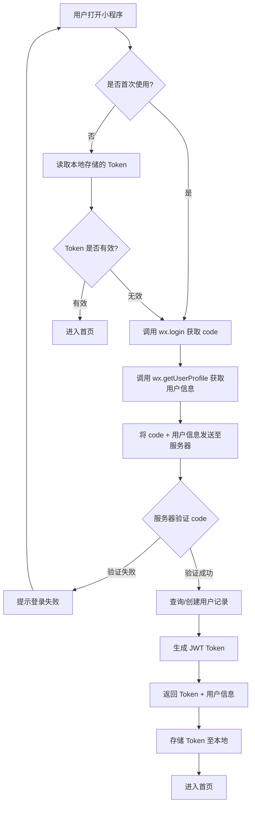
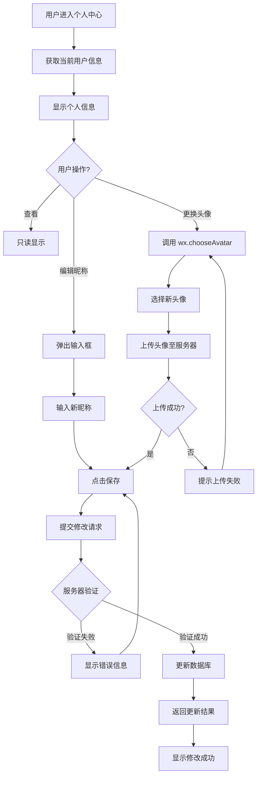
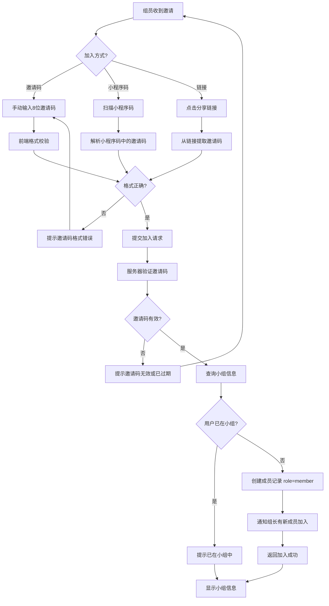
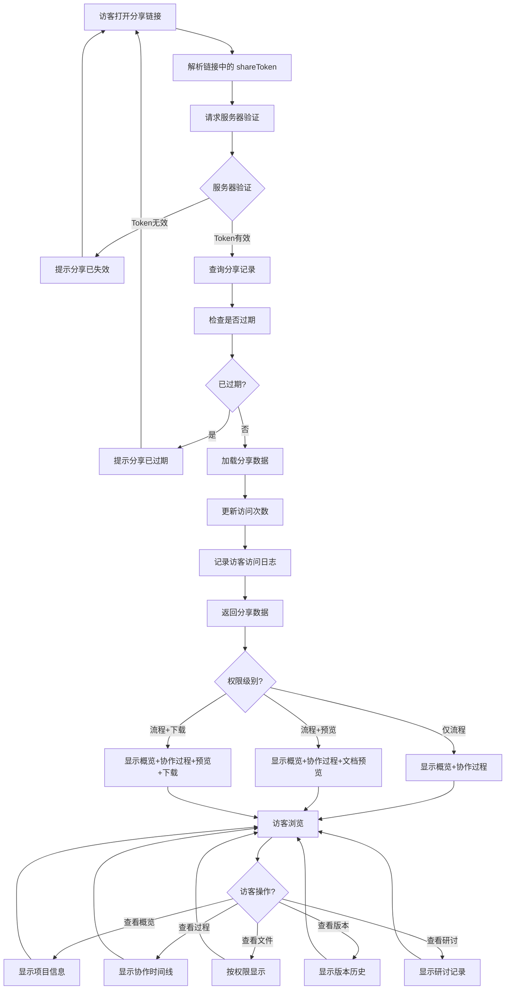
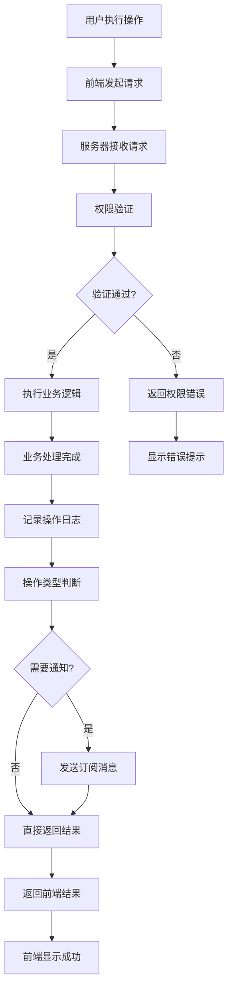
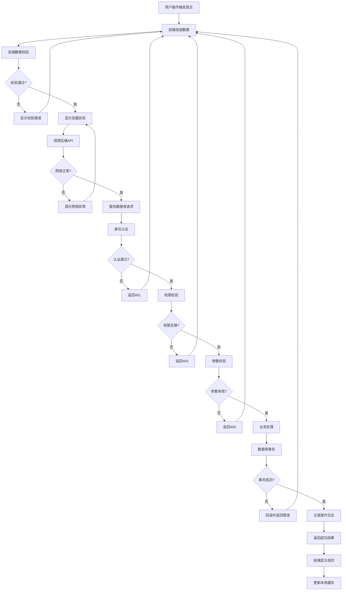
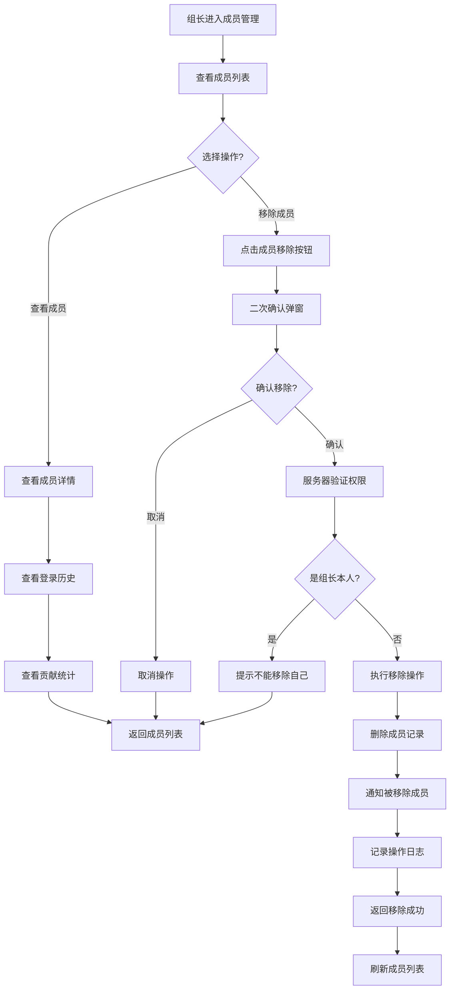
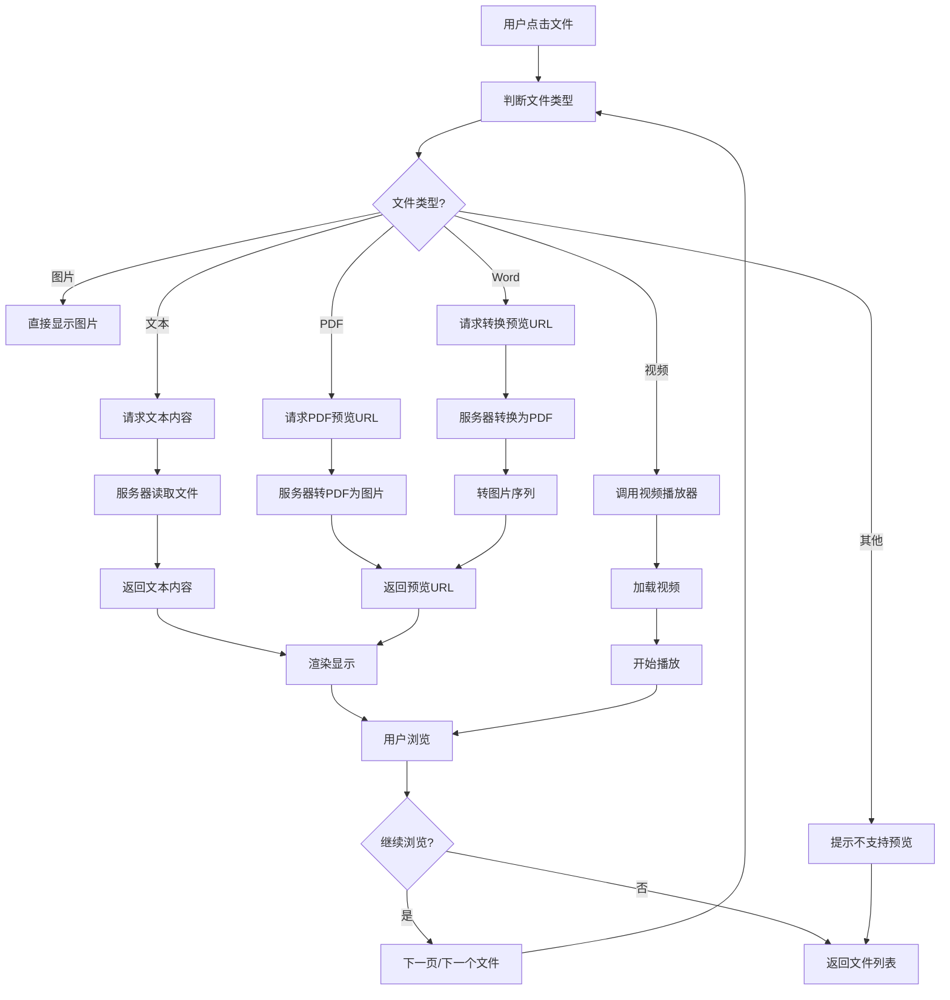

# ROC-git 课程小组文档协作管理平台

## 需求规格说明书 v1.9


| 版本信息 | 说明                                   | 日期         |
| ---- | ------------------------------------ | ---------- |
| v1.9 | 生成Swagger/OpenAPI文档（openapi.yaml + SWAGGER_GUIDE.md）+ 附录D | 2026-09-21 |
| v1.8 | 完善接口设计：从57个扩展到146个REST API | 2026-09-20 |
| v1.7 | 补充2.6.1业务流程：新增17~26号流程 | 2026-09-20 |
| v1.5 | 补充2.6详细设计：业务流程图 + REST API接口设计 | 2026-09-16 |
| v1.4 | 补充3.6用户需求总结：新增UX需求/系统级需求/优先级总览/覆盖度分析 | 2026-09-16 |
| v1.3 | 补充：类图新增5.8~5.11，时序图新增6.8~6.15 | 2026-09-16 |
| v1.2 | 新增完整用户分析、用例图、类图、时序图                  | 2026-09-16 |
| v1.1 | 去掉教师角色，改为纯组内协作，新增结项分享功能              | 2026-09-16 |
| v1.0 | 初始版本                                 | 2026-09-16 |


---

## 📋 目录

1. [项目概述](#1-项目概述)
2. [产品定位](#2-产品定位)
3. [用户角色分析](#3-用户角色分析)
4. [用例图分析](#4-用例图分析)
5. [类图设计](#5-类图设计)
6. [时序图设计](#6-时序图设计)
7. [功能需求](#7-功能需求)
8. [非功能需求](#8-非功能需求)
9. [业务流程](#9-业务流程)
10. [界面原型说明](#10-界面原型说明)
11. [数据字典](#11-数据字典)
12. [约束条件](#12-约束条件)
13. [验收标准](#13-验收标准)

---


## 1. 项目概述


### 1.1 项目名称


| 项目名称 | ROC-git              |
| ---- | -------------------- |
| 全称   | ROC-git 课程小组文档协作管理平台 |
| 简称   | ROC-git              |
| 项目类型 | 微信小程序                |


### 1.2 项目背景

高校课程学习过程中，学生通常以小组为单位完成课程作业、项目设计等学习任务。然而，传统的协作方式存在以下问题：


| 痛点         | 说明                                     |
| ---------- | -------------------------------------- |
| **文件散乱**   | 小组资料分散在各个成员的电脑、手机、微信群中，难以统一管理          |
| **版本混乱**   | 文档经过多次修改后，出现"最终版"、"最终版v2"、"真正最终版"等混乱情况 |
| **审核缺失**   | 组员提交的文件直接入库，没有审核机制，质量参差不齐              |
| **过程不可追溯** | 最终只能看到成果，无法了解协作过程中的讨论、修改、决策            |
| **协作效率低**  | 依赖微信群沟通，重要消息容易被覆盖，任务分工不清晰              |


### 1.3 项目目标

```
┌─────────────────────────────────────────────────────────────────┐
│                        ROC-git 项目目标                          │
├─────────────────────────────────────────────────────────────────┤
│                                                                  │
│  🎯 核心目标                                                     │
│  └── 为高校课程小组提供轻量、高效、规范化的组内协作管理平台       │
│                                                                  │
│  📌 功能目标                                                     │
│  ├── 支持小组快速创建与成员管理                                 │
│  ├── 支持文件的多端上传与智能审核                               │
│  ├── 提供文件版本管理与全流程追溯                               │
│  ├── 支持自定义项目阶段与任务分工                               │
│  ├── 支持结项后分享给别人查看协作全过程                        │
│                                                                  │
│  📌 体验目标                                                     │
│  ├── 操作简单，上手即用，无需复杂培训                           │
│  ├── 界面简洁美观，符合微信小程序交互习惯                       │
│  └── 消息及时触达，重要事项不遗漏                              │
│                                                                  │
└─────────────────────────────────────────────────────────────────┘
```

---


## 2. 产品定位


### 2.1 产品定位


| 维度       | 说明                    |
| -------- | --------------------- |
| **产品类型** | 团队协作工具 / 文档管理平台       |
| **目标用户** | 高校学生课程小组（纯组内管理，不需要教师） |
| **使用场景** | 课程作业协作、项目文档管理、团队过程管理  |
| **核心价值** | 轻量化、易上手、过程留痕、协作规范     |


### 2.2 产品特色


| 特色        | 说明                      |
| --------- | ----------------------- |
| **纯组内协作** | 无需教师参与，小组自己管理自己的项目      |
| **轻量化**   | 无需复杂配置，创建项目即可使用         |
| **微信生态**  | 依托微信小程序，用户无需额外安装软件      |
| **审核机制**  | 首创"挂单审核"模式，保证文件质量       |
| **版本追溯**  | 每次修改都有记录，支持版本对比与回溯      |
| **过程留痕**  | 完整的操作日志，协作过程一目了然        |
| **结项分享**  | 结项后可生成分享链接，别人可以查看完整协作流程 |


### 2.3 市场对比


| 功能     | ROC-git | 微信群 | QQ群 | Notion | 飞书  |
| ------ | ------- | --- | --- | ------ | --- |
| 纯组内管理  | ✅       | ✅   | ✅   | ❌      | ❌   |
| 文件统一管理 | ✅       | ❌   | ⚠️  | ✅      | ✅   |
| 版本控制   | ✅       | ❌   | ❌   | ✅      | ✅   |
| 审核机制   | ✅       | ❌   | ❌   | ❌      | ⚠️  |
| 任务分工   | ✅       | ❌   | ❌   | ✅      | ✅   |
| 过程留痕   | ✅       | ❌   | ❌   | ⚠️     | ⚠️  |
| 结项分享   | ✅       | ❌   | ❌   | ❌      | ❌   |
| 微信文件导入 | ✅       | N/A | ❌   | ❌      | ❌   |
| 无需安装   | ✅       | ✅   | ❌   | ❌      | ❌   |
| 学习成本   | ⭐       | ⭐   | ⭐   | ⭐⭐⭐⭐   | ⭐⭐⭐ |


### 2.4 产品架构概述

ROC-git 系统采用经典的前后端分离架构，依托微信小程序生态，为高校学生课程小组提供轻量化的协作管理平台。

```
┌─────────────────────────────────────────────────────────────────┐
│                    ROC-git 系统架构图                            │
├─────────────────────────────────────────────────────────────────┤
│                                                                  │
│  ┌──────────────┐   ┌──────────────┐   ┌──────────────┐       │
│  │  微信小程序   │   │  H5 访客页面  │   │  管理后台     │       │
│  │  (成员端)    │   │  (访客端)    │   │  (运营端)    │       │
│  └──────┬───────┘   └──────┬───────┘   └──────┬───────┘       │
│         │                  │                  │                │
│         └──────────┬───────┴──────────────────┘                │
│                    │ HTTPS / WSS                                │
│                    ▼                                            │
│  ┌──────────────────────────────────────────────────────────┐  │
│  │              API 网关 (Nginx + Spring Cloud Gateway)    │  │
│  │  ┌────────┐  ┌────────┐  ┌────────┐  ┌────────┐        │  │
│  │  │ 限流   │  │ 鉴权   │  │ 路由   │  │ 监控   │        │  │
│  │  └────────┘  └────────┘  └────────┘  └────────┘        │  │
│  └──────────────────────────────────────────────────────────┘  │
│                    │                                            │
│                    ▼                                            │
│  ┌──────────────────────────────────────────────────────────┐  │
│  │                  微服务集群                               │  │
│  │  ┌──────────┐ ┌──────────┐ ┌──────────┐ ┌──────────┐   │  │
│  │  │ 用户服务 │ │ 小组服务 │ │ 项目服务 │ │ 文件服务 │   │  │
│  │  └──────────┘ └──────────┘ └──────────┘ └──────────┘   │  │
│  │  ┌──────────┐ ┌──────────┐ ┌──────────┐ ┌──────────┐   │  │
│  │  │ 任务服务 │ │ 版本服务 │ │ 协作服务 │ │ 分享服务 │   │  │
│  │  └──────────┘ └──────────┘ └──────────┘ └──────────┘   │  │
│  └──────────────────────────────────────────────────────────┘  │
│                    │                                            │
│         ┌──────────┼──────────┬──────────┐                     │
│         ▼          ▼          ▼          ▼                     │
│  ┌──────────┐ ┌──────────┐ ┌──────────┐ ┌──────────┐           │
│  │   MySQL  │ │  Redis   │ │ 对象存储  │ │  消息队列 │           │
│  │  (主库)  │ │ (缓存)  │ │ (OSS)   │ │ (MQ)    │           │
│  └──────────┘ └──────────┘ └──────────┘ └──────────┘           │
│                                                                  │
└─────────────────────────────────────────────────────────────────┘
```

**架构特点**：

| 特点 | 说明 |
|------|------|
| **前后端分离** | 小程序/H5 前端 + REST API 后端 |
| **微服务架构** | 按业务模块拆分服务，独立部署 |
| **多端统一** | 微信小程序、H5访客页、管理后台共用API |
| **云原生** | 容器化部署，支持弹性伸缩 |
| **高可用** | 多副本部署，故障自动转移 |


### 2.5 技术选型

| 层级 | 技术栈 | 说明 |
|------|--------|------|
| **前端-小程序** | 微信原生小程序 + WXML/WXSS/JS | 用户体验最佳，无需安装 |
| **前端-H5** | Vue 3 + Vite + Vant | 访客分享页，轻量化 |
| **后端-语言** | Java 17 / Spring Boot 3.x | 成熟稳定，生态丰富 |
| **后端-框架** | Spring Cloud Alibaba | 微服务治理全套方案 |
| **后端-数据库** | MySQL 8.0 + 读写分离 | 主库写入，从库读取 |
| **后端-缓存** | Redis 7.x Cluster | 高性能缓存，分布式Session |
| **后端-对象存储** | 阿里云OSS / 腾讯云COS | 文件存储，CDN加速 |
| **后端-消息队列** | RabbitMQ / RocketMQ | 异步任务，削峰填谷 |
| **后端-搜索引擎** | Elasticsearch | 文件检索，日志分析 |
| **运维-容器** | Docker + Kubernetes | 容器化编排 |
| **运维-CI/CD** | Jenkins / GitLab CI | 自动化部署 |
| **运维-监控** | Prometheus + Grafana | 全链路监控告警 |
| **运维-日志** | ELK (Elasticsearch + Logstash + Kibana) | 集中日志分析 |
| **安全-WAF** | Web应用防火墙 | 防SQL注入、XSS等 |


---


## 2.6 详细设计

### 2.6.1 业务流程设计

本节详细描述 ROC-git 课程小组文档协作管理平台的核心业务流程。每个流程都通过流程图+文字说明的形式进行完整描述。

#### 1. 用户登录流程

**流程说明**：用户通过微信小程序进行一键登录，系统自动获取用户身份信息。



**关键节点说明**：

| 步骤 | 操作 | 系统处理 | 异常处理 |
|------|------|----------|----------|
| 1 | 调用 wx.login | 获取临时 code | 网络异常则提示重试 |
| 2 | 调用 wx.getUserProfile | 获取昵称、头像 | 用户拒绝则使用默认头像 |
| 3 | 服务器验证 | 调用微信接口验证 code | 验证失败返回错误码 |
| 4 | 查询/创建用户 | 根据 openid 查询 | 不存在则创建新用户 |
| 5 | 生成 Token | 生成 JWT 包含用户信息 | Token 有效期 7 天 |
| 6 | 本地存储 | 写入 Storage | 存储失败则提示 |

#### 2. 修改个人信息流程

**流程说明**：用户可以查看和编辑个人基本信息（昵称、头像）。



**关键节点说明**：

| 步骤 | 操作 | 系统处理 | 异常处理 |
|------|------|----------|----------|
| 1 | 获取当前信息 | 调用 getUserInfo | 接口异常提示 |
| 2 | 编辑昵称 | 限制 1-20 字符 | 超长截断 |
| 3 | 更换头像 | 调用微信 chooseAvatar | 取消则不修改 |
| 4 | 上传头像 | 保存到云存储 | 失败重试机制 |
| 5 | 提交修改 | POST /api/user/profile | 验证失败返回 400 |

#### 3. 创建小组流程

**流程说明**：组长创建小组，并自动生成8位邀请码供组员加入。

```mermaid
flowchart TD
    A[用户点击"创建小组"] --> B[显示创建表单]
    B --> C[输入小组名称]
    C --> D[输入小组描述 可选]
    D --> E[点击"创建"]
    E --> F[前端校验表单]
    F --> G{校验通过?}
    G -->|否| H[显示校验错误]
    G -->|是| I[提交创建请求]
    I --> J[服务器创建小组记录]
    J --> K[生成8位随机邀请码]
    K --> L[将当前用户设为组长]
    L --> M[创建操作日志]
    M --> N[返回小组信息 + 邀请码]
    N --> O[前端显示创建成功]
    O --> P[显示邀请码和小程序码]
    P --> Q{用户操作?}
    Q -->|复制邀请码| R[复制到剪贴板]
    Q -->|分享小程序码| S[调用 wx.showShareMenu]
    Q -->|进入小组| T[跳转到小组主页]
    H --> C
```

**关键节点说明**：

| 步骤 | 操作 | 系统处理 | 异常处理 |
|------|------|----------|----------|
| 1 | 输入小组名称 | 限制 2-20 字符 | 含特殊字符提示 |
| 2 | 生成邀请码 | 8位字母数字组合 | 检查唯一性 |
| 3 | 设置权限 | 当前用户为 leader | 权限持久化 |
| 4 | 操作日志 | 记录创建动作 | 用于审计 |

#### 4. 加入小组流程

**流程说明**：组员通过邀请码或小程序码加入小组。



#### 5. 创建项目流程

**流程说明**：组长创建新项目，配置阶段模板和基础规则。

```mermaid
flowchart TD
    A[组长进入小组主页] --> B[点击"创建项目"]
    B --> C[选择创建方式]
    C --> D{创建方式?}
    D -->|空白创建| E[输入项目信息]
    D -->|使用模板| F[选择阶段模板]
    D -->|复制已有项目| G[选择源项目]
    E --> H[输入项目名称/描述]
    F --> I[加载模板阶段列表]
    G --> J[复制项目结构和数据]
    H --> K[配置项目规则]
    I --> K
    J --> K
    K --> L[配置审核规则]
    L --> M[配置提醒规则]
    M --> N[选择可见性]
    N --> O[点击"创建"]
    O --> P[前端校验]
    P --> Q{校验通过?}
    Q -->|否| R[显示错误]
    Q -->|是| S[提交创建请求]
    S --> T[服务器创建项目记录]
    T --> U[生成项目阶段]
    U --> V[创建默认任务列表]
    V --> W[记录操作日志]
    W --> X[返回项目信息]
    X --> Y[跳转到项目主页]
    R --> O
```

**关键节点说明**：

| 步骤 | 操作 | 系统处理 | 异常处理 |
|------|------|----------|----------|
| 1 | 选择创建方式 | 模板/空白/复制 | 复制需权限验证 |
| 2 | 配置项目信息 | 名称必填 描述可选 | 长度校验 |
| 3 | 配置审核规则 | 默认/自定义 | 保存至项目配置 |
| 4 | 生成阶段 | 根据模板生成 | 模板不存在则报错 |
| 5 | 创建任务 | 默认任务列表 | 异步处理 |

#### 6. 文件提交流程

**流程说明**：组员上传文件至项目指定阶段，文件进入待审核状态。

```mermaid
flowchart TD
    A[组员进入文件列表] --> B[点击"上传文件"]
    B --> C{选择文件来源?}
    C -->|本地相册| D[调用 wx.chooseMedia]
    C -->|微信聊天| E[调用 wx.chooseMessageFile]
    C -->|文档| F[调用 wx.chooseFile]
    D --> G[选择本地文件]
    E --> G
    F --> G
    G --> H[显示文件预览]
    H --> I[选择目标阶段]
    I --> J[填写文件说明 可选]
    J --> K[点击"上传"]
    K --> L[前端校验文件大小]
    L --> M{超过限制?}
    M -->|是| N[提示文件过大]
    M -->|否| O[显示上传进度]
    O --> P[分片上传至云存储]
    P --> Q{上传成功?}
    Q -->|否| R[显示上传失败]
    Q -->|是| S[服务器创建文件记录]
    S --> T[设置状态为 pending]
    T --> U[记录操作日志]
    U --> V[异步通知组长]
    V --> W[返回上传结果]
    W --> X[显示上传成功]
    N --> G
    R --> K
```

**关键节点说明**：

| 步骤 | 操作 | 系统处理 | 异常处理 |
|------|------|----------|----------|
| 1 | 选择文件 | 微信API调用 | 用户取消则退出 |
| 2 | 文件校验 | 大小≤50MB | 超限提示 |
| 3 | 选择阶段 | 阶段列表 | 必选校验 |
| 4 | 上传文件 | 分片上传 | 断点续传 |
| 5 | 创建记录 | status=pending | 事务保证 |
| 6 | 通知组长 | 订阅消息 | 失败降级 |

#### 7. 文件审核流程

**流程说明**：组长审核组员提交的文件，决定通过或驳回。

```mermaid
flowchart TD
    A[组长收到审核通知] --> B[进入审核中心]
    B --> C[获取待审核文件列表]
    C --> D[显示待审核文件]
    D --> E{审核方式?}
    E -->|逐个审核| F[点击单个文件]
    E -->|批量审核| G[多选文件]
    F --> H[查看文件详情]
    H --> I[预览文件内容]
    I --> J{审核决定?}
    J -->|通过| K[点击"通过"]
    J -->|驳回| L[点击"驳回"]
    L --> M[填写驳回原因]
    M --> K
    K --> N{批量?}
    N -->|是| O[遍历选中文件]
    N -->|否| P[提交单个审核]
    O --> P
    P --> Q[服务器验证权限]
    Q --> R{权限足够?}
    R -->|否| S[提示无权限]
    R -->|是| T[更新文件状态]
    T --> U[创建审核日志]
    U --> V[通知组员审核结果]
    V --> W[返回审核结果]
    W --> X[显示审核完成]
    G --> Y[选择多个文件]
    Y --> Z[选择批量操作]
    Z --> AA{批量操作?}
    AA -->|批量通过| K
    AA -->|批量驳回| L
    S --> F
```

**关键节点说明**：

| 步骤 | 操作 | 系统处理 | 异常处理 |
|------|------|----------|----------|
| 1 | 获取待审核 | 查询 status=pending | 权限验证 |
| 2 | 预览文件 | 调用预览API | 格式不支持提示 |
| 3 | 填写驳回原因 | 限制 5-200 字符 | 必填校验 |
| 4 | 批量操作 | 限制≤20个/次 | 超限提示 |
| 5 | 更新状态 | approved/rejected | 事务处理 |
| 6 | 通知组员 | 订阅消息 | 失败日志记录 |

#### 8. 任务分配流程

**流程说明**：组长创建任务并分配给指定成员，设置截止时间。

```mermaid
flowchart TD
    A[组长进入任务面板] --> B[点击"创建任务"]
    B --> C[显示任务创建表单]
    C --> D[输入任务名称]
    D --> E[输入任务描述]
    E --> F[选择负责人]
    F --> G[设置截止时间]
    G --> H[选择优先级]
    H --> I[关联文件 可选]
    I --> J[点击"分配"]
    J --> K[前端校验]
    K --> L{校验通过?}
    L -->|否| M[显示校验错误]
    L -->|是| N[提交任务创建]
    N --> O[服务器创建任务记录]
    O --> P[设置提醒规则]
    P --> Q[记录操作日志]
    Q --> R[通知被分配的成员]
    R --> S[返回创建结果]
    S --> T[显示分配成功]
    T --> U[跳转到任务详情]
    M --> J
```

**关键节点说明**：

| 步骤 | 操作 | 系统处理 | 异常处理 |
|------|------|----------|----------|
| 1 | 输入任务信息 | 名称必填 描述可选 | 长度校验 |
| 2 | 选择负责人 | 小组成员列表 | 仅可选成员 |
| 3 | 设置截止时间 | 日历选择器 | 必须未来时间 |
| 4 | 设置提醒 | 截止前3天/1天 | 默认开启 |
| 5 | 关联文件 | 可选附件 | 文件权限验证 |
| 6 | 通知成员 | 订阅消息 | 失败站内消息 |

#### 9. 任务完成流程

**流程说明**：组员完成任务，标记为已完成状态。

```mermaid
flowchart TD
    A[组员查看任务列表] --> B[点击目标任务]
    B --> C[查看任务详情]
    C --> D{任务状态?}
    D -->|已完成| E[显示完成信息]
    D -->|进行中| F[查看进度]
    F --> G{准备完成?}
    G -->|否| H[继续执行]
    G -->|是| I[点击"标记完成"]
    I --> J[填写完成说明]
    J --> K[上传完成凭证 可选]
    K --> L[提交完成]
    L --> M[服务器验证权限]
    M --> N{是任务负责人?}
    N -->|否| O[提示无权限]
    N -->|是| P[更新任务状态]
    P --> Q[记录完成时间]
    Q --> R[创建操作日志]
    R --> S[通知组长]
    S --> T[返回结果]
    T --> U[显示完成成功]
    H --> F
    O --> C
```

#### 10. 阶段成果更新流程

**流程说明**：组长记录每个阶段的成果产出。

```mermaid
flowchart TD
    A[组长进入项目主页] --> B[点击"阶段成果"]
    B --> C[查看各阶段成果列表]
    C --> D{操作?}
    D -->|查看历史| E[显示该阶段所有成果]
    D -->|新增成果| F[选择目标阶段]
    D -->|更新成果| G[选择已有成果]
    F --> H[填写成果标题]
    H --> I[填写成果描述]
    I --> J[关联文件 可选]
    J --> K[点击"保存"]
    G --> L[修改成果信息]
    L --> K
    K --> M[前端校验]
    M --> N{校验通过?}
    N -->|否| O[显示错误]
    N -->|是| P[提交保存]
    P --> Q[服务器创建/更新成果]
    Q --> R[更新阶段进度]
    R --> S[记录操作日志]
    S --> T[通知所有成员]
    T --> U[返回结果]
    U --> V[显示保存成功]
    O --> K
```

#### 11. 结项分享生成流程

**流程说明**：项目完成后，组长生成分享链接供访客查看。

```mermaid
flowchart TD
    A[项目完成] --> B[组长点击"结项"]
    B --> C[确认结项信息]
    C --> D[点击"确认结项"]
    D --> E[服务器更新项目状态]
    E --> F[归档所有文件]
    F --> G[生成项目总结数据]
    G --> H[返回结项成功]
    H --> I[进入分享设置页面]
    I --> J[选择分享权限级别]
    J --> K{权限级别?}
    K -->|仅流程| L[选择"仅查看流程"]
    K -->|流程+预览| M[选择"可预览"]
    K -->|流程+下载| N[选择"可下载"]
    L --> O[点击"生成分享链接"]
    M --> O
    N --> O
    O --> P[服务器生成 shareToken]
    P --> Q[创建分享记录]
    Q --> R[缓存分享数据到 Redis]
    R --> S[返回分享链接]
    S --> T[显示分享卡片]
    T --> U{分享方式?}
    U -->|复制链接| V[复制到剪贴板]
    U -->|分享到微信| W[调用 wx.showShareMenu]
    U -->|生成小程序码| X[调用 wx.canvasToTempFilePath]
    V --> Y[分享完成]
    W --> Y
    X --> Y
```

**关键节点说明**：

| 步骤 | 操作 | 系统处理 | 异常处理 |
|------|------|----------|----------|
| 1 | 确认结项 | 项目状态检查 | 未完成提示 |
| 2 | 归档文件 | 移动至归档表 | 事务保证 |
| 3 | 生成总结 | 聚合统计数据 | 异步处理 |
| 4 | 选择权限 | 3个级别 | 单选 |
| 5 | 生成 Token | 32位随机字符串 | 唯一性检查 |
| 6 | 缓存数据 | Redis 7天 | 缓存失败降级 |

#### 12. 访客访问分享流程

**流程说明**：访客通过分享链接查看项目协作过程和文件。



#### 13. 订阅消息授权流程

**流程说明**：用户订阅微信消息，以便及时接收通知。

```mermaid
flowchart TD
    A[用户进入消息中心] --> B[显示可订阅的消息类型]
    B --> C[用户勾选要订阅的类型]
    C --> D[点击"订阅"]
    D --> E{订阅方式?}
    E -->|一次性订阅| F[调用 wx.requestSubscribeMessage]
    E -->|长期订阅| G[调用长期订阅接口]
    F --> H[弹出微信订阅确认]
    G --> H
    H --> I{用户确认?}
    I -->|拒绝| J[提示订阅失败]
    I -->|允许| K[返回订阅结果]
    K --> L[提交订阅授权至服务器]
    L --> M[服务器保存订阅记录]
    M --> N[返回保存成功]
    N --> O[显示订阅成功]
    J --> B
```

#### 14. 操作日志记录流程

**流程说明**：系统自动记录所有重要操作，便于追溯。



#### 15. 数据提交流程（综合）

**流程说明**：用户提交各类数据（文件/任务/评论/成果等）的统一流程。



#### 16. 数据发布流程（项目结项分享发布）

**流程说明**：项目结项后发布分享链接的完整流程。

```mermaid
flowchart TD
    A[组长确认项目完成] --> B[检查所有任务状态]
    B --> C{所有任务完成?}
    C -->|否| D[提示未完成任务]
    C -->|是| E[检查所有文件状态]
    E --> F{文件都已审核?}
    F -->|否| G[提示待审核文件]
    F -->|是| H[显示结项确认弹窗]
    H --> I[填写结项总结]
    I --> J[点击"确认结项"]
    J --> K[服务器验证结项条件]
    K --> L{满足结项条件?}
    L -->|否| M[返回错误原因]
    L -->|是| N[更新项目状态为 completed]
    N --> O[归档项目数据]
    O --> P[生成项目总结报告]
    P --> Q[创建结项记录]
    Q --> R[通知所有成员]
    R --> S[返回结项成功]
    S --> T[进入分享发布页面]
    T --> U[选择分享权限]
    U --> V[生成分享链接]
    V --> W[分享发布]
    W --> X[显示分享卡片]
    D --> B
    G --> E
    M --> A
```

#### 17. 邀请成员流程

**流程说明**：组长邀请新成员加入小组，支持多种邀请方式。

```mermaid
flowchart TD
    A[组长进入小组主页] --> B[点击"邀请成员"]
    B --> C[选择邀请方式]
    C --> D{邀请方式?}
    D -->|邀请码| E[系统生成8位邀请码]
    D -->|小程序码| F[系统生成小程序码]
    D -->|分享链接| G[系统生成分享链接]
    E --> H[显示邀请信息]
    F --> H
    G --> H
    H --> I{操作?}
    I -->|复制邀请码| J[复制到剪贴板]
    I -->|保存小程序码| K[保存到相册]
    I -->|分享链接| L[调用分享菜单]
    J --> M[提示复制成功]
    K --> N[提示保存成功]
    L --> O[选择分享渠道]
    O --> P[分享成功]
    M --> Q[等待成员加入]
    N --> Q
    P --> Q
    Q --> R{有新成员加入?}
    R -->|是| S[系统通知组长]
    S --> T[显示新成员加入]
    R -->|否| U[持续等待]
```

**关键节点说明**：

| 步骤 | 操作 | 系统处理 | 异常处理 |
|------|------|----------|----------|
| 1 | 生成邀请码 | 8位随机字母数字 | 检查唯一性 |
| 2 | 生成小程序码 | 调用微信生成二维码 | 频率限制 |
| 3 | 分享链接 | 生成 URL Scheme | 有效期7天 |
| 4 | 成员加入 | 验证邀请码有效 | 邀请码失效提示 |

#### 18. 移除成员流程

**流程说明**：组长移除不活跃或已退出的成员。



#### 19. 变更组长流程

**流程说明**：组长将权限转移给其他成员。

```mermaid
flowchart TD
    A[组长进入设置] --> B[点击"变更组长"]
    B --> C[显示成员选择器]
    C --> D[选择新组长]
    D --> E{选择自己?}
    E -->|是| F[提示不能选择自己]
    E -->|否| G[显示确认信息]
    G --> H[确认变更]
    H --> I[二次身份验证]
    I --> J{验证通过?}
    J -->|否| K[提示验证失败]
    J -->|是| L[服务器执行变更]
    L --> M[更新权限关系]
    M --> N[原组长变为普通成员]
    N --> O[通知新组长]
    O --> P[通知所有成员]
    P --> Q[记录操作日志]
    Q --> R[返回变更成功]
    R --> S[跳转至新身份]
```

**关键节点说明**：

| 步骤 | 操作 | 系统处理 | 异常处理 |
|------|------|----------|----------|
| 1 | 选择新组长 | 仅显示组内成员 | 不能选自己 |
| 2 | 身份验证 | 密码/短信验证 | 验证失败限流 |
| 3 | 更新权限 | 事务保证一致性 | 失败回滚 |
| 4 | 通知 | 推送全员通知 | 异步发送 |

#### 20. 文件预览流程

**流程说明**：用户在小程序内预览各类文件。



**关键节点说明**：

| 步骤 | 操作 | 系统处理 | 异常处理 |
|------|------|----------|----------|
| 1 | 判断类型 | 识别MIME类型 | 类型识别失败 |
| 2 | 文本预览 | 直接读取内容 | 编码检测 |
| 3 | Office预览 | 转换为PDF图片 | 转换失败提示 |
| 4 | 视频播放 | 断点续播 | 网络波动重试 |

#### 21. 文件管理流程（删除/移动/收藏）

**流程说明**：用户对文件进行删除、移动、收藏操作。

```mermaid
flowchart TD
    A[用户进入文件列表] --> B[长按/勾选文件]
    B --> C[显示操作菜单]
    C --> D{选择操作?}
    D -->|删除| E[点击删除]
    D -->|移动| F[点击移动]
    D -->|收藏| G[点击收藏]
    D -->|批量| H[多选模式]
    E --> I[确认删除弹窗]
    I --> J{确认?}
    J -->|取消| K[取消操作]
    J -->|确认| L[权限校验]
    L --> M{有权限?}
    M -->|否| N[提示无权限]
    M -->|是| O[执行删除]
    O --> P[删除文件记录]
    P --> Q[记录操作日志]
    Q --> R[返回删除成功]
    R --> S[刷新文件列表]
    F --> T[显示阶段选择器]
    T --> U[选择目标阶段]
    U --> V[提交移动请求]
    V --> W[更新阶段关联]
    W --> X[记录操作日志]
    X --> Y[返回移动成功]
    Y --> S
    G --> Z[切换收藏状态]
    Z --> AA[保存状态]
    AA --> BB[更新UI显示]
    BB --> S
    H --> CC[进入批量选择]
    CC --> DD[勾选多个文件]
    DD --> C
    N --> S
    K --> S
```

#### 22. 版本管理全流程

**流程说明**：文件版本的创建、查看、对比和回溯。

```mermaid
flowchart TD
    A[用户上传新版本] --> B[上传文件]
    B --> C[自动生成版本号]
    C --> D[填写版本说明]
    D --> E[点击确认]
    E --> F[创建版本记录]
    F --> G[旧版本标记为历史]
    G --> H[新版本标记为最新]
    H --> I[记录操作日志]
    I --> J[返回上传成功]

    K[用户查看版本] --> L[进入文件详情]
    L --> M[点击版本历史]
    M --> N[获取版本列表]
    N --> O[显示版本时间线]
    O --> P{选择操作?}
    P -->|对比| Q[选择对比版本]
    Q --> R[请求版本差异]
    R --> S[显示差异对比视图]
    P -->|回溯| T[选择目标版本]
    T --> U[确认回溯]
    U --> V[创建新版本指向旧版本]
    V --> W[更新最新版本标识]
    W --> X[记录回溯日志]
    X --> Y[通知相关成员]
    Y --> Z[返回回溯成功]
```

**版本对比视图说明**：

| 文件类型 | 对比方式 | 显示效果 |
|----------|----------|----------|
| 文本文件(.txt/.md/.py) | 行级差异 | 高亮显示增删改行 |
| Office文档(.docx/.xlsx) | 转换后对比 | 页面并排显示 |
| 图片文件(.jpg/.png) | 缩略图对比 | 左右分栏显示 |
| PDF文件 | 页面对比 | 指定页面对照 |

#### 23. 文件检索与筛选流程

**流程说明**：用户通过多种条件检索和筛选文件。

```mermaid
flowchart TD
    A[用户进入文件列表] --> B[点击搜索框]
    B --> C[输入搜索关键词]
    C --> D[实时搜索建议]
    D --> E{选择建议?}
    E -->|是| F[点击建议词]
    E -->|否| G[手动输入完整]
    F --> H[执行搜索]
    G --> H
    H --> I[显示搜索结果]

    J[使用高级筛选] --> K[点击筛选按钮]
    K --> L[显示筛选面板]
    L --> M{筛选条件?}
    M -->|文件类型| N[选择类型：文档/图片/视频]
    M -->|所属阶段| O[选择阶段]
    M -->|上传者| P[选择成员]
    M -->|时间范围| Q[选择日期]
    M -->|审核状态| R[选择状态]
    N --> S[应用筛选]
    O --> S
    P --> S
    Q --> S
    R --> S
    S --> T[显示筛选结果]

    U[组合使用] --> V[先搜索关键词]
    V --> W[再添加筛选]
    W --> X[显示精筛结果]
    X --> Y[进一步操作]

    I --> Z[查看结果详情]
    T --> Z
    Y --> Z
    Z --> AA{找到目标?}
    AA -->|是| AB[点击文件]
    AA -->|否| AC[调整搜索词]
    AC --> C
    AB --> AD[进入文件详情]
```

**筛选组合示例**：

| 场景 | 搜索词 | 筛选条件 | 结果 |
|------|--------|----------|------|
| 需求文档 | 需求 | 阶段=需求分析 + 类型=文档 | 精准定位 |
| 组员贡献 | - | 上传者=张三 | 查看个人贡献 |
| 本周更新 | - | 时间=本周 | 最新文件 |
| 待审文件 | - | 状态=待审核 | 审核队列 |

#### 24. 消息通知与已读流程

**流程说明**：系统推送通知，用户管理消息已读状态。

```mermaid
flowchart TD
    A[系统触发事件] --> B{事件类型?}
    B -->|文件待审核| C[通知组长审核]
    B -->|审核完成| D[通知上传者结果]
    B -->|任务到期| E[通知任务负责人]
    B -->|成员变动| F[通知所有成员]
    B -->|阶段更新| G[通知关注成员]
    C --> H[组装消息内容]
    D --> H
    E --> H
    F --> H
    G --> H
    H --> I[查询订阅状态]
    I --> J{用户已订阅?}
    J -->|是| K[调用微信订阅API]
    J -->|否| L[发送站内消息]
    K --> M{发送成功?}
    M -->|是| N[记录发送日志]
    M -->|否| O[降级为站内消息]
    N --> P[消息送达用户]
    L --> P
    O --> P

    Q[用户打开消息中心] --> R[获取消息列表]
    R --> S[显示消息列表]
    S --> T{操作?}
    T -->|查看详情| U[点击消息]
    U --> V[跳转相关页面]
    T -->|单个已读| W[标记单条已读]
    W --> X[更新已读状态]
    X --> Y[刷新未读数]
    T -->|全部已读| Z[点击全部已读]
    Z --> AA[批量更新状态]
    AA --> AB[更新未读数显示]
    V --> AC[返回消息列表]
    Y --> AC
    AB --> AC
    AC --> T
```

**消息类型说明**：

| 类型 | 触发场景 | 推送方式 | 优先级 |
|------|----------|----------|--------|
| 审核通知 | 文件提交 | 订阅消息/站内 | 高 |
| 审核结果 | 组长审核 | 订阅消息/站内 | 高 |
| 任务提醒 | 截止前3天/1天 | 订阅消息 | 高 |
| 成员动态 | 加入/退出 | 站内消息 | 中 |
| 阶段成果 | 成果更新 | 站内消息 | 中 |
| 系统公告 | 平台通知 | 订阅消息 | 低 |

#### 25. 协作功能流程（研讨/决策/成果）

**流程说明**：团队进行研讨、记录决策、更新成果的完整流程。

```mermaid
flowchart TD
    A[组长进入协作中心] --> B{选择功能?}
    B -->|研讨记录| C[点击新建研讨]
    B -->|决策留存| D[点击新建决策]
    B -->|成果更新| E[点击更新成果]
    C --> F[填写研讨信息]
    F --> G[输入主题/时间/参与人]
    G --> H[记录研讨内容]
    H --> I[保存研讨记录]
    I --> J[创建研讨记录]
    J --> K[关联参与人员]
    K --> L[记录操作日志]
    L --> M[通知参与人]
    M --> N[返回创建成功]

    D --> O[填写决策信息]
    O --> P[输入标题/内容]
    P --> Q[关联研讨记录 可选]
    Q --> R[保存决策]
    R --> S[创建决策记录]
    S --> T[更新项目状态]
    T --> U[记录操作日志]
    U --> V[通知相关成员]
    V --> N

    E --> W[选择阶段]
    W --> X[填写成果信息]
    X --> Y[输入标题/描述]
    Y --> Z[关联相关文件]
    Z --> AA[上传成果凭证]
    AA --> AB[保存成果]
    AB --> AC[创建/更新成果记录]
    AC --> AD[更新阶段进度]
    AD --> AE[记录操作日志]
    AE --> AF[通知所有成员]
    AF --> N

    N --> AG[返回协作中心]
```

#### 26. 分享链接访问流程（访客视角）

**流程说明**：访客通过分享链接查看项目协作过程的完整流程。

```mermaid
flowchart TD
    A[访客点击分享链接] --> B[打开小程序/H5]
    B --> C[解析shareToken]
    C --> D[请求验证Token]
    D --> E{Token有效?}
    E -->|无效| F[提示链接已失效]
    E -->|有效| G[检查过期时间]
    G --> H{已过期?}
    H -->|是| I[提示链接已过期]
    H -->|否| J[加载项目数据]
    J --> K[获取项目基本信息]
    K --> L[获取成员列表]
    L --> M[获取阶段列表]
    M --> N[获取成果汇总]
    N --> O[获取操作日志]
    O --> P[组合返回数据]
    P --> Q[根据权限过滤内容]
    Q --> R{权限级别?}
    R -->|仅流程| S[返回概览+日志]
    R -->|流程+预览| T[额外返回文件预览]
    R -->|流程+下载| U[额外返回下载链接]

    S --> V[显示项目概览页]
    T --> V
    U --> V
    V --> W{访客操作?}
    W -->|查看概览| X[显示项目信息]
    W -->|查看过程| Y[显示协作时间线]
    W -->|查看成员| Z[显示团队成员]
    W -->|查看阶段| AA[显示阶段列表]
    W -->|查看成果| AB[显示阶段成果]
    W -->|查看文件| AC{有权限?}
    AC -->|预览| AD[预览文件]
    AC -->|下载| AE[下载文件]
    W -->|查看研讨| AF[显示研讨记录]
    W -->|查看版本| AG[显示版本历史]
    X --> V
    Y --> V
    Z --> V
    AA --> V
    AB --> V
    AD --> V
    AE --> V
    AF --> V
    AG --> V

    F --> AH[显示失效页面]
    I --> AH
    AH --> AI[提示联系分享者]
```

---

### 2.6.2 接口设计

本节定义 ROC-git 系统的所有 RESTful API 接口。所有接口均已在 `knife4j-spring` 项目中实际实现，可通过 `http://localhost:8080/doc.html` 在线查阅 API 文档。

#### 1. 接口设计规范

##### 1.1 基础规范

| 项目 | 规范 |
|------|------|
| **协议** | HTTPS（开发环境支持 HTTP） |
| **数据格式** | JSON |
| **字符编码** | UTF-8 |
| **接口前缀** | `/api/v1/` |
| **认证方式** | JWT Token（Header: `Authorization: Bearer <token>`） |
| **请求方法** | GET（查询） / POST（创建） / PUT（更新） / DELETE（删除） |
| **响应格式** | 统一 JSON 结构 |
| **文档地址** | `/doc.html`（Knife4j 增强 UI）|

##### 1.2 统一响应格式

**成功响应**：

```json
{
  "code": 0,
  "message": "success",
  "data": {
    // 业务数据
  },
  "timestamp": 1694697600000
}
```

**失败响应**：

```json
{
  "code": 40001,
  "message": "参数错误",
  "data": null,
  "timestamp": 1694697600000,
  "requestId": "abc123"
}
```

##### 1.3 错误码规范

| 错误码 | 含义 | 说明 |
|:------:|------|------|
| 0 | 成功 | - |
| 400 | 请求参数错误 | 参数缺失或格式错误 |
| 401 | 未认证 | Token 无效或过期 |
| 403 | 无权限 | 用户无访问权限 |
| 404 | 资源不存在 | 资源已被删除 |
| 409 | 资源冲突 | 数据重复或冲突 |
| 429 | 请求频繁 | 限流 |
| 500 | 服务器错误 | 系统异常 |
| 10001 | 业务错误码 | 用户相关 |
| 10002 | 业务错误码 | 小组相关 |
| 10003 | 业务错误码 | 项目相关 |
| 10004 | 业务错误码 | 文件相关 |
| 10005 | 业务错误码 | 任务相关 |

##### 1.4 鉴权机制

```mermaid
flowchart LR
    A[小程序发起请求] --> B[携带 JWT Token]
    B --> C[API 网关]
    C --> D{Token 验证}
    D -->|无效| E[返回401]
    D -->|有效| F[解析用户身份]
    F --> G[路由到对应服务]
    G --> H[业务权限校验]
    H --> I{权限足够?}
    I -->|否| J[返回403]
    I -->|是| K[执行业务逻辑]
    K --> L[返回结果]
```

---

#### 2. 通用接口（Common）

##### 2.1 健康检查

| 项目 | 说明 |
|------|------|
| **接口路径** | `GET /api/v1/health` |
| **接口描述** | 服务健康检查接口 |
| **是否需要鉴权** | 否 |

**响应示例**：

```json
{
  "code": 0,
  "message": "success",
  "data": {
    "status": "UP",
    "version": "1.0.0",
    "timestamp": "2026-09-22T14:00:00Z"
  }
}
```

##### 2.2 获取服务端配置

| 项目 | 说明 |
|------|------|
| **接口路径** | `GET /api/v1/config` |
| **接口描述** | 获取客户端必要配置信息 |
| **是否需要鉴权** | 否 |

**响应示例**：

```json
{
  "code": 0,
  "data": {
    "minVersion": "1.0.0",
    "latestVersion": "1.0.0",
    "maintenanceMode": false,
    "announcement": "欢迎使用 ROC-git！"
  }
}
```

##### 2.3 通用文件上传

| 项目 | 说明 |
|------|------|
| **接口路径** | `POST /api/v1/upload` |
| **接口描述** | 上传通用文件（头像、附件等） |
| **是否需要鉴权** | 是 |

**请求格式**：`multipart/form-data`

| 字段 | 类型 | 必填 | 说明 |
|------|------|:----:|------|
| file | File | ✅ | 文件（图片/文档，单文件≤50MB） |
| type | String | ❌ | 文件类型标识 |

**响应示例**：

```json
{
  "code": 0,
  "data": {
    "fileId": "f_abc123",
    "url": "https://cdn.example.com/f_abc123.png"
  }
}
```

##### 2.4 获取上传凭证

| 项目 | 说明 |
|------|------|
| **接口路径** | `POST /api/v1/upload/credentials` |
| **接口描述** | 获取 OSS 直传凭证（减少服务端压力） |
| **是否需要鉴权** | 是 |

##### 2.5 提交反馈

| 项目 | 说明 |
|------|------|
| **接口路径** | `POST /api/v1/feedback` |
| **接口描述** | 用户提交问题反馈 |
| **是否需要鉴权** | 是 |

**请求参数**：

| 字段 | 类型 | 必填 | 说明 |
|------|------|:----:|------|
| type | String | ✅ | 反馈类型：bug/suggestion/complaint |
| content | String | ✅ | 反馈内容（5-500字） |
| contact | String | ❌ | 联系方式 |

---

#### 3. 用户模块接口（User）

##### 3.1 微信登录

| 项目 | 说明 |
|------|------|
| **接口路径** | `POST /api/v1/user/login` |
| **接口描述** | 用户通过微信 code 登录 |
| **是否需要鉴权** | 否 |

**请求参数**：

| 字段 | 类型 | 必填 | 说明 |
|------|------|:----:|------|
| code | String | ✅ | 微信登录 code |
| nickname | String | ✅ | 用户昵称 |
| avatarUrl | String | ✅ | 用户头像 URL |

**请求示例**：

```json
{
  "code": "wx_code_xxxxx",
  "nickname": "张三",
  "avatarUrl": "https://thirdwx.qlogo.cn/xxx"
}
```

**响应示例**：

```json
{
  "code": 0,
  "message": "success",
  "data": {
    "token": "eyJhbGciOiJIUzI1NiIsInR5cCI6IkpXVCJ9.xxx",
    "userId": 10001,
    "openid": "oRocG5txxxxxx",
    "nickname": "张三",
    "avatarUrl": "https://thirdwx.qlogo.cn/xxx",
    "isNewUser": false
  }
}
```

##### 3.2 获取个人信息

| 项目 | 说明 |
|------|------|
| **接口路径** | `GET /api/v1/user/profile` |
| **接口描述** | 获取当前登录用户的详细信息 |
| **是否需要鉴权** | 是 |

**响应示例**：

```json
{
  "code": 0,
  "data": {
    "userId": 10001,
    "openid": "oRocG5txxxxxx",
    "nickname": "张三",
    "avatarUrl": "https://thirdwx.qlogo.cn/xxx",
    "createdAt": "2026-09-01T10:00:00Z",
    "groupCount": 2,
    "projectCount": 5
  }
}
```

##### 3.3 更新个人信息

| 项目 | 说明 |
|------|------|
| **接口路径** | `PUT /api/v1/user/profile` |
| **接口描述** | 更新用户昵称、头像 |
| **是否需要鉴权** | 是 |

**请求参数**：

| 字段 | 类型 | 必填 | 说明 |
|------|------|:----:|------|
| nickname | String | ❌ | 新昵称 |
| avatarUrl | String | ❌ | 新头像 URL |

##### 3.4 获取登录历史

| 项目 | 说明 |
|------|------|
| **接口路径** | `GET /api/v1/user/login-history` |
| **接口描述** | 获取用户最近的登录记录 |
| **是否需要鉴权** | 是 |

**响应示例**：

```json
{
  "code": 0,
  "data": {
    "total": 10,
    "list": [
      {
        "loginTime": "2026-09-22T08:30:00Z",
        "device": "iPhone 15 Pro",
        "ip": "120.0.0.1"
      }
    ]
  }
}
```

##### 3.5 退出登录

| 项目 | 说明 |
|------|------|
| **接口路径** | `POST /api/v1/user/logout` |
| **接口描述** | 退出当前登录状态 |
| **是否需要鉴权** | 是 |

##### 3.6 刷新 Token

| 项目 | 说明 |
|------|------|
| **接口路径** | `POST /api/v1/user/refresh-token` |
| **接口描述** | 使用 refreshToken 获取新 Token |
| **是否需要鉴权** | 否 |

**请求参数**：

| 字段 | 类型 | 必填 | 说明 |
|------|------|:----:|------|
| refreshToken | String | ✅ | 刷新令牌 |

**响应示例**：

```json
{
  "code": 0,
  "data": {
    "token": "eyJhbGciOiJIUzI1NiIsInR5cCI6IkpXVCJ9.xxx",
    "expiresIn": 604800
  }
}
```

##### 3.7 获取贡献统计

| 项目 | 说明 |
|------|------|
| **接口路径** | `GET /api/v1/user/contribution-stats` |
| **接口描述** | 获取当前用户的贡献统计数据 |
| **是否需要鉴权** | 是 |

##### 3.8 绑定微信

| 项目 | 说明 |
|------|------|
| **接口路径** | `POST /api/v1/user/bind-wechat` |
| **接口描述** | 将微信账号与现有账号绑定 |
| **是否需要鉴权** | 是 |

**请求参数**：

| 字段 | 类型 | 必填 | 说明 |
|------|------|:----:|------|
| code | String | ✅ | 微信登录 code |

---

#### 4. 小组模块接口（Group）

##### 4.1 创建小组

| 项目 | 说明 |
|------|------|
| **接口路径** | `POST /api/v1/group/create` |
| **接口描述** | 创建新小组 |
| **是否需要鉴权** | 是 |

**请求参数**：

| 字段 | 类型 | 必填 | 说明 |
|------|------|:----:|------|
| name | String | ✅ | 小组名称（2-20字） |
| description | String | ❌ | 小组描述 |

**响应示例**：

```json
{
  "code": 0,
  "data": {
    "groupId": 20001,
    "name": "ROC-git第一小组",
    "description": "软件工程课程设计小组",
    "leaderId": 10001,
    "leaderName": "张三",
    "inviteCode": "ABC12345",
    "qrCodeUrl": "https://cdn.example.com/qr/abc123.png",
    "createdAt": "2026-09-16T20:00:00Z"
  }
}
```

##### 4.2 加入小组

| 项目 | 说明 |
|------|------|
| **接口路径** | `POST /api/v1/group/join` |
| **接口描述** | 通过邀请码加入小组 |
| **是否需要鉴权** | 是 |

**请求参数**：

| 字段 | 类型 | 必填 | 说明 |
|------|------|:----:|------|
| inviteCode | String | ✅ | 8位邀请码 |

##### 4.3 校验邀请码

| 项目 | 说明 |
|------|------|
| **接口路径** | `POST /api/v1/group/validate-invite-code` |
| **接口描述** | 验证邀请码是否有效，返回小组预览信息 |
| **是否需要鉴权** | 是 |

**请求参数**：

| 字段 | 类型 | 必填 | 说明 |
|------|------|:----:|------|
| inviteCode | String | ✅ | 8位邀请码 |

##### 4.4 获取我的小组列表

| 项目 | 说明 |
|------|------|
| **接口路径** | `GET /api/v1/group/my-list` |
| **接口描述** | 获取当前用户加入的所有小组 |
| **是否需要鉴权** | 是 |

##### 4.5 获取小组详情

| 项目 | 说明 |
|------|------|
| **接口路径** | `GET /api/v1/group/{groupId}` |
| **接口描述** | 获取小组详细信息 |
| **是否需要鉴权** | 是（需为小组成员） |

##### 4.6 更新小组信息

| 项目 | 说明 |
|------|------|
| **接口路径** | `PUT /api/v1/group/{groupId}` |
| **接口描述** | 更新小组名称、描述 |
| **是否需要鉴权** | 是（仅组长） |

##### 4.7 退出小组

| 项目 | 说明 |
|------|------|
| **接口路径** | `POST /api/v1/group/{groupId}/leave` |
| **接口描述** | 当前用户退出指定小组 |
| **是否需要鉴权** | 是 |

##### 4.8 获取小组成员列表

| 项目 | 说明 |
|------|------|
| **接口路径** | `GET /api/v1/group/{groupId}/members` |
| **接口描述** | 获取小组成员列表 |
| **是否需要鉴权** | 是（需为小组成员） |

**请求参数**：

| 字段 | 类型 | 必填 | 说明 |
|------|------|:----:|------|
| pageNum | Integer | ❌ | 页码，默认1 |
| pageSize | Integer | ❌ | 每页大小，默认10 |

**响应示例**：

```json
{
  "code": 0,
  "data": {
    "total": 5,
    "members": [
      {
        "userId": 10001,
        "nickname": "张三",
        "avatarUrl": "https://xxx",
        "role": "leader",
        "joinedAt": "2026-09-16T20:00:00Z",
        "status": "active",
        "remark": "组长"
      }
    ]
  }
}
```

##### 4.9 修改成员备注

| 项目 | 说明 |
|------|------|
| **接口路径** | `PUT /api/v1/group/{groupId}/member/{userId}/remark` |
| **接口描述** | 组长修改成员备注 |
| **是否需要鉴权** | 是（仅组长） |

**请求参数**：

| 字段 | 类型 | 必填 | 说明 |
|------|------|:----:|------|
| remark | String | ✅ | 备注信息 |

##### 4.10 转让组长

| 项目 | 说明 |
|------|------|
| **接口路径** | `POST /api/v1/group/{groupId}/transfer-leader` |
| **接口描述** | 将组长权限转让给其他成员 |
| **是否需要鉴权** | 是（仅组长） |

**请求参数**：

| 字段 | 类型 | 必填 | 说明 |
|------|------|:----:|------|
| newLeaderId | Long | ✅ | 新组长用户ID |

##### 4.11 重新生成邀请码

| 项目 | 说明 |
|------|------|
| **接口路径** | `POST /api/v1/group/{groupId}/invite-code` |
| **接口描述** | 重新生成小组邀请码 |
| **是否需要鉴权** | 是（仅组长） |

##### 4.12 获取小组统计

| 项目 | 说明 |
|------|------|
| **接口路径** | `GET /api/v1/group/{groupId}/stats` |
| **接口描述** | 获取小组综合统计数据 |
| **是否需要鉴权** | 是 |

##### 4.13 获取成员贡献排行

| 项目 | 说明 |
|------|------|
| **接口路径** | `GET /api/v1/group/{groupId}/member-stats` |
| **接口描述** | 获取小组成员贡献统计排行 |
| **是否需要鉴权** | 是 |

---

#### 5. 项目模块接口（Project）

##### 5.1 创建项目

| 项目 | 说明 |
|------|------|
| **接口路径** | `POST /api/v1/project/create` |
| **接口描述** | 创建新项目 |
| **是否需要鉴权** | 是（仅组长） |

**请求参数**：

| 字段 | 类型 | 必填 | 说明 |
|------|------|:----:|------|
| groupId | Long | ✅ | 所属小组ID |
| name | String | ✅ | 项目名称 |
| description | String | ❌ | 项目描述 |

**响应示例**：

```json
{
  "code": 0,
  "data": {
    "projectId": 30001,
    "groupId": 20001,
    "name": "软件工程课程设计",
    "description": "课程项目文档管理",
    "currentStage": "需求分析",
    "progress": 0,
    "status": "active",
    "memberCount": 5,
    "fileCount": 0,
    "taskCount": 0,
    "completedTaskCount": 0,
    "createdAt": "2026-09-22T14:00:00Z"
  }
}
```

##### 5.2 获取项目列表

| 项目 | 说明 |
|------|------|
| **接口路径** | `GET /api/v1/project/list` |
| **接口描述** | 获取指定小组的项目列表 |
| **是否需要鉴权** | 是（需为小组成员） |

##### 5.3 获取项目详情

| 项目 | 说明 |
|------|------|
| **接口路径** | `GET /api/v1/project/{projectId}` |
| **接口描述** | 获取项目详细信息（含阶段列表） |
| **是否需要鉴权** | 是（需为小组成员） |

##### 5.4 更新项目

| 项目 | 说明 |
|------|------|
| **接口路径** | `PUT /api/v1/project/{projectId}` |
| **接口描述** | 更新项目名称、描述 |
| **是否需要鉴权** | 是（仅组长） |

##### 5.5 删除项目

| 项目 | 说明 |
|------|------|
| **接口路径** | `DELETE /api/v1/project/{projectId}` |
| **接口描述** | 删除项目（仅组长可操作） |
| **是否需要鉴权** | 是（仅组长） |

##### 5.6 复制项目

| 项目 | 说明 |
|------|------|
| **接口路径** | `POST /api/v1/project/{projectId}/copy` |
| **接口描述** | 复制项目结构创建新项目 |
| **是否需要鉴权** | 是（仅组长） |

**请求参数**：

| 字段 | 类型 | 必填 | 说明 |
|------|------|:----:|------|
| name | String | ✅ | 新项目名称 |

##### 5.7 项目结项

| 项目 | 说明 |
|------|------|
| **接口路径** | `POST /api/v1/project/{projectId}/complete` |
| **接口描述** | 将项目标记为已完成（结项） |
| **是否需要鉴权** | 是（仅组长） |

##### 5.8 获取项目进度

| 项目 | 说明 |
|------|------|
| **接口路径** | `GET /api/v1/project/{projectId}/progress` |
| **接口描述** | 获取项目整体完成进度 |
| **是否需要鉴权** | 是 |

##### 5.9 获取项目动态

| 项目 | 说明 |
|------|------|
| **接口路径** | `GET /api/v1/project/{projectId}/activities` |
| **接口描述** | 获取项目操作动态列表 |
| **是否需要鉴权** | 是 |

**请求参数**：

| 字段 | 类型 | 必填 | 说明 |
|------|------|:----:|------|
| type | String | ❌ | 动态类型：file/task/discussion |
| pageNum | Integer | ❌ | 页码，默认1 |
| pageSize | Integer | ❌ | 每页大小，默认10 |

##### 5.10 获取任务统计

| 项目 | 说明 |
|------|------|
| **接口路径** | `GET /api/v1/project/{projectId}/task-stats` |
| **接口描述** | 获取项目任务统计 |
| **是否需要鉴权** | 是 |

##### 5.11 新增阶段

| 项目 | 说明 |
|------|------|
| **接口路径** | `POST /api/v1/project/{projectId}/stage` |
| **接口描述** | 为项目新增一个阶段 |
| **是否需要鉴权** | 是（仅组长） |

**请求参数**：

| 字段 | 类型 | 必填 | 说明 |
|------|------|:----:|------|
| name | String | ✅ | 阶段名称 |
| orderNum | Integer | ✅ | 阶段序号 |
| startDate | String | ❌ | 开始日期（yyyy-MM-dd） |
| endDate | String | ❌ | 结束日期（yyyy-MM-dd） |

##### 5.12 获取阶段列表

| 项目 | 说明 |
|------|------|
| **接口路径** | `GET /api/v1/project/{projectId}/stage` |
| **接口描述** | 获取项目的所有阶段 |
| **是否需要鉴权** | 是 |

##### 5.13 调整阶段顺序

| 项目 | 说明 |
|------|------|
| **接口路径** | `PUT /api/v1/project/{projectId}/stage/order` |
| **接口描述** | 批量调整阶段的显示顺序 |
| **是否需要鉴权** | 是（仅组长） |

**请求参数**：

| 字段 | 类型 | 必填 | 说明 |
|------|------|:----:|------|
| stageOrders | Array | ✅ | 阶段顺序数组，格式：`[{stageId, orderNum}]` |

##### 5.14 获取阶段详情

| 项目 | 说明 |
|------|------|
| **接口路径** | `GET /api/v1/project/{projectId}/stage/{stageId}` |
| **接口描述** | 获取指定阶段的详细信息 |
| **是否需要鉴权** | 是 |

##### 5.15 更新阶段

| 项目 | 说明 |
|------|------|
| **接口路径** | `PUT /api/v1/project/{projectId}/stage/{stageId}` |
| **接口描述** | 更新阶段名称和时间 |
| **是否需要鉴权** | 是（仅组长） |

##### 5.16 删除阶段

| 项目 | 说明 |
|------|------|
| **接口路径** | `DELETE /api/v1/project/{projectId}/stage/{stageId}` |
| **接口描述** | 删除指定阶段（需阶段下无文件） |
| **是否需要鉴权** | 是（仅组长） |

##### 5.17 获取项目模板列表

| 项目 | 说明 |
|------|------|
| **接口路径** | `GET /api/v1/project/template/list` |
| **接口描述** | 获取可用的项目模板列表 |
| **是否需要鉴权** | 是 |

##### 5.18 获取模板详情

| 项目 | 说明 |
|------|------|
| **接口路径** | `GET /api/v1/project/template/{templateId}` |
| **接口描述** | 获取指定模板的详细信息 |
| **是否需要鉴权** | 是 |

##### 5.19 创建项目模板

| 项目 | 说明 |
|------|------|
| **接口路径** | `POST /api/v1/project/template` |
| **接口描述** | 将已有项目保存为模板 |
| **是否需要鉴权** | 是（仅组长） |

**请求参数**：

| 字段 | 类型 | 必填 | 说明 |
|------|------|:----:|------|
| projectId | Long | ✅ | 源项目ID |
| name | String | ✅ | 模板名称 |
| description | String | ❌ | 模板描述 |
| isPublic | Boolean | ❌ | 是否公开，默认false |
| stages | Array | ❌ | 阶段列表 |

---

#### 6. 文件模块接口（File）

##### 6.1 上传文件

| 项目 | 说明 |
|------|------|
| **接口路径** | `POST /api/v1/file/upload` |
| **接口描述** | 上传文件到指定项目阶段 |
| **是否需要鉴权** | 是 |

**请求格式**：`multipart/form-data`

| 字段 | 类型 | 必填 | 说明 |
|------|------|:----:|------|
| file | File | ✅ | 文件（≤50MB） |
| projectId | Long | ✅ | 所属项目ID |
| stageId | Long | ✅ | 所属阶段ID |
| remark | String | ❌ | 文件说明 |

**响应示例**：

```json
{
  "code": 0,
  "data": {
    "fileId": "f_abc123",
    "name": "需求文档v1.docx",
    "url": "https://cdn.example.com/f_abc123.docx",
    "size": 2048576,
    "type": "document",
    "status": "pending",
    "version": 1,
    "projectId": 30001,
    "stageId": 1,
    "uploadedAt": "2026-09-22T14:00:00Z",
    "uploader": "张三"
  }
}
```

##### 6.2 获取文件列表

| 项目 | 说明 |
|------|------|
| **接口路径** | `GET /api/v1/file/list` |
| **接口描述** | 获取文件列表（支持多条件筛选） |
| **是否需要鉴权** | 是 |

**请求参数**：

| 字段 | 类型 | 必填 | 说明 |
|------|------|:----:|------|
| projectId | Long | ✅ | 项目ID |
| stageId | Long | ❌ | 阶段ID |
| type | String | ❌ | 文件类型：document/image/code/archive/other |
| uploaderId | Long | ❌ | 上传者ID |
| keyword | String | ❌ | 搜索关键词 |
| status | String | ❌ | 审核状态：pending/approved/rejected |
| startDate | String | ❌ | 开始日期 |
| endDate | String | ❌ | 结束日期 |
| pageNum | Integer | ❌ | 页码，默认1 |
| pageSize | Integer | ❌ | 每页大小，默认10 |

##### 6.3 获取文件详情

| 项目 | 说明 |
|------|------|
| **接口路径** | `GET /api/v1/file/{fileId}` |
| **接口描述** | 获取文件详细信息 |
| **是否需要鉴权** | 是 |

##### 6.4 删除文件

| 项目 | 说明 |
|------|------|
| **接口路径** | `DELETE /api/v1/file/{fileId}` |
| **接口描述** | 删除指定文件（组员仅能删除自己的文件） |
| **是否需要鉴权** | 是 |

##### 6.5 文件预览

| 项目 | 说明 |
|------|------|
| **接口路径** | `GET /api/v1/file/{fileId}/preview` |
| **接口描述** | 获取文件预览地址（含水印） |
| **是否需要鉴权** | 是 |

##### 6.6 文件下载

| 项目 | 说明 |
|------|------|
| **接口路径** | `GET /api/v1/file/{fileId}/download` |
| **接口描述** | 获取文件下载链接（临时签名URL） |
| **是否需要鉴权** | 是 |

##### 6.7 移动文件

| 项目 | 说明 |
|------|------|
| **接口路径** | `PUT /api/v1/file/{fileId}/move` |
| **接口描述** | 将文件移动到其他阶段 |
| **是否需要鉴权** | 是（仅组长） |

**请求参数**：

| 字段 | 类型 | 必填 | 说明 |
|------|------|:----:|------|
| stageId | Long | ✅ | 目标阶段ID |

##### 6.8 重命名文件

| 项目 | 说明 |
|------|------|
| **接口路径** | `PUT /api/v1/file/{fileId}/rename` |
| **接口描述** | 重命名文件 |
| **是否需要鉴权** | 是（仅上传者或组长） |

**请求参数**：

| 字段 | 类型 | 必填 | 说明 |
|------|------|:----:|------|
| name | String | ✅ | 新文件名 |

##### 6.9 收藏文件

| 项目 | 说明 |
|------|------|
| **接口路径** | `POST /api/v1/file/{fileId}/favorite` |
| **接口描述** | 收藏或取消收藏文件 |
| **是否需要鉴权** | 是 |

##### 6.10 审核通过

| 项目 | 说明 |
|------|------|
| **接口路径** | `POST /api/v1/file/{fileId}/approve` |
| **接口描述** | 组长审核通过文件 |
| **是否需要鉴权** | 是（仅组长） |

##### 6.11 审核驳回

| 项目 | 说明 |
|------|------|
| **接口路径** | `POST /api/v1/file/{fileId}/reject` |
| **接口描述** | 组长驳回文件 |
| **是否需要鉴权** | 是（仅组长） |

**请求参数**：

| 字段 | 类型 | 必填 | 说明 |
|------|------|:----:|------|
| reason | String | ✅ | 驳回原因 |

##### 6.12 重新提交

| 项目 | 说明 |
|------|------|
| **接口路径** | `POST /api/v1/file/{fileId}/resubmit` |
| **接口描述** | 被驳回的文件重新上传新版本 |
| **是否需要鉴权** | 是（仅上传者） |

**请求格式**：`multipart/form-data`

| 字段 | 类型 | 必填 | 说明 |
|------|------|:----:|------|
| file | File | ✅ | 新版本文件 |
| remark | String | ❌ | 修订说明 |

##### 6.13 获取审核日志

| 项目 | 说明 |
|------|------|
| **接口路径** | `GET /api/v1/file/{fileId}/audit-logs` |
| **接口描述** | 获取文件的审核历史记录 |
| **是否需要鉴权** | 是 |

##### 6.14 获取下载记录

| 项目 | 说明 |
|------|------|
| **接口路径** | `GET /api/v1/file/{fileId}/download-records` |
| **接口描述** | 获取文件被下载的记录 |
| **是否需要鉴权** | 是 |

##### 6.15 待审核列表

| 项目 | 说明 |
|------|------|
| **接口路径** | `GET /api/v1/file/pending-audit` |
| **接口描述** | 获取当前用户需要审核的文件列表（组长视角） |
| **是否需要鉴权** | 是（仅组长） |

##### 6.16 批量审核

| 项目 | 说明 |
|------|------|
| **接口路径** | `POST /api/v1/file/batch-audit` |
| **接口描述** | 批量审核文件 |
| **是否需要鉴权** | 是（仅组长） |

**请求参数**：

| 字段 | 类型 | 必填 | 说明 |
|------|------|:----:|------|
| fileIds | Array | ✅ | 文件ID数组 |
| action | String | ✅ | 操作：approve/reject |

##### 6.17 批量移动

| 项目 | 说明 |
|------|------|
| **接口路径** | `PUT /api/v1/file/batch-move` |
| **接口描述** | 批量移动文件到指定阶段 |
| **是否需要鉴权** | 是（仅组长） |

**请求参数**：

| 字段 | 类型 | 必填 | 说明 |
|------|------|:----:|------|
| fileIds | Array | ✅ | 文件ID数组 |
| stageId | Long | ✅ | 目标阶段ID |

##### 6.18 批量删除

| 项目 | 说明 |
|------|------|
| **接口路径** | `DELETE /api/v1/file/batch-delete` |
| **接口描述** | 批量删除文件 |
| **是否需要鉴权** | 是 |

**请求参数**：

| 字段 | 类型 | 必填 | 说明 |
|------|------|:----:|------|
| fileIds | Array | ✅ | 文件ID数组 |

##### 6.19 我的收藏

| 项目 | 说明 |
|------|------|
| **接口路径** | `GET /api/v1/file/favorites` |
| **接口描述** | 获取当前用户收藏的文件列表 |
| **是否需要鉴权** | 是 |

##### 6.20 我的上传

| 项目 | 说明 |
|------|------|
| **接口路径** | `GET /api/v1/file/my-uploads` |
| **接口描述** | 获取当前用户上传的文件列表 |
| **是否需要鉴权** | 是 |

##### 6.21 类型统计

| 项目 | 说明 |
|------|------|
| **接口路径** | `GET /api/v1/file/{projectId}/type-stats` |
| **接口描述** | 获取项目下各类型文件的数量统计 |
| **是否需要鉴权** | 是 |

##### 6.22 导出文件清单

| 项目 | 说明 |
|------|------|
| **接口路径** | `POST /api/v1/file/{projectId}/export` |
| **接口描述** | 导出项目文件清单为 Excel |
| **是否需要鉴权** | 是 |

**请求参数**：

| 字段 | 类型 | 必填 | 说明 |
|------|------|:----:|------|
| format | String | ✅ | 导出格式：excel/pdf |

---

#### 7. 版本模块接口（Version）

##### 7.1 获取版本列表

| 项目 | 说明 |
|------|------|
| **接口路径** | `GET /api/v1/version/list` |
| **接口描述** | 获取文件的版本历史列表 |
| **是否需要鉴权** | 是 |

**请求参数**：

| 字段 | 类型 | 必填 | 说明 |
|------|------|:----:|------|
| fileId | Long | ✅ | 文件ID |

##### 7.2 版本对比

| 项目 | 说明 |
|------|------|
| **接口路径** | `GET /api/v1/version/compare` |
| **接口描述** | 对比两个版本的差异 |
| **是否需要鉴权** | 是 |

**请求参数**：

| 字段 | 类型 | 必填 | 说明 |
|------|------|:----:|------|
| fileId | Long | ✅ | 文件ID |
| fromVersion | Integer | ✅ | 起始版本号 |
| toVersion | Integer | ✅ | 目标版本号 |

##### 7.3 版本回溯

| 项目 | 说明 |
|------|------|
| **接口路径** | `POST /api/v1/version/{fileId}/rollback` |
| **接口描述** | 将文件回溯到指定历史版本 |
| **是否需要鉴权** | 是 |

**请求参数**：

| 字段 | 类型 | 必填 | 说明 |
|------|------|:----:|------|
| targetVersion | Integer | ✅ | 目标版本号 |
| comment | String | ❌ | 回溯说明 |

---

#### 8. 任务模块接口（Task）

##### 8.1 创建任务

| 项目 | 说明 |
|------|------|
| **接口路径** | `POST /api/v1/task/create` |
| **接口描述** | 创建新任务并分配给成员 |
| **是否需要鉴权** | 是（仅组长） |

**请求参数**：

| 字段 | 类型 | 必填 | 说明 |
|------|------|:----:|------|
| projectId | Long | ✅ | 所属项目ID |
| name | String | ✅ | 任务名称 |
| description | String | ❌ | 任务描述 |
| assigneeId | Long | ✅ | 负责人ID |
| deadline | String | ❌ | 截止时间（yyyy-MM-dd HH:mm） |
| priority | String | ❌ | 优先级：low/medium/high |

**响应示例**：

```json
{
  "code": 0,
  "data": {
    "taskId": 40001,
    "projectId": 30001,
    "name": "完成需求文档初稿",
    "description": "编写课程设计需求文档",
    "assigneeId": 10002,
    "deadline": "2026-09-30T18:00:00Z",
    "priority": "high",
    "status": "pending",
    "progress": 0,
    "createdAt": "2026-09-22T14:00:00Z"
  }
}
```

##### 8.2 获取任务列表

| 项目 | 说明 |
|------|------|
| **接口路径** | `GET /api/v1/task/list` |
| **接口描述** | 获取项目的任务列表 |
| **是否需要鉴权** | 是 |

**请求参数**：

| 字段 | 类型 | 必填 | 说明 |
|------|------|:----:|------|
| projectId | Long | ✅ | 项目ID |
| assigneeId | Long | ❌ | 按负责人筛选 |
| status | String | ❌ | 状态：pending/in_progress/completed/abandoned |

##### 8.3 获取我的任务

| 项目 | 说明 |
|------|------|
| **接口路径** | `GET /api/v1/task/my-tasks` |
| **接口描述** | 获取当前用户负责的任务 |
| **是否需要鉴权** | 是 |

**请求参数**：

| 字段 | 类型 | 必填 | 说明 |
|------|------|:----:|------|
| status | String | ❌ | 状态筛选 |
| overdue | Boolean | ❌ | 是否只看超期 |
| pageNum | Integer | ❌ | 页码，默认1 |
| pageSize | Integer | ❌ | 每页大小，默认10 |

##### 8.4 获取即将到期任务

| 项目 | 说明 |
|------|------|
| **接口路径** | `GET /api/v1/task/due-soon` |
| **接口描述** | 获取截止日期临近的任务（默认未来7天） |
| **是否需要鉴权** | 是 |

**请求参数**：

| 字段 | 类型 | 必填 | 说明 |
|------|------|:----:|------|
| days | Integer | ❌ | 天数，默认7 |

##### 8.5 获取任务详情

| 项目 | 说明 |
|------|------|
| **接口路径** | `GET /api/v1/task/{taskId}` |
| **接口描述** | 获取任务详细信息 |
| **是否需要鉴权** | 是 |

##### 8.6 更新任务

| 项目 | 说明 |
|------|------|
| **接口路径** | `PUT /api/v1/task/{taskId}` |
| **接口描述** | 更新任务信息 |
| **是否需要鉴权** | 是（仅组长） |

##### 8.7 删除任务

| 项目 | 说明 |
|------|------|
| **接口路径** | `DELETE /api/v1/task/{taskId}` |
| **接口描述** | 删除任务（仅组长可操作） |
| **是否需要鉴权** | 是（仅组长） |

##### 8.8 完成任务

| 项目 | 说明 |
|------|------|
| **接口路径** | `POST /api/v1/task/{taskId}/complete` |
| **接口描述** | 标记任务为已完成 |
| **是否需要鉴权** | 是（负责人或组长） |

**请求参数**：

| 字段 | 类型 | 必填 | 说明 |
|------|------|:----:|------|
| comment | String | ❌ | 完成说明 |
| fileIds | Array | ❌ | 关联文件ID数组 |

##### 8.9 放弃任务

| 项目 | 说明 |
|------|------|
| **接口路径** | `POST /api/v1/task/{taskId}/abandon` |
| **接口描述** | 负责人放弃任务 |
| **是否需要鉴权** | 是（负责人或组长） |

**请求参数**：

| 字段 | 类型 | 必填 | 说明 |
|------|------|:----:|------|
| reason | String | ✅ | 放弃原因 |

##### 8.10 转交任务

| 项目 | 说明 |
|------|------|
| **接口路径** | `POST /api/v1/task/{taskId}/transfer` |
| **接口描述** | 将任务转交给其他成员 |
| **是否需要鉴权** | 是（仅组长） |

**请求参数**：

| 字段 | 类型 | 必填 | 说明 |
|------|------|:----:|------|
| assigneeId | Long | ✅ | 新负责人ID |

##### 8.11 更新任务进度

| 项目 | 说明 |
|------|------|
| **接口路径** | `POST /api/v1/task/{taskId}/progress` |
| **接口描述** | 更新任务完成百分比 |
| **是否需要鉴权** | 是（负责人或组长） |

**请求参数**：

| 字段 | 类型 | 必填 | 说明 |
|------|------|:----:|------|
| progress | Integer | ✅ | 完成进度（0-100） |

---

#### 9. 研讨模块接口（Discussion）

##### 9.1 创建研讨记录

| 项目 | 说明 |
|------|------|
| **接口路径** | `POST /api/v1/discussion/create` |
| **接口描述** | 创建研讨会议记录 |
| **是否需要鉴权** | 是 |

**请求参数**：

| 字段 | 类型 | 必填 | 说明 |
|------|------|:----:|------|
| projectId | Long | ✅ | 所属项目ID |
| topic | String | ✅ | 研讨主题 |
| content | String | ✅ | 研讨内容 |
| meetingTime | String | ❌ | 会议时间 |

##### 9.2 获取研讨列表

| 项目 | 说明 |
|------|------|
| **接口路径** | `GET /api/v1/discussion/list` |
| **接口描述** | 获取项目的研讨记录列表 |
| **是否需要鉴权** | 是 |

**请求参数**：

| 字段 | 类型 | 必填 | 说明 |
|------|------|:----:|------|
| projectId | Long | ✅ | 项目ID |
| pageNum | Integer | ❌ | 页码，默认1 |
| pageSize | Integer | ❌ | 每页大小，默认10 |

##### 9.3 获取研讨详情

| 项目 | 说明 |
|------|------|
| **接口路径** | `GET /api/v1/discussion/{discussionId}` |
| **接口描述** | 获取研讨详情 |
| **是否需要鉴权** | 是 |

##### 9.4 更新研讨记录

| 项目 | 说明 |
|------|------|
| **接口路径** | `PUT /api/v1/discussion/{discussionId}` |
| **接口描述** | 更新研讨记录内容 |
| **是否需要鉴权** | 是（仅创建者） |

##### 9.5 删除研讨记录

| 项目 | 说明 |
|------|------|
| **接口路径** | `DELETE /api/v1/discussion/{discussionId}` |
| **接口描述** | 删除研讨记录（仅组长可操作） |
| **是否需要鉴权** | 是（仅组长） |

---

#### 10. 决策模块接口（Decision）

##### 10.1 创建决策

| 项目 | 说明 |
|------|------|
| **接口路径** | `POST /api/v1/decision/create` |
| **接口描述** | 记录团队决策 |
| **是否需要鉴权** | 是 |

**请求参数**：

| 字段 | 类型 | 必填 | 说明 |
|------|------|:----:|------|
| projectId | Long | ✅ | 所属项目ID |
| title | String | ✅ | 决策标题 |
| content | String | ✅ | 决策内容 |
| discussionId | Long | ❌ | 关联研讨ID |

##### 10.2 获取决策列表

| 项目 | 说明 |
|------|------|
| **接口路径** | `GET /api/v1/decision/list` |
| **接口描述** | 获取项目的决策列表 |
| **是否需要鉴权** | 是 |

**请求参数**：

| 字段 | 类型 | 必填 | 说明 |
|------|------|:----:|------|
| projectId | Long | ✅ | 项目ID |
| pageNum | Integer | ❌ | 页码，默认1 |
| pageSize | Integer | ❌ | 每页大小，默认10 |

##### 10.3 获取决策详情

| 项目 | 说明 |
|------|------|
| **接口路径** | `GET /api/v1/decision/{decisionId}` |
| **接口描述** | 获取决策详情 |
| **是否需要鉴权** | 是 |

##### 10.4 更新决策

| 项目 | 说明 |
|------|------|
| **接口路径** | `PUT /api/v1/decision/{decisionId}` |
| **接口描述** | 更新决策内容（仅组长） |
| **是否需要鉴权** | 是（仅组长） |

##### 10.5 删除决策

| 项目 | 说明 |
|------|------|
| **接口路径** | `DELETE /api/v1/decision/{decisionId}` |
| **接口描述** | 删除决策（仅组长） |
| **是否需要鉴权** | 是（仅组长） |

---

#### 11. 成果模块接口（Achievement）

##### 11.1 创建成果

| 项目 | 说明 |
|------|------|
| **接口路径** | `POST /api/v1/achievement/create` |
| **接口描述** | 记录项目阶段成果 |
| **是否需要鉴权** | 是 |

**请求参数**：

| 字段 | 类型 | 必填 | 说明 |
|------|------|:----:|------|
| projectId | Long | ✅ | 所属项目ID |
| stageId | Long | ✅ | 所属阶段ID |
| title | String | ✅ | 成果标题 |
| description | String | ❌ | 成果描述 |

##### 11.2 获取成果列表

| 项目 | 说明 |
|------|------|
| **接口路径** | `GET /api/v1/achievement/list` |
| **接口描述** | 获取项目的成果列表 |
| **是否需要鉴权** | 是 |

**请求参数**：

| 字段 | 类型 | 必填 | 说明 |
|------|------|:----:|------|
| projectId | Long | ✅ | 项目ID |

##### 11.3 获取成果详情

| 项目 | 说明 |
|------|------|
| **接口路径** | `GET /api/v1/achievement/{achievementId}` |
| **接口描述** | 获取成果详细信息 |
| **是否需要鉴权** | 是 |

##### 11.4 更新成果

| 项目 | 说明 |
|------|------|
| **接口路径** | `PUT /api/v1/achievement/{achievementId}` |
| **接口描述** | 更新成果信息（仅组长） |
| **是否需要鉴权** | 是（仅组长） |

##### 11.5 删除成果

| 项目 | 说明 |
|------|------|
| **接口路径** | `DELETE /api/v1/achievement/{achievementId}` |
| **接口描述** | 删除成果（仅组长） |
| **是否需要鉴权** | 是（仅组长） |

---

#### 12. 日志模块接口（Log）

##### 12.1 获取操作日志列表

| 项目 | 说明 |
|------|------|
| **接口路径** | `GET /api/v1/log/list` |
| **接口描述** | 获取项目的操作日志 |
| **是否需要鉴权** | 是 |

**请求参数**：

| 字段 | 类型 | 必填 | 说明 |
|------|------|:----:|------|
| projectId | Long | ✅ | 项目ID |
| type | String | ❌ | 日志类型：file/task/discussion/decision |
| pageNum | Integer | ❌ | 页码，默认1 |
| pageSize | Integer | ❌ | 每页大小，默认10 |

##### 12.2 获取日志详情

| 项目 | 说明 |
|------|------|
| **接口路径** | `GET /api/v1/log/{logId}` |
| **接口描述** | 获取单条操作日志详情 |
| **是否需要鉴权** | 是 |

##### 12.3 获取日志统计

| 项目 | 说明 |
|------|------|
| **接口路径** | `GET /api/v1/log/project/{projectId}/log-stats` |
| **接口描述** | 获取项目日志统计 |
| **是否需要鉴权** | 是 |

---

#### 13. 消息模块接口（Message）

##### 13.1 获取消息列表

| 项目 | 说明 |
|------|------|
| **接口路径** | `GET /api/v1/message/list` |
| **接口描述** | 获取用户的消息列表 |
| **是否需要鉴权** | 是 |

**请求参数**：

| 字段 | 类型 | 必填 | 说明 |
|------|------|:----:|------|
| type | String | ❌ | 消息类型：system/task/mention/audit |
| pageNum | Integer | ❌ | 页码，默认1 |
| pageSize | Integer | ❌ | 每页大小，默认10 |

##### 13.2 获取未读消息数

| 项目 | 说明 |
|------|------|
| **接口路径** | `GET /api/v1/message/unread-count` |
| **接口描述** | 获取各类型未读消息数量 |
| **是否需要鉴权** | 是 |

##### 13.3 获取消息详情

| 项目 | 说明 |
|------|------|
| **接口路径** | `GET /api/v1/message/{messageId}` |
| **接口描述** | 获取消息详细内容 |
| **是否需要鉴权** | 是 |

##### 13.4 标记已读

| 项目 | 说明 |
|------|------|
| **接口路径** | `POST /api/v1/message/{messageId}/read` |
| **接口描述** | 标记单条消息为已读 |
| **是否需要鉴权** | 是 |

##### 13.5 全部已读

| 项目 | 说明 |
|------|------|
| **接口路径** | `POST /api/v1/message/read-all` |
| **接口描述** | 标记全部消息或指定类型消息为已读 |
| **是否需要鉴权** | 是 |

**请求参数**：

| 字段 | 类型 | 必填 | 说明 |
|------|------|:----:|------|
| type | String | ❌ | 消息类型，不传则全部 |

##### 13.6 消息订阅设置

| 项目 | 说明 |
|------|------|
| **接口路径** | `POST /api/v1/message/subscribe` |
| **接口描述** | 设置指定类型消息的订阅状态 |
| **是否需要鉴权** | 是 |

**请求参数**：

| 字段 | 类型 | 必填 | 说明 |
|------|------|:----:|------|
| type | String | ✅ | 消息类型 |
| enabled | Boolean | ✅ | 是否启用订阅 |

##### 13.7 获取订阅状态

| 项目 | 说明 |
|------|------|
| **接口路径** | `GET /api/v1/message/subscription` |
| **接口描述** | 获取当前用户的消息订阅配置 |
| **是否需要鉴权** | 是 |

##### 13.8 更新订阅状态

| 项目 | 说明 |
|------|------|
| **接口路径** | `PUT /api/v1/message/subscription` |
| **接口描述** | 批量更新消息订阅配置 |
| **是否需要鉴权** | 是 |

---

#### 14. 公告模块接口（Announcement）

##### 14.1 获取公告列表

| 项目 | 说明 |
|------|------|
| **接口路径** | `GET /api/v1/announcement/list` |
| **接口描述** | 获取系统公告列表 |
| **是否需要鉴权** | 否 |

**请求参数**：

| 字段 | 类型 | 必填 | 说明 |
|------|------|:----:|------|
| pageNum | Integer | ❌ | 页码，默认1 |
| pageSize | Integer | ❌ | 每页大小，默认10 |

##### 14.2 标记公告已读

| 项目 | 说明 |
|------|------|
| **接口路径** | `POST /api/v1/announcement/{announcementId}/read` |
| **接口描述** | 标记指定公告为已读 |
| **是否需要鉴权** | 是 |

---

#### 15. 分享模块接口（Share）

##### 15.1 创建分享链接

| 项目 | 说明 |
|------|------|
| **接口路径** | `POST /api/v1/share/create` |
| **接口描述** | 为项目生成分享链接 |
| **是否需要鉴权** | 是（仅组长） |

**请求参数**：

| 字段 | 类型 | 必填 | 说明 |
|------|------|:----:|------|
| projectId | Long | ✅ | 项目ID |
| permissionLevel | String | ✅ | 权限级别：view/download/full |
| expiresAt | String | ❌ | 过期时间（yyyy-MM-dd HH:mm） |
| needPassword | Boolean | ❌ | 是否需要密码 |
| password | String | ❌ | 分享密码（needPassword=true时必填） |

##### 15.2 获取分享列表

| 项目 | 说明 |
|------|------|
| **接口路径** | `GET /api/v1/share/list` |
| **接口描述** | 获取当前项目的分享链接列表 |
| **是否需要鉴权** | 是 |

##### 15.3 获取分享详情

| 项目 | 说明 |
|------|------|
| **接口路径** | `GET /api/v1/share/{shareId}` |
| **接口描述** | 获取分享链接详情 |
| **是否需要鉴权** | 是（仅分享创建者） |

##### 15.4 更新分享权限

| 项目 | 说明 |
|------|------|
| **接口路径** | `PUT /api/v1/share/{shareId}` |
| **接口描述** | 修改分享链接权限或有效期 |
| **是否需要鉴权** | 是（仅创建者） |

##### 15.5 取消分享

| 项目 | 说明 |
|------|------|
| **接口路径** | `DELETE /api/v1/share/{shareId}` |
| **接口描述** | 删除分享链接 |
| **是否需要鉴权** | 是（仅创建者） |

##### 15.6 重新生成分享链接

| 项目 | 说明 |
|------|------|
| **接口路径** | `POST /api/v1/share/{shareId}/regenerate` |
| **接口描述** | 重新生成分享Token（旧的失效） |
| **是否需要鉴权** | 是（仅创建者） |

##### 15.7 获取分享统计

| 项目 | 说明 |
|------|------|
| **接口路径** | `GET /api/v1/share/{shareId}/stats` |
| **接口描述** | 获取分享链接的访问统计数据 |
| **是否需要鉴权** | 是（仅创建者） |

##### 15.8 获取访问日志

| 项目 | 说明 |
|------|------|
| **接口路径** | `GET /api/v1/share/{shareId}/access-logs` |
| **接口描述** | 获取分享链接的访问记录 |
| **是否需要鉴权** | 是（仅创建者） |

##### 15.9 生成分享海报

| 项目 | 说明 |
|------|------|
| **接口路径** | `POST /api/v1/share/{shareId}/poster` |
| **接口描述** | 生成包含二维码的分享海报图片 |
| **是否需要鉴权** | 是（仅创建者） |

##### 15.10 校验分享令牌

| 项目 | 说明 |
|------|------|
| **接口路径** | `POST /api/v1/share/validate` |
| **接口描述** | 访客输入Token后验证分享是否有效 |
| **是否需要鉴权** | 否 |

**请求参数**：

| 字段 | 类型 | 必填 | 说明 |
|------|------|:----:|------|
| shareToken | String | ✅ | 分享Token |
| password | String | ❌ | 分享密码 |

##### 15.11 访客查看分享（无需登录）

| 项目 | 说明 |
|------|------|
| **接口路径** | `GET /api/v1/share/{shareToken}` |
| **接口描述** | 访客通过Token获取分享项目基本信息 |
| **是否需要鉴权** | 否 |

##### 15.12 访客获取项目概览

| 项目 | 说明 |
|------|------|
| **接口路径** | `GET /api/v1/share/{shareToken}/overview` |
| **接口描述** | 访客获取分享项目的统计数据概览 |
| **是否需要鉴权** | 否 |

##### 15.13 访客获取协作时间线

| 项目 | 说明 |
|------|------|
| **接口路径** | `GET /api/v1/share/{shareToken}/timeline` |
| **接口描述** | 访客获取项目协作时间线 |
| **是否需要鉴权** | 否 |

##### 15.14 访客获取文件列表

| 项目 | 说明 |
|------|------|
| **接口路径** | `GET /api/v1/share/{shareToken}/files` |
| **接口描述** | 访客获取分享项目的文件列表 |
| **是否需要鉴权** | 否 |

##### 15.15 访客预览文件

| 项目 | 说明 |
|------|------|
| **接口路径** | `GET /api/v1/share/{shareToken}/file/{fileId}/preview` |
| **接口描述** | 访客预览分享项目中的文件（需权限） |
| **是否需要鉴权** | 否 |

##### 15.16 访客下载文件

| 项目 | 说明 |
|------|------|
| **接口路径** | `GET /api/v1/share/{shareToken}/file/{fileId}/download` |
| **接口描述** | 访客下载分享项目中的文件（需权限） |
| **是否需要鉴权** | 否 |

##### 15.17 访客获取研讨列表

| 项目 | 说明 |
|------|------|
| **接口路径** | `GET /api/v1/share/{shareToken}/discussions` |
| **接口描述** | 访客获取分享项目的研讨记录列表 |
| **是否需要鉴权** | 否 |

##### 15.18 访客获取决策列表

| 项目 | 说明 |
|------|------|
| **接口路径** | `GET /api/v1/share/{shareToken}/decisions` |
| **接口描述** | 访客获取分享项目的决策列表 |
| **是否需要鉴权** | 否 |

---

#### 16. 接口统计总览

| 模块 | 接口数量 | 说明 |
|------|:--------:|------|
| 通用（Common） | 5 | 健康检查、配置、文件上传、反馈 |
| 用户（User） | 8 | 登录、Profile、Token、贡献统计 |
| 小组（Group） | 13 | CRUD、小组成员、权限管理、统计 |
| 项目（Project） | 19 | CRUD、阶段管理、进度、模板 |
| 文件（File） | 22 | 上传、审核、批量操作、收藏 |
| 版本（Version） | 3 | 版本列表、对比、回溯 |
| 任务（Task） | 11 | CRUD、分配、完成、转交 |
| 研讨（Discussion） | 5 | CRUD 研讨记录 |
| 决策（Decision） | 5 | CRUD 决策记录 |
| 成果（Achievement） | 5 | CRUD 阶段成果 |
| 日志（Log） | 3 | 操作日志、统计 |
| 消息（Message） | 8 | 消息列表、已读、订阅设置 |
| 公告（Announcement） | 2 | 公告列表、已读 |
| 分享（Share） | 18 | 分享创建/管理（9）+ 访客接口（9） |
| **总计** | **127** | — |

> 注：接口数量以实际 Controller 方法为准，可通过 `http://localhost:8080/doc.html` 在线查阅最新接口。

---


#### 2. 用户模块接口

##### 2.1 微信登录

| 项目 | 说明 |
|------|------|
| **接口路径** | `POST /api/v1/user/login` |
| **接口描述** | 用户通过微信 code 登录 |
| **是否需要鉴权** | 否 |

**请求参数**：

| 字段 | 类型 | 必填 | 说明 |
|------|------|:----:|------|
| code | String | ✅ | 微信登录 code |
| nickname | String | ✅ | 用户昵称 |
| avatarUrl | String | ✅ | 用户头像 URL |

**请求示例**：

```json
{
  "code": "wx_code_xxxxx",
  "nickname": "张三",
  "avatarUrl": "https://thirdwx.qlogo.cn/xxx"
}
```

**响应示例**：

```json
{
  "code": 0,
  "message": "success",
  "data": {
    "token": "eyJhbGciOiJIUzI1NiIsInR5cCI6IkpXVCJ9.xxx",
    "userId": 10001,
    "openid": "oRocG5txxxxxx",
    "nickname": "张三",
    "avatarUrl": "https://thirdwx.qlogo.cn/xxx",
    "isNewUser": false
  }
}
```

##### 2.2 获取个人信息

| 项目 | 说明 |
|------|------|
| **接口路径** | `GET /api/v1/user/profile` |
| **接口描述** | 获取当前登录用户的详细信息 |
| **是否需要鉴权** | 是 |

**响应示例**：

```json
{
  "code": 0,
  "data": {
    "userId": 10001,
    "openid": "oRocG5txxxxxx",
    "nickname": "张三",
    "avatarUrl": "https://thirdwx.qlogo.cn/xxx",
    "createdAt": "2026-09-01T10:00:00Z",
    "groupCount": 2,
    "projectCount": 5
  }
}
```

##### 2.3 更新个人信息

| 项目 | 说明 |
|------|------|
| **接口路径** | `PUT /api/v1/user/profile` |
| **接口描述** | 更新用户昵称、头像 |
| **是否需要鉴权** | 是 |

**请求参数**：

| 字段 | 类型 | 必填 | 说明 |
|------|------|:----:|------|
| nickname | String | ❌ | 新昵称 |
| avatarUrl | String | ❌ | 新头像 URL |

##### 2.4 获取登录历史

| 项目 | 说明 |
|------|------|
| **接口路径** | `GET /api/v1/user/login-history` |
| **接口描述** | 获取用户最近的登录记录 |
| **是否需要鉴权** | 是 |

#### 3. 小组模块接口

##### 3.1 创建小组

| 项目 | 说明 |
|------|------|
| **接口路径** | `POST /api/v1/group/create` |
| **接口描述** | 创建新小组 |
| **是否需要鉴权** | 是 |

**请求参数**：

| 字段 | 类型 | 必填 | 说明 |
|------|------|:----:|------|
| name | String | ✅ | 小组名称（2-20字） |
| description | String | ❌ | 小组描述 |

**响应示例**：

```json
{
  "code": 0,
  "data": {
    "groupId": 20001,
    "name": "ROC-git第一小组",
    "leaderId": 10001,
    "inviteCode": "ABC12345",
    "qrCodeUrl": "https://cdn.xxx.com/qr/abc123.png",
    "createdAt": "2026-09-16T20:00:00Z"
  }
}
```

##### 3.2 加入小组

| 项目 | 说明 |
|------|------|
| **接口路径** | `POST /api/v1/group/join` |
| **接口描述** | 通过邀请码加入小组 |
| **是否需要鉴权** | 是 |

**请求参数**：

| 字段 | 类型 | 必填 | 说明 |
|------|------|:----:|------|
| inviteCode | String | ✅ | 8位邀请码 |

##### 3.3 获取我的小组列表

| 项目 | 说明 |
|------|------|
| **接口路径** | `GET /api/v1/group/my-list` |
| **接口描述** | 获取当前用户加入的所有小组 |
| **是否需要鉴权** | 是 |

##### 3.4 获取小组详情

| 项目 | 说明 |
|------|------|
| **接口路径** | `GET /api/v1/group/{groupId}` |
| **接口描述** | 获取小组详细信息 |
| **是否需要鉴权** | 是 |

##### 3.5 获取小组成员列表

| 项目 | 说明 |
|------|------|
| **接口路径** | `GET /api/v1/group/{groupId}/members` |
| **接口描述** | 获取小组成员列表 |
| **是否需要鉴权** | 是 |

**响应示例**：

```json
{
  "code": 0,
  "data": {
    "total": 5,
    "members": [
      {
        "userId": 10001,
        "nickname": "张三",
        "avatarUrl": "https://xxx.jpg",
        "role": "leader",
        "joinedAt": "2026-09-01T10:00:00Z",
        "status": "active"
      },
      {
        "userId": 10002,
        "nickname": "李四",
        "avatarUrl": "https://xxx.jpg",
        "role": "member",
        "joinedAt": "2026-09-02T14:30:00Z",
        "status": "active"
      }
    ]
  }
}
```

##### 3.6 移除成员

| 项目 | 说明 |
|------|------|
| **接口路径** | `DELETE /api/v1/group/{groupId}/members/{userId}` |
| **接口描述** | 组长移除组员 |
| **是否需要鉴权** | 是（仅组长） |

##### 3.7 变更组长

| 项目 | 说明 |
|------|------|
| **接口路径** | `PUT /api/v1/group/{groupId}/transfer-leader` |
| **接口描述** | 组长权限转移 |
| **是否需要鉴权** | 是（仅组长） |

**请求参数**：

| 字段 | 类型 | 必填 | 说明 |
|------|------|:----:|------|
| newLeaderId | Long | ✅ | 新组长用户ID |

##### 3.8 重新生成邀请码

| 项目 | 说明 |
|------|------|
| **接口路径** | `PUT /api/v1/group/{groupId}/invite-code` |
| **接口描述** | 重新生成8位邀请码 |
| **是否需要鉴权** | 是（仅组长） |

#### 4. 项目模块接口

##### 4.1 创建项目

| 项目 | 说明 |
|------|------|
| **接口路径** | `POST /api/v1/project/create` |
| **接口描述** | 创建新项目 |
| **是否需要鉴权** | 是 |

**请求参数**：

| 字段 | 类型 | 必填 | 说明 |
|------|------|:----:|------|
| groupId | Long | ✅ | 所属小组ID |
| name | String | ✅ | 项目名称 |
| description | String | ❌ | 项目描述 |
| templateId | Long | ❌ | 阶段模板ID |
| stages | Array | ❌ | 自定义阶段列表 |
| auditRule | Object | ❌ | 审核规则 |
| reminderRule | Object | ❌ | 提醒规则 |

**请求示例**：

```json
{
  "groupId": 20001,
  "name": "软件工程课程设计",
  "description": "本学期的课程设计项目",
  "templateId": 1,
  "stages": [
    { "name": "需求分析", "orderNum": 1 },
    { "name": "系统设计", "orderNum": 2 },
    { "name": "编码实现", "orderNum": 3 },
    { "name": "测试验收", "orderNum": 4 }
  ],
  "auditRule": {
    "requireAudit": true,
    "auditorRole": "leader"
  },
  "reminderRule": {
    "taskReminderDays": [3, 1]
  }
}
```

##### 4.2 获取项目列表

| 项目 | 说明 |
|------|------|
| **接口路径** | `GET /api/v1/project/list` |
| **接口描述** | 获取当前用户可见的项目列表 |
| **是否需要鉴权** | 是 |

**请求参数**：

| 字段 | 类型 | 必填 | 说明 |
|------|------|:----:|------|
| groupId | Long | ❌ | 筛选小组 |
| status | String | ❌ | 筛选状态 |
| page | Integer | ❌ | 页码，默认1 |
| pageSize | Integer | ❌ | 每页大小，默认20 |

##### 4.3 获取项目详情

| 项目 | 说明 |
|------|------|
| **接口路径** | `GET /api/v1/project/{projectId}` |
| **接口描述** | 获取项目详细信息（含阶段、成员、进度） |
| **是否需要鉴权** | 是 |

**响应示例**：

```json
{
  "code": 0,
  "data": {
    "projectId": 30001,
    "groupId": 20001,
    "name": "软件工程课程设计",
    "description": "本学期的课程设计项目",
    "currentStage": "需求分析",
    "progress": 25,
    "status": "active",
    "stages": [
      {
        "stageId": 40001,
        "name": "需求分析",
        "orderNum": 1,
        "status": "in_progress",
        "startDate": "2026-09-01",
        "endDate": "2026-09-15"
      }
    ],
    "memberCount": 5,
    "fileCount": 12,
    "taskCount": 20,
    "completedTaskCount": 5,
    "createdAt": "2026-09-01T10:00:00Z"
  }
}
```

##### 4.4 更新项目

| 项目 | 说明 |
|------|------|
| **接口路径** | `PUT /api/v1/project/{projectId}` |
| **接口描述** | 更新项目信息 |
| **是否需要鉴权** | 是（仅组长） |

##### 4.5 删除项目

| 项目 | 说明 |
|------|------|
| **接口路径** | `DELETE /api/v1/project/{projectId}` |
| **接口描述** | 删除项目（二次确认） |
| **是否需要鉴权** | 是（仅组长） |

##### 4.6 项目结项

| 项目 | 说明 |
|------|------|
| **接口路径** | `POST /api/v1/project/{projectId}/complete` |
| **接口描述** | 项目标记为结项 |
| **是否需要鉴权** | 是（仅组长） |

##### 4.7 添加阶段

| 项目 | 说明 |
|------|------|
| **接口路径** | `POST /api/v1/project/{projectId}/stage` |
| **接口描述** | 向项目添加新阶段 |
| **是否需要鉴权** | 是（仅组长） |

##### 4.8 更新阶段

| 项目 | 说明 |
|------|------|
| **接口路径** | `PUT /api/v1/project/{projectId}/stage/{stageId}` |
| **接口描述** | 更新阶段信息 |
| **是否需要鉴权** | 是（仅组长） |

##### 4.9 删除阶段

| 项目 | 说明 |
|------|------|
| **接口路径** | `DELETE /api/v1/project/{projectId}/stage/{stageId}` |
| **接口描述** | 删除阶段（含文件处理） |
| **是否需要鉴权** | 是（仅组长） |

**请求参数**：

| 字段 | 类型 | 必填 | 说明 |
|------|------|:----:|------|
| fileAction | String | ✅ | transfer（转移）/ delete（删除） |
| targetStageId | Long | ❌ | 转移目标阶段（fileAction=transfer时） |

##### 4.10 获取阶段模板列表

| 项目 | 说明 |
|------|------|
| **接口路径** | `GET /api/v1/project/template/list` |
| **接口描述** | 获取系统预设的阶段模板 |
| **是否需要鉴权** | 是 |

#### 5. 文件模块接口

##### 5.1 上传文件

| 项目 | 说明 |
|------|------|
| **接口路径** | `POST /api/v1/file/upload` |
| **接口描述** | 上传文件到项目 |
| **是否需要鉴权** | 是 |
| **Content-Type** | multipart/form-data |

**请求参数**：

| 字段 | 类型 | 必填 | 说明 |
|------|------|:----:|------|
| projectId | Long | ✅ | 项目ID |
| stageId | Long | ✅ | 阶段ID |
| file | File | ✅ | 文件二进制 |
| remark | String | ❌ | 文件说明 |

**响应示例**：

```json
{
  "code": 0,
  "data": {
    "fileId": 50001,
    "name": "需求文档v1.docx",
    "url": "https://cdn.xxx.com/files/50001.docx",
    "size": 1024000,
    "type": "docx",
    "status": "pending",
    "version": 1,
    "uploadedAt": "2026-09-16T20:00:00Z"
  }
}
```

##### 5.2 获取文件列表

| 项目 | 说明 |
|------|------|
| **接口路径** | `GET /api/v1/file/list` |
| **接口描述** | 获取项目文件列表（支持筛选） |
| **是否需要鉴权** | 是 |

**请求参数**：

| 字段 | 类型 | 必填 | 说明 |
|------|------|:----:|------|
| projectId | Long | ✅ | 项目ID |
| stageId | Long | ❌ | 按阶段筛选 |
| type | String | ❌ | 按文件类型 |
| uploaderId | Long | ❌ | 按上传者 |
| startDate | Date | ❌ | 开始日期 |
| endDate | Date | ❌ | 结束日期 |
| keyword | String | ❌ | 文件名关键词 |
| status | String | ❌ | 文件状态 |
| page | Integer | ❌ | 页码 |
| pageSize | Integer | ❌ | 每页大小 |

##### 5.3 获取文件详情

| 项目 | 说明 |
|------|------|
| **接口路径** | `GET /api/v1/file/{fileId}` |
| **接口描述** | 获取文件详细信息 |
| **是否需要鉴权** | 是 |

##### 5.4 预览文件

| 项目 | 说明 |
|------|------|
| **接口路径** | `GET /api/v1/file/{fileId}/preview` |
| **接口描述** | 获取文件预览URL |
| **是否需要鉴权** | 是 |

##### 5.5 下载文件

| 项目 | 说明 |
|------|------|
| **接口路径** | `GET /api/v1/file/{fileId}/download` |
| **接口描述** | 下载文件 |
| **是否需要鉴权** | 是 |

##### 5.6 删除文件

| 项目 | 说明 |
|------|------|
| **接口路径** | `DELETE /api/v1/file/{fileId}` |
| **接口描述** | 删除文件 |
| **是否需要鉴权** | 是（上传者或组长） |

##### 5.7 移动文件

| 项目 | 说明 |
|------|------|
| **接口路径** | `PUT /api/v1/file/{fileId}/move` |
| **接口描述** | 移动文件到指定阶段 |
| **是否需要鉴权** | 是（上传者或组长） |

**请求参数**：

| 字段 | 类型 | 必填 | 说明 |
|------|------|:----:|------|
| targetStageId | Long | ✅ | 目标阶段ID |

##### 5.8 收藏/取消收藏

| 项目 | 说明 |
|------|------|
| **接口路径** | `PUT /api/v1/file/{fileId}/favorite` |
| **接口描述** | 切换收藏状态 |
| **是否需要鉴权** | 是 |

##### 5.9 审核文件-通过

| 项目 | 说明 |
|------|------|
| **接口路径** | `POST /api/v1/file/{fileId}/approve` |
| **接口描述** | 审核通过文件 |
| **是否需要鉴权** | 是（仅组长） |

##### 5.10 审核文件-驳回

| 项目 | 说明 |
|------|------|
| **接口路径** | `POST /api/v1/file/{fileId}/reject` |
| **接口描述** | 驳回文件 |
| **是否需要鉴权** | 是（仅组长） |

**请求参数**：

| 字段 | 类型 | 必填 | 说明 |
|------|------|:----:|------|
| reason | String | ✅ | 驳回原因（5-200字） |

##### 5.11 获取待审核文件列表

| 项目 | 说明 |
|------|------|
| **接口路径** | `GET /api/v1/file/pending-audit` |
| **接口描述** | 获取待审核文件列表 |
| **是否需要鉴权** | 是（仅组长） |

##### 5.12 批量审核

| 项目 | 说明 |
|------|------|
| **接口路径** | `POST /api/v1/file/batch-audit` |
| **接口描述** | 批量通过/驳回 |
| **是否需要鉴权** | 是（仅组长） |

**请求参数**：

| 字段 | 类型 | 必填 | 说明 |
|------|------|:----:|------|
| fileIds | Array | ✅ | 文件ID列表（≤20） |
| action | String | ✅ | approve / reject |
| reason | String | ❌ | 驳回原因（reject时必填） |

#### 6. 版本模块接口

##### 6.1 获取版本列表

| 项目 | 说明 |
|------|------|
| **接口路径** | `GET /api/v1/version/list` |
| **接口描述** | 获取文件的所有历史版本 |
| **是否需要鉴权** | 是 |

**请求参数**：

| 字段 | 类型 | 必填 | 说明 |
|------|------|:----:|------|
| fileId | Long | ✅ | 文件ID |

##### 6.2 版本对比

| 项目 | 说明 |
|------|------|
| **接口路径** | `GET /api/v1/version/compare` |
| **接口描述** | 对比两个版本的差异 |
| **是否需要鉴权** | 是 |

**请求参数**：

| 字段 | 类型 | 必填 | 说明 |
|------|------|:----:|------|
| fileId | Long | ✅ | 文件ID |
| versionA | String | ✅ | 版本A |
| versionB | String | ✅ | 版本B |

##### 6.3 版本回溯

| 项目 | 说明 |
|------|------|
| **接口路径** | `POST /api/v1/version/{fileId}/rollback` |
| **接口描述** | 恢复到指定版本 |
| **是否需要鉴权** | 是（仅组长） |

**请求参数**：

| 字段 | 类型 | 必填 | 说明 |
|------|------|:----:|------|
| targetVersionId | Long | ✅ | 目标版本ID |

#### 7. 任务模块接口

##### 7.1 创建任务

| 项目 | 说明 |
|------|------|
| **接口路径** | `POST /api/v1/task/create` |
| **接口描述** | 创建任务 |
| **是否需要鉴权** | 是（仅组长） |

**请求参数**：

| 字段 | 类型 | 必填 | 说明 |
|------|------|:----:|------|
| projectId | Long | ✅ | 项目ID |
| name | String | ✅ | 任务名称 |
| description | String | ❌ | 任务描述 |
| assigneeId | Long | ✅ | 负责人ID |
| deadline | DateTime | ✅ | 截止时间 |
| priority | String | ❌ | high/normal/low |
| relatedFileIds | Array | ❌ | 关联文件 |

##### 7.2 获取任务列表

| 项目 | 说明 |
|------|------|
| **接口路径** | `GET /api/v1/task/list` |
| **接口描述** | 获取项目的任务列表 |
| **是否需要鉴权** | 是 |

**请求参数**：

| 字段 | 类型 | 必填 | 说明 |
|------|------|:----:|------|
| projectId | Long | ✅ | 项目ID |
| assigneeId | Long | ❌ | 按负责人筛选 |
| status | String | ❌ | pending/in_progress/completed |

##### 7.3 获取任务详情

| 项目 | 说明 |
|------|------|
| **接口路径** | `GET /api/v1/task/{taskId}` |
| **接口描述** | 获取任务详情 |
| **是否需要鉴权** | 是 |

##### 7.4 更新任务

| 项目 | 说明 |
|------|------|
| **接口路径** | `PUT /api/v1/task/{taskId}` |
| **接口描述** | 更新任务信息 |
| **是否需要鉴权** | 是（仅组长） |

##### 7.5 完成任务

| 项目 | 说明 |
|------|------|
| **接口路径** | `POST /api/v1/task/{taskId}/complete` |
| **接口描述** | 标记任务完成 |
| **是否需要鉴权** | 是（任务负责人或组长） |

**请求参数**：

| 字段 | 类型 | 必填 | 说明 |
|------|------|:----:|------|
| remark | String | ❌ | 完成说明 |
| proofFiles | Array | ❌ | 完成凭证文件 |

##### 7.6 删除任务

| 项目 | 说明 |
|------|------|
| **接口路径** | `DELETE /api/v1/task/{taskId}` |
| **接口描述** | 删除任务 |
| **是否需要鉴权** | 是（仅组长） |

#### 8. 协作模块接口

##### 8.1 研讨记录

| 项目 | 说明 |
|------|------|
| **接口路径** | `POST /api/v1/discussion/create` |
| **接口描述** | 创建研讨记录 |
| **是否需要鉴权** | 是 |

**请求参数**：

| 字段 | 类型 | 必填 | 说明 |
|------|------|:----:|------|
| projectId | Long | ✅ | 项目ID |
| topic | String | ✅ | 研讨主题 |
| content | String | ✅ | 研讨内容 |
| meetingTime | DateTime | ✅ | 会议时间 |
| attendees | Array | ❌ | 参与人员 |

##### 8.2 决策留存

| 项目 | 说明 |
|------|------|
| **接口路径** | `POST /api/v1/decision/create` |
| **接口描述** | 创建决策记录 |
| **是否需要鉴权** | 是 |

**请求参数**：

| 字段 | 类型 | 必填 | 说明 |
|------|------|:----:|------|
| projectId | Long | ✅ | 项目ID |
| title | String | ✅ | 决策标题 |
| content | String | ✅ | 决策内容 |
| discussionId | Long | ❌ | 关联研讨记录 |

##### 8.3 阶段成果

| 项目 | 说明 |
|------|------|
| **接口路径** | `POST /api/v1/achievement/create` |
| **接口描述** | 创建/更新阶段成果 |
| **是否需要鉴权** | 是（仅组长） |

**请求参数**：

| 字段 | 类型 | 必填 | 说明 |
|------|------|:----:|------|
| projectId | Long | ✅ | 项目ID |
| stageId | Long | ✅ | 阶段ID |
| title | String | ✅ | 成果标题 |
| description | String | ✅ | 成果描述 |
| relatedFileIds | Array | ❌ | 关联文件 |

##### 8.4 操作日志

| 项目 | 说明 |
|------|------|
| **接口路径** | `GET /api/v1/log/list` |
| **接口描述** | 获取项目操作日志 |
| **是否需要鉴权** | 是 |

**请求参数**：

| 字段 | 类型 | 必填 | 说明 |
|------|------|:----:|------|
| projectId | Long | ✅ | 项目ID |
| userId | Long | ❌ | 按用户筛选 |
| action | String | ❌ | 按操作类型 |
| page | Integer | ❌ | 页码 |
| pageSize | Integer | ❌ | 每页大小 |

#### 9. 消息模块接口

##### 9.1 获取消息列表

| 项目 | 说明 |
|------|------|
| **接口路径** | `GET /api/v1/message/list` |
| **接口描述** | 获取当前用户的消息列表 |
| **是否需要鉴权** | 是 |

##### 9.2 标记已读

| 项目 | 说明 |
|------|------|
| **接口路径** | `PUT /api/v1/message/{messageId}/read` |
| **接口描述** | 标记单条消息为已读 |
| **是否需要鉴权** | 是 |

##### 9.3 全部已读

| 项目 | 说明 |
|------|------|
| **接口路径** | `PUT /api/v1/message/read-all` |
| **接口描述** | 标记所有消息为已读 |
| **是否需要鉴权** | 是 |

##### 9.4 提交订阅授权

| 项目 | 说明 |
|------|------|
| **接口路径** | `POST /api/v1/message/subscribe` |
| **接口描述** | 保存用户的微信订阅授权 |
| **是否需要鉴权** | 是 |

**请求参数**：

| 字段 | 类型 | 必填 | 说明 |
|------|------|:----:|------|
| templateId | String | ✅ | 订阅消息模板ID |
| isAccept | Boolean | ✅ | 是否接受 |
| isLongTerm | Boolean | ❌ | 是否长期订阅 |

#### 10. 分享模块接口

##### 10.1 生成分享链接

| 项目 | 说明 |
|------|------|
| **接口路径** | `POST /api/v1/share/create` |
| **接口描述** | 生成分享链接 |
| **是否需要鉴权** | 是（仅组长） |

**请求参数**：

| 字段 | 类型 | 必填 | 说明 |
|------|------|:----:|------|
| projectId | Long | ✅ | 项目ID |
| permissionLevel | String | ✅ | flow_only/flow_preview/flow_download |
| expiresAt | DateTime | ❌ | 过期时间（默认7天） |

**响应示例**：

```json
{
  "code": 0,
  "data": {
    "shareId": 70001,
    "shareToken": "abcdef1234567890",
    "shareUrl": "https://m.rocgit.com/share/abcdef1234567890",
    "qrCodeUrl": "https://cdn.xxx.com/qr/abcdef.png",
    "permissionLevel": "flow_preview",
    "viewCount": 0,
    "expiresAt": "2026-09-23T20:00:00Z"
  }
}
```

##### 10.2 获取分享数据（访客访问）

| 项目 | 说明 |
|------|------|
| **接口路径** | `GET /api/v1/share/{shareToken}` |
| **接口描述** | 访客通过Token获取分享数据 |
| **是否需要鉴权** | 否（Token验证） |

**响应示例**：

```json
{
  "code": 0,
  "data": {
    "projectInfo": {
      "name": "软件工程课程设计",
      "description": "本学期的课程设计项目",
      "currentStage": "已完成",
      "progress": 100,
      "completedAt": "2026-09-15T18:00:00Z"
    },
    "members": [
      { "nickname": "张三", "role": "leader" }
    ],
    "stages": [
      { "name": "需求分析", "achievements": [...] }
    ],
    "permissionLevel": "flow_preview",
    "isPreview": true,
    "isDownload": false
  }
}
```

##### 10.3 获取分享列表

| 项目 | 说明 |
|------|------|
| **接口路径** | `GET /api/v1/share/list` |
| **接口描述** | 获取项目的分享列表 |
| **是否需要鉴权** | 是（仅组长） |

##### 10.4 取消分享

| 项目 | 说明 |
|------|------|
| **接口路径** | `DELETE /api/v1/share/{shareId}` |
| **接口描述** | 取消分享链接 |
| **是否需要鉴权** | 是（仅组长） |

##### 10.5 重新生成分享链接

| 项目 | 说明 |
|------|------|
| **接口路径** | `PUT /api/v1/share/{shareId}/regenerate` |
| **接口描述** | 重新生成Token |
| **是否需要鉴权** | 是（仅组长） |

##### 10.6 获取分享统计

| 项目 | 说明 |
|------|------|
| **接口路径** | `GET /api/v1/share/{shareId}/stats` |
| **接口描述** | 获取分享访问统计 |
| **是否需要鉴权** | 是（仅组长） |

**响应示例**：

```json
{
  "code": 0,
  "data": {
    "totalViews": 128,
    "uniqueVisitors": 45,
    "viewTrend": [
      { "date": "2026-09-16", "views": 20 }
    ]
  }
}
```

#### 10.7 获取我的收藏列表

| 项目 | 说明 |
|------|------|
| **接口路径** | `GET /api/v1/file/favorites` |
| **接口描述** | 获取当前用户收藏的文件列表 |
| **是否需要鉴权** | 是 |

**请求参数**：

| 字段 | 类型 | 必填 | 说明 |
|------|------|:----:|------|
| projectId | Long | ❌ | 按项目筛选 |
| page | Integer | ❌ | 页码，默认1 |
| pageSize | Integer | ❌ | 每页大小，默认20 |

#### 10.8 获取我上传的文件列表

| 项目 | 说明 |
|------|------|
| **接口路径** | `GET /api/v1/file/my-uploads` |
| **接口描述** | 获取当前用户上传的文件列表 |
| **是否需要鉴权** | 是 |

**请求参数**：

| 字段 | 类型 | 必填 | 说明 |
|------|------|:----:|------|
| projectId | Long | ❌ | 按项目筛选 |
| status | String | ❌ | pending/approved/rejected |
| page | Integer | ❌ | 页码 |
| pageSize | Integer | ❌ | 每页大小 |

#### 10.9 获取审核日志列表

| 项目 | 说明 |
|------|------|
| **接口路径** | `GET /api/v1/file/{fileId}/audit-logs` |
| **接口描述** | 获取文件的审核历史记录 |
| **是否需要鉴权** | 是 |

**响应示例**：

```json
{
  "code": 0,
  "data": {
    "total": 3,
    "logs": [
      {
        "logId": 80001,
        "action": "reject",
        "reason": "文档格式不规范，请按模板重新排版",
        "auditor": {
          "userId": 10001,
          "nickname": "张三",
          "avatarUrl": "https://xxx.jpg"
        },
        "createdAt": "2026-09-16T14:30:00Z"
      },
      {
        "logId": 80002,
        "action": "approve",
        "auditor": {
          "userId": 10001,
          "nickname": "张三"
        },
        "createdAt": "2026-09-16T15:00:00Z"
      }
    ]
  }
}
```

#### 10.10 获取文件下载记录

| 项目 | 说明 |
|------|------|
| **接口路径** | `GET /api/v1/file/{fileId}/download-records` |
| **接口描述** | 获取文件的下载记录（访客下载统计） |
| **是否需要鉴权** | 是（仅组长） |

#### 10.11 重新上传被驳回文件

| 项目 | 说明 |
|------|------|
| **接口路径** | `POST /api/v1/file/{fileId}/resubmit` |
| **接口描述** | 针对被驳回的文件，重新上传新版本 |
| **是否需要鉴权** | 是（文件上传者） |

**请求参数**：

| 字段 | 类型 | 必填 | 说明 |
|------|------|:----:|------|
| file | File | ✅ | 新文件 |
| remark | String | ❌ | 上传说明 |

#### 10.12 获取文件类型统计

| 项目 | 说明 |
|------|------|
| **接口路径** | `GET /api/v1/file/{projectId}/type-stats` |
| **接口描述** | 获取项目下各类型文件的数量统计 |
| **是否需要鉴权** | 是 |

**响应示例**：

```json
{
  "code": 0,
  "data": {
    "total": 45,
    "stats": [
      { "type": "docx", "count": 15, "label": "Word文档" },
      { "type": "pdf", "count": 10, "label": "PDF文件" },
      { "type": "jpg", "count": 8, "label": "图片" },
      { "type": "xlsx", "count": 7, "label": "Excel表格" },
      { "type": "pptx", "count": 3, "label": "PPT演示" },
      { "type": "zip", "count": 2, "label": "压缩包" }
    ]
  }
}
```

#### 10.13 导出文件清单

| 项目 | 说明 |
|------|------|
| **接口路径** | `POST /api/v1/file/{projectId}/export` |
| **接口描述** | 导出项目文件清单（支持Excel格式） |
| **是否需要鉴权** | 是（仅组长） |

**请求参数**：

| 字段 | 类型 | 必填 | 说明 |
|------|------|:----:|------|
| format | String | ❌ | xlsx / csv，默认 xlsx |
| stageId | Long | ❌ | 筛选阶段 |
| includeVersions | Boolean | ❌ | 是否包含版本历史 |

#### 10.14 一键重命名文件

| 项目 | 说明 |
|------|------|
| **接口路径** | `PUT /api/v1/file/{fileId}/rename` |
| **接口描述** | 修改文件名 |
| **是否需要鉴权** | 是（上传者或组长） |

**请求参数**：

| 字段 | 类型 | 必填 | 说明 |
|------|------|:----:|------|
| name | String | ✅ | 新文件名 |

#### 10.15 批量移动文件

| 项目 | 说明 |
|------|------|
| **接口路径** | `PUT /api/v1/file/batch-move` |
| **接口描述** | 批量移动文件到指定阶段 |
| **是否需要鉴权** | 是（仅组长） |

**请求参数**：

| 字段 | 类型 | 必填 | 说明 |
|------|------|:----:|------|
| fileIds | Array | ✅ | 文件ID列表（≤50） |
| targetStageId | Long | ✅ | 目标阶段ID |

#### 10.16 批量删除文件

| 项目 | 说明 |
|------|------|
| **接口路径** | `DELETE /api/v1/file/batch-delete` |
| **接口描述** | 批量删除文件 |
| **是否需要鉴权** | 是（仅组长） |

**请求参数**：

| 字段 | 类型 | 必填 | 说明 |
|------|------|:----:|------|
| fileIds | Array | ✅ | 文件ID列表（≤20） |
| reason | String | ❌ | 删除原因 |

---

## 3. 用户角色分析


### 3.1 角色定义

```
┌─────────────────────────────────────────────────────────────────┐
│                        角色层级关系                              │
├─────────────────────────────────────────────────────────────────┤
│                                                                  │
│                    ┌──────────┐                                │
│                    │  管理员  │  （系统级别，普通用户不涉及）    │
│                    └────┬─────┘                                │
│                         │                                       │
│                    ┌────┴─────┐                                │
│                    │  组长    │  （创建项目，管理小组）         │
│                    └────┬─────┘                                │
│                         │                                       │
│                    ┌────┴─────┐                                │
│                    │  组员    │  （参与项目，上传文件）         │
│                    └──────────┘                                │
│                                                                  │
│                    ┌──────────┐                                │
│                    │  访客    │  （查看分享的项目，不可编辑）   │
│                    └──────────┘                                │
│                                                                  │
└─────────────────────────────────────────────────────────────────┘
```


### 3.2 角色权限矩阵


| 功能       | 组长  | 组员     | 访客      |
| -------- | --- | ------ | ------- |
| **用户登录** |     |        |         |
| 微信一键登录   | ✅   | ✅      | ✅       |
| 个人信息编辑   | ✅   | ✅      | ❌       |
| **项目管理** |     |        |         |
| 创建项目     | ✅   | ❌      | ❌       |
| 编辑项目     | ✅   | ❌      | ❌       |
| 删除项目     | ✅   | ❌      | ❌       |
| 查看项目     | ✅   | ✅      | ✅（仅分享的） |
| 结项分享     | ✅   | ❌      | ❌       |
| **成员管理** |     |        |         |
| 添加成员     | ✅   | ❌      | ❌       |
| 移除成员     | ✅   | ❌      | ❌       |
| 设置成员角色   | ✅   | ❌      | ❌       |
| 变更组长     | ✅   | ❌      | ❌       |
| **文件管理** |     |        |         |
| 上传文件     | ✅   | ✅      | ❌       |
| 删除自己的文件  | ✅   | ✅      | ❌       |
| 删除他人的文件  | ✅   | ❌      | ❌       |
| 审核文件     | ✅   | ❌      | ❌       |
| **任务管理** |     |        |         |
| 创建任务     | ✅   | ❌      | ❌       |
| 分配任务     | ✅   | ❌      | ❌       |
| 完成任务     | ✅   | ✅（自己的） | ❌       |
| **消息管理** |     |        |         |
| 接收通知     | ✅   | ✅      | ❌       |
| 发送通知     | ✅   | ❌      | ❌       |


### 3.3 用户画像


#### 3.3.1 组长用户画像

```
┌─────────────────────────────────────────────────────────────────┐
│  👤 组长用户画像                                                │
├─────────────────────────────────────────────────────────────────┤
│                                                                  │
│  姓名：张三（假设）                                             │
│  身份：大三计算机专业学生                                       │
│  角色：课程小组组长                                            │
│                                                                  │
│  【使用场景】                                                   │
│  • 刚创建了"软件工程课程设计"项目                              │
│  • 需要快速拉同学进群、分配任务                               │
│  • 每天审核组员提交的文件                                     │
│  • 项目完成后分享给朋友/老师查看                               │
│                                                                  │
│  【核心诉求】                                                   │
│  • 快速建群、分工，不用反复@人                               │
│  • 文件审核方便，一键通过/驳回                                │
│  • 随时了解每个组员的工作进度                                 │
│  • 结项后能分享给老师/同学，展示协作过程                      │
│                                                                  │
│  【痛点】                                                       │
│  • 微信群文件太多，找不到最新版                               │
│  • 组员总是不看消息，任务分配不下去                          │
│  • 最后汇总材料时发现过程资料不全                             │
│                                                                  │
└─────────────────────────────────────────────────────────────────┘
```


#### 3.3.2 组员用户画像

```
┌─────────────────────────────────────────────────────────────────┐
│  👤 组员用户画像                                                │
├─────────────────────────────────────────────────────────────────┤
│                                                                  │
│  姓名：李四（假设）                                             │
│  身份：大三计算机专业学生                                       │
│  角色：课程小组成员                                            │
│                                                                  │
│  【使用场景】                                                   │
│  • 被组长拉进项目，收到通知                                   │
│  • 看到分配给自己的任务                                       │
│  • 上传自己负责的资料文档                                     │
│  • 等待组长审核                                               │
│                                                                  │
│  【核心诉求】                                                   │
│  • 知道自己要干什么、截止时间                                 │
│  • 上传文件方便（最好直接从微信转发）                         │
│  • 知道自己的成果有没有被采纳                                 │
│  • 不被催，安心做事                                           │
│                                                                  │
│  【痛点】                                                       │
│  • 不知道该做什么，组长没说清楚                               │
│  • 文件不知道怎么上传，要用邮件                               │
│  • 不知道自己做得对不对，没人反馈                             │
│                                                                  │
└─────────────────────────────────────────────────────────────────┘
```


#### 3.3.3 访客用户画像（查看分享链接的人）

```
┌─────────────────────────────────────────────────────────────────┐
│  👤 访客用户画像                                                │
├─────────────────────────────────────────────────────────────────┤
│                                                                  │
│  姓名：王五（假设）                                             │
│  身份：隔壁小组同学 / 老师 / 朋友                              │
│  角色：访客（只读）                                            │
│                                                                  │
│  【使用场景】                                                   │
│  • 收到同学分享的项目链接                                      │
│  • 想了解这个小组的协作过程                                    │
│  • 查看他们的文档版本变化                                      │
│  • 查看每个阶段的成果                                          │
│                                                                  │
│  【核心诉求】                                                   │
│  • 快速了解项目整体情况                                        │
│  • 看到协作过程的详细记录                                     │
│  • 了解文档的修改历史                                          │
│  • 看到每个阶段产出了什么                                      │
│                                                                  │
│  【权限限制】                                                   │
│  • 只能查看，不能编辑任何内容                                 │
│  • 不能上传文件、不能审核                                     │
│  • 不能查看成员个人信息（仅显示昵称）                         │
│                                                                  │
└─────────────────────────────────────────────────────────────────┘
```


### 3.4 用户故事地图

```
┌─────────────────────────────────────────────────────────────────┐
│                    用户故事地图 (User Story Map)                  │
├─────────────────────────────────────────────────────────────────┤
│                                                                  │
│  层级一：用户活动 (Activities)                                  │
│  ════════════════════════════════════════════════════════════  │
│                                                                  │
│  ┌──────────────┬──────────────┬──────────────┬──────────────┐  │
│  │   加入小组    │   日常协作    │   项目管理   │   分享展示   │  │
│  └──────────────┴──────────────┴──────────────┴──────────────┘  │
│                                                                  │
│  层级二：用户目标 (Goals)                                       │
│  ─────────────────────────────────────────────────────────────  │
│                                                                  │
│  ┌──────────────┬──────────────┬──────────────┬──────────────┐  │
│  │ • 创建小组   │ • 上传文件   │ • 创建项目   │ • 结项归档   │  │
│  │ • 加入小组   │ • 查看任务   │ • 分配任务   │ • 生成分享   │  │
│  │ • 邀请成员   │ • 完成任务   │ • 审核文件   │ • 访客查看   │  │
│  │ • 管理成员   │ • 查看通知   │ • 管理阶段   │ • 导出材料   │  │
│  └──────────────┴──────────────┴──────────────┴──────────────┘  │
│                                                                  │
│  层级三：用户故事 (User Stories)                                 │
│  ════════════════════════════════════════════════════════════  │
│                                                                  │
│  【组长故事】                                                   │
│  ┌─────────────────────────────────────────────────────────┐     │
│  │ 1. "作为组长，我希望快速创建小组并邀请成员，            │     │
│  │    以便快速开始项目协作"                                │     │
│  │ 2. "作为组长，我希望一键审核组员提交的文件，           │     │
│  │    确保文档质量"                                        │     │
│  │ 3. "作为组长，我希望给组员分配任务并设置截止时间，     │     │
│  │    让大家知道要做什么"                                  │     │
│  │ 4. "作为组长，我希望项目完成后生成分享链接，           │     │
│  │    展示完整的协作过程给老师"                            │     │
│  └─────────────────────────────────────────────────────────┘     │
│                                                                  │
│  【组员故事】                                                   │
│  ┌─────────────────────────────────────────────────────────┐     │
│  │ 1. "作为组员，我希望通过邀请码快速加入小组，           │     │
│  │    不需要繁琐的注册"                                    │     │
│  │ 2. "作为组员，我希望直接从微信聊天转发文件，           │     │
│  │    不用先下载到本地"                                    │     │
│  │ 3. "作为组员，我希望看到分配给我的任务和截止时间，    │     │
│  │    知道要先做什么"                                      │     │
│  │ 4. "作为组员，我希望知道我的文件是否被审核通过，       │     │
│  │    及时获得反馈"                                        │     │
│  └─────────────────────────────────────────────────────────┘     │
│                                                                  │
│  【访客故事】                                                   │
│  ┌─────────────────────────────────────────────────────────┐     │
│  │ 1. "作为访客，我希望无需登录就能查看分享的项目，       │     │
│  │    快速了解项目情况"                                    │     │
│  │ 2. "作为访客，我希望看到完整的协作过程和操作记录，     │     │
│  │    了解团队如何工作"                                    │     │
│  │ 3. "作为访客（权限足够），我希望能够预览和下载文档，   │     │
│  │    获取所需材料"                                        │     │
│  └─────────────────────────────────────────────────────────┘     │
│                                                                  │
└─────────────────────────────────────────────────────────────────┘
```


### 3.5 用户旅程图


#### 3.5.1 组长完整旅程图

```
┌─────────────────────────────────────────────────────────────────────────────┐
│  👤 组长用户旅程图                                                            │
├─────────────────────────────────────────────────────────────────────────────┤
│                                                                             │
│  【阶段1：创建小组】                                                         │
│  ┌─────────────────────────────────────────────────────────────────────┐   │
│  │ 步骤  │ 操作行为                    │ 触点/工具    │ 情绪/痛点      │   │
│  ├───────┼────────────────────────────┼──────────────┼────────────────┤   │
│  │   1   │ 产生想法                   │ -            │ 期待新开始     │   │
│  │   2   │ 点击"创建小组"             │ 首页按钮      │ -              │   │
│  │   3   │ 填写小组名称               │ 输入框        │ 思考名称       │   │
│  │   4   │ 系统生成邀请码             │ 自动          │ 期待           │   │
│  │   5   │ 分享邀请码到微信群        │ 微信         │ 等待反馈       │   │
│  │   6   │ 等待成员加入              │ -            │ 焦虑           │   │
│  │   7   │ 确认成员名单              │ 成员列表     │ 满意           │   │
│  └─────────────────────────────────────────────────────────────────────┘   │
│                                                                             │
│  【阶段2：创建项目】                                                         │
│  ┌─────────────────────────────────────────────────────────────────────┐   │
│  │ 步骤  │ 操作行为                    │ 触点/工具    │ 情绪/痛点      │   │
│  ├───────┼────────────────────────────┼──────────────┼────────────────┤   │
│  │   1   │ 进入小组                   │ 小组卡片      │ -              │   │
│  │   2   │ 点击"新建项目"             │ 按钮          │ 期待           │   │
│  │   3   │ 填写项目信息               │ 输入框        │ 思考规划       │   │
│  │   4   │ 配置阶段（模板/自定义）    │ 选择器        │ 决策           │   │
│  │   5   │ 设置截止时间               │ 日期选择器    │ -              │   │
│  │   6   │ 点击"创建"                 │ 按钮          │ 兴奋           │   │
│  └─────────────────────────────────────────────────────────────────────┘   │
│                                                                             │
│  【阶段3：分配任务】                                                         │
│  ┌─────────────────────────────────────────────────────────────────────┐   │
│  │ 步骤  │ 操作行为                    │ 触点/工具    │ 情绪/痛点      │   │
│  ├───────┼────────────────────────────┼──────────────┼────────────────┤   │
│  │   1   │ 进入项目详情               │ 项目卡片      │ -              │   │
│  │   2   │ 点击"创建任务"             │ 按钮          │ 期待           │   │
│  │   3   │ 填写任务信息               │ 输入框        │ 思考分工       │   │
│  │   4   │ 选择负责人                 │ 成员选择器    │ 决定           │   │
│  │   5   │ 设置截止时间               │ 日期选择器    │ -              │   │
│  │   6   │ 点击"分配"                 │ 按钮          │ 期待           │   │
│  │   7   │ 系统通知组员               │ 自动          │ 满意           │   │
│  └─────────────────────────────────────────────────────────────────────┘   │
│                                                                             │
│  【阶段4：审核文件】                                                         │
│  ┌─────────────────────────────────────────────────────────────────────┐   │
│  │ 步骤  │ 操作行为                    │ 触点/工具    │ 情绪/痛点      │   │
│  ├───────┼────────────────────────────┼──────────────┼────────────────┤   │
│  │   1   │ 收到审核通知               │ 微信订阅消息  │ 收到提醒       │   │
│  │   2   │ 点击通知打开审核页          │ 通知卡片      │ -              │   │
│  │   3   │ 查看文件内容               │ 预览          │ 评估质量       │   │
│  │   4   │ 决定通过或驳回             │ 按钮          │ 责任           │   │
│  │   5   │ 驳回时填写原因             │ 输入框        │ 思考反馈       │   │
│  │   6   │ 点击"提交"                 │ 按钮          │ 确认           │   │
│  │   7   │ 系统通知组员               │ 自动          │ 完成           │   │
│  └─────────────────────────────────────────────────────────────────────┘   │
│                                                                             │
│  【阶段5：结项分享】⭐                                                       │
│  ┌─────────────────────────────────────────────────────────────────────┐   │
│  │ 步骤  │ 操作行为                    │ 触点/工具    │ 情绪/痛点      │   │
│  ├───────┼────────────────────────────┼──────────────┼────────────────┤   │
│  │   1   │ 项目完成，点击"结项"       │ 按钮          │ 成就感         │   │
│  │   2   │ 确认结项                   │ 确认弹窗      │ 期待           │   │
│  │   3   │ 选择分享权限级别           │ 单选按钮      │ 决策           │   │
│  │   4   │ 点击"生成分享链接"        │ 按钮          │ 期待           │   │
│  │   5   │ 复制分享链接               │ 复制按钮      │ -              │   │
│  │   6   │ 分享给老师/同学           │ 微信         │ 满足           │   │
│  └─────────────────────────────────────────────────────────────────────┘   │
│                                                                             │
└─────────────────────────────────────────────────────────────────────────────┘
```


#### 3.5.2 组员完整旅程图

```
┌─────────────────────────────────────────────────────────────────────────────┐
│  👤 组员用户旅程图                                                            │
├─────────────────────────────────────────────────────────────────────────────┤
│                                                                             │
│  【阶段1：加入小组】                                                         │
│  ┌─────────────────────────────────────────────────────────────────────┐   │
│  │ 步骤  │ 操作行为                    │ 触点/工具    │ 情绪/痛点      │   │
│  ├───────┼────────────────────────────┼──────────────┼────────────────┤   │
│  │   1   │ 收到组长邀请链接          │ 微信消息      │ 好奇           │   │
│  │   2   │ 点击链接                   │ 微信          │ 期待           │   │
│  │   3   │ 微信授权登录              │ 授权弹窗      │ -              │   │
│  │   4   │ 输入邀请码                 │ 输入框        │ 确认           │   │
│  │   5   │ 点击"加入"                 │ 按钮          │ 期待           │   │
│  │   6   │ 成功加入，进入首页        │ 页面跳转      │ 兴奋           │   │
│  └─────────────────────────────────────────────────────────────────────┘   │
│                                                                             │
│  【阶段2：查看任务】                                                         │
│  ┌─────────────────────────────────────────────────────────────────────┐   │
│  │ 步骤  │ 操作行为                    │ 触点/工具    │ 情绪/痛点      │   │
│  ├───────┼────────────────────────────┼──────────────┼────────────────┤   │
│  │   1   │ 收到任务分配通知           │ 微信订阅消息  │ 收到提醒       │   │
│  │   2   │ 点击通知打开小程序         │ 通知卡片      │ -              │   │
│  │   3   │ 首页查看任务卡片           │ 任务卡片      │ 了解           │   │
│  │   4   │ 点击任务查看详情           │ 卡片详情      │ 明确目标       │   │
│  │   5   │ 确认截止时间               │ 日期显示      │ 规划时间       │   │
│  └─────────────────────────────────────────────────────────────────────┘   │
│                                                                             │
│  【阶段3：上传文件】                                                         │
│  ┌─────────────────────────────────────────────────────────────────────┐   │
│  │ 步骤  │ 操作行为                    │ 触点/工具    │ 情绪/痛点      │   │
│  ├───────┼────────────────────────────┼──────────────┼────────────────┤   │
│  │   1   │ 完成工作准备上传           │ -            │ 成就感         │   │
│  │   2   │ 进入项目 → 点击上传        │ 按钮          │ -              │   │
│  │   3   │ 选择文件来源               │ 选项卡        │ 选择           │   │
│  │       │ ① 微信聊天转发文件        │ 微信          │ 方便           │   │
│  │       │ ② 本地相册选择            │ 文件选择器    │ 传统           │   │
│  │   4   │ 选择目标阶段               │ 选择器        │ 确认           │   │
│  │   5   │ 确认上传                   │ 按钮          │ 期待           │   │
│  │   6   │ 等待审核                   │ 状态显示      │ 紧张           │   │
│  │   7   │ 收到审核结果通知           │ 微信订阅消息  │ 期待结果       │   │
│  └─────────────────────────────────────────────────────────────────────┘   │
│                                                                             │
│  【阶段4：完成任务】                                                         │
│  ┌─────────────────────────────────────────────────────────────────────┐   │
│  │ 步骤  │ 操作行为                    │ 触点/工具    │ 情绪/痛点      │   │
│  ├───────┼────────────────────────────┼──────────────┼────────────────┤   │
│  │   1   │ 完成分配的工作             │ -            │ 满足           │   │
│  │   2   │ 进入任务详情页            │ 任务卡片      │ -              │   │
│  │   3   │ 点击"完成任务"             │ 按钮          │ 确认           │   │
│  │   4   │ 确认完成                   │ 弹窗确认      │ 成就感         │   │
│  │   5   │ 系统通知组长              │ 自动          │ 满意           │   │
│  └─────────────────────────────────────────────────────────────────────┘   │
│                                                                             │
│  【阶段5：查看动态】                                                         │
│  ┌─────────────────────────────────────────────────────────────────────┐   │
│  │ 步骤  │ 操作行为                    │ 触点/工具    │ 情绪/痛点      │   │
│  ├───────┼────────────────────────────┼──────────────┼────────────────┤   │
│  │   1   │ 收到项目动态通知           │ 微信订阅消息  │ 关注           │   │
│  │   2   │ 点击查看消息详情          │ 消息卡片      │ 了解           │   │
│  │   3   │ 了解项目进展              │ 详情页        │ 归属感         │   │
│  │   4   │ 决定是否响应              │ -            │ 参与感         │   │
│  └─────────────────────────────────────────────────────────────────────┘   │
│                                                                             │
└─────────────────────────────────────────────────────────────────────────────┘
```


#### 3.5.3 访客查看旅程图

```
┌─────────────────────────────────────────────────────────────────────────────┐
│  👤 访客用户旅程图                                                            │
├─────────────────────────────────────────────────────────────────────────────┤
│                                                                             │
│  【阶段1：打开分享】                                                         │
│  ┌─────────────────────────────────────────────────────────────────────┐   │
│  │ 步骤  │ 操作行为                    │ 触点/工具    │ 情绪/痛点      │   │
│  ├───────┼────────────────────────────┼──────────────┼────────────────┤   │
│  │   1   │ 收到分享链接              │ 微信消息      │ 好奇           │   │
│  │   2   │ 点击链接                   │ 微信          │ 期待           │   │
│  │   3   │ 页面加载                   │ -            │ 等待           │   │
│  │   4   │ 显示权限级别提示           │ 提示条        │ 了解权限       │   │
│  │   5   │ 查看项目概览              │ 概览页        │ 了解整体       │   │
│  └─────────────────────────────────────────────────────────────────────┘   │
│                                                                             │
│  【阶段2：浏览协作过程】                                                     │
│  ┌─────────────────────────────────────────────────────────────────────┐   │
│  │ 步骤  │ 操作行为                    │ 触点/工具    │ 情绪/痛点      │   │
│  ├───────┼────────────────────────────┼──────────────┼────────────────┤   │
│  │   1   │ 点击"协作过程"Tab         │ Tab切换      │ -              │   │
│  │   2   │ 浏览协作时间线            │ 时间线组件    │ 了解过程       │   │
│  │   3   │ 查看操作记录             │ 记录列表      │ 了解细节       │   │
│  │   4   │ 查看阶段进度             │ 进度卡片      │ 了解进度       │   │
│  └─────────────────────────────────────────────────────────────────────┘   │
│                                                                             │
│  【阶段3：查看文件】                                                         │
│  ┌─────────────────────────────────────────────────────────────────────┐   │
│  │ 步骤  │ 操作行为                    │ 触点/工具    │ 情绪/痛点      │   │
│  ├───────┼────────────────────────────┼──────────────┼────────────────┤   │
│  │   1   │ 点击"文件浏览"Tab         │ Tab切换      │ -              │   │
│  │   2   │ 选择阶段                   │ 阶段选择器    │ 浏览           │   │
│  │   3   │ 查看文件列表              │ 文件列表      │ 了解资料       │   │
│  │   4   │ 点击"预览"（权限允许）    │ 预览按钮      │ 查看内容       │   │
│  │   5   │ 点击"下载"（权限允许）    │ 下载按钮      │ 获取材料       │   │
│  └─────────────────────────────────────────────────────────────────────┘   │
│                                                                             │
│  【阶段4：查看详情】                                                         │
│  ┌─────────────────────────────────────────────────────────────────────┐   │
│  │ 步骤  │ 操作行为                    │ 触点/工具    │ 情绪/痛点      │   │
│  ├───────┼────────────────────────────┼──────────────┼────────────────┤   │
│  │   1   │ 点击文件进入详情           │ 文件卡片      │ -              │   │
│  │   2   │ 查看版本历史记录          │ 版本列表      │ 了解修改       │   │
│  │   3   │ 查看审核记录              │ 审核日志      │ 了解流程       │   │
│  │   4   │ 查看研讨记录              │ 研讨列表      │ 了解讨论       │   │
│  │   5   │ 查看决策留存              │ 决策列表      │ 了解决策       │   │
│  └─────────────────────────────────────────────────────────────────────┘   │
│                                                                             │
│  【阶段5：反馈评价】                                                         │
│  ┌─────────────────────────────────────────────────────────────────────┐   │
│  │ 步骤  │ 操作行为                    │ 触点/工具    │ 情绪/痛点      │   │
│  ├───────┼────────────────────────────┼──────────────┼────────────────┤   │
│  │   1   │ 浏览完毕                 │ -            │ 形成评价       │   │
│  │   2   │ 联系组长反馈             │ 联系方式      │ 交流           │   │
│  │   3   │ 分享给其他人             │ 转发          │ 帮助传播       │   │
│  └─────────────────────────────────────────────────────────────────────┘   │
│                                                                             │
│  【权限提示】                                                               │
│  ┌─────────────────────────────────────────────────────────────────────┐   │
│  │ 🔒 仅流程模式：可看协作过程、版本记录，不可预览/下载文档           │   │
│  │ 👁️ 流程+预览：可看协作过程+预览文档，不可下载                      │   │
│  │ 📥 流程+下载：可看协作过程+预览+下载文档                           │   │
│  └─────────────────────────────────────────────────────────────────────┘   │
│                                                                             │
└─────────────────────────────────────────────────────────────────────────────┘
```


### 3.6 用户需求总结


#### 3.6.1 组长核心需求


| 需求类别     | 具体需求        | 优先级 | 解决方案         |
| -------- | ----------- | --- | ------------ |
| **快速建群** | 快速创建小组并邀请成员 | P0  | 生成邀请码/小程序码   |
| **任务分配** | 清晰分配任务并追踪进度 | P0  | 任务管理+截止提醒    |
| **文件审核** | 高效审核组员提交的文件 | P0  | 挂单审核+一键通过/驳回 |
| **过程追溯** | 了解团队协作过程    | P0  | 操作日志+时间线     |
| **结项分享** | 展示完整协作成果    | P0  | 生成分享链接       |
| **阶段管理** | 配置和管理项目阶段   | P0  | 阶段自定义+模板     |
| **版本管理** | 追踪文件修改历史    | P0  | 自动版本+对比+回溯   |
| **成员管理** | 管理组员和变更组长   | P0  | 成员列表+权限控制    |
| **成果汇总** | 快速汇总项目材料    | P1  | 一键导出+分享      |
| **研讨记录** | 记录团队研讨会议    | P1  | 研讨记录+决策留存    |
| **数据统计** | 查看成员贡献和项目统计 | P1  | 数据看板+贡献度     |
| **批量操作** | 批量管理文件      | P1  | 多选+批量操作      |


#### 3.6.2 组员核心需求


| 需求类别     | 具体需求        | 优先级 | 解决方案     |
| -------- | ----------- | --- | -------- |
| **快速上手** | 轻松加入小组      | P0  | 邀请码/扫码加入 |
| **文件上传** | 方便上传文件      | P0  | 微信文件转发   |
| **任务明确** | 知道要做什么、截止时间 | P0  | 任务卡片+提醒  |
| **及时反馈** | 知道审核结果      | P0  | 订阅消息通知   |
| **进度可见** | 了解项目整体进度    | P1  | 进度看板     |
| **查看历史** | 查看自己上传的文件   | P1  | 文件列表+筛选  |
| **版本对比** | 对比文件新旧版本    | P1  | 版本对比视图   |
| **版本回溯** | 恢复到历史版本     | P1  | 一键恢复     |
| **协作参与** | 参与研讨和决策     | P1  | 研讨记录查看   |
| **消息订阅** | 自定义订阅消息类型   | P2  | 订阅设置     |
| **文件收藏** | 收藏重要文件      | P2  | 星标收藏     |


#### 3.6.3 访客核心需求


| 需求类别     | 具体需求        | 优先级 | 解决方案     |
| -------- | ----------- | --- | -------- |
| **无需登录** | 直接查看分享内容    | P0  | Token验证  |
| **流程透明** | 看到完整协作过程    | P0  | 协作时间线    |
| **文档查看** | 预览/下载文档（权限） | P0  | 根据权限级别控制 |
| **权限明确** | 清楚知道能做什么    | P0  | 权限提示     |
| **版本追溯** | 了解文档修改历史    | P1  | 版本记录     |
| **阶段成果** | 看到每个阶段的产出   | P1  | 阶段成果汇总   |
| **研讨记录** | 查看会议决策      | P2  | 研讨记录列表   |
| **统计概览** | 了解项目整体数据    | P1  | 统计卡片     |


#### 3.6.4 用户体验需求（跨角色）


| 需求类别     | 具体需求      | 优先级 | 解决方案           |
| -------- | --------- | --- | -------------- |
| **快速响应** | 操作流畅，加载迅速 | P0  | 首屏≤2秒，切换≤300ms |
| **操作简单** | 无需培训即可上手  | P0  | 引导式交互+简洁UI     |
| **消息及时** | 重要事项不遗漏   | P0  | 订阅消息+站内消息      |
| **断网可用** | 网络异常不闪退   | P0  | 本地缓存+离线提示      |
| **错误友好** | 错误提示清晰    | P0  | 异常处理+重试机制      |
| **数据安全** | 文件不丢失     | P0  | 云端存储+定期备份      |
| **多端兼容** | 不同手机都能用   | P0  | 适配iOS/Android  |
| **微信集成** | 与微信生态无缝衔接 | P0  | 文件转发+分享卡片      |


#### 3.6.5 非功能需求（系统级）


| 需求类别        | 具体需求        | 优先级 | 解决方案         |
| ----------- | ----------- | --- | ------------ |
| **数据隔离**    | 小组之间数据不可见   | P0  | 权限控制+数据隔离    |
| **权限严格**    | 越权操作被拦截     | P0  | 角色权限+接口鉴权    |
| **访客只读**    | 访客无法编辑      | P0  | Token验证+只读接口 |
| **分享安全**    | 分享Token不可预测 | P0  | 随机生成+加密存储    |
| **HTTPS加密** | 数据传输加密      | P0  | 全站HTTPS      |
| **稳定性**     | 7×24小时可用    | P0  | 高可用部署+容灾     |
| **可扩展**     | 支持后续功能扩展    | P1  | 模块化设计        |
| **可维护**     | 问题可快速定位     | P1  | 日志+监控+告警     |


## 4. 用例图分析


### 4.1 系统总体用例图

```mermaid
graph TD
    %% 参与者
    Leader["👤 组长<br/>(Group Leader)"]
    Member["👤 组员<br/>(Group Member)"]
    Visitor["👤 访客<br/>(Visitor)"]
    System["⚙️ 系统<br/>(ROC-git System)"]
    WeChat["💬 微信<br/>(WeChat Platform)"]

    %% 组长用例
    Leader --> UC1["UC1 创建小组"]
    Leader --> UC2["UC2 管理成员"]
    Leader --> UC3["UC3 创建项目"]
    Leader --> UC4["UC4 配置项目阶段"]
    Leader --> UC5["UC5 分配任务"]
    Leader --> UC6["UC6 审核文件"]
    Leader --> UC7["UC7 驳回文件"]
    Leader --> UC8["UC8 结项分享"]
    Leader --> UC9["UC9 管理分享"]
    Leader --> UC10["UC10 查看协作记录"]
    Leader --> UC11["UC11 变更组长"]
    Leader --> UC12["UC12 研讨记录"]
    Leader --> UC13["UC13 决策留存"]

    %% 组员用例
    Member --> UC14["UC14 加入小组"]
    Member --> UC15["UC15 上传文件"]
    Member --> UC16["UC16 完成任务"]
    Member --> UC17["UC17 查看任务"]
    Member --> UC18["UC18 查看通知"]
    Member --> UC19["UC19 个人信息管理"]

    %% 访客用例
    Visitor --> UC20["UC20 查看项目概览"]
    Visitor --> UC21["UC21 查看协作过程"]
    Visitor --> UC22["UC22 查看文件"]
    Visitor --> UC23["UC23 预览文档"]
    Visitor --> UC24["UC24 下载文档"]
    Visitor --> UC25["UC25 查看版本历史"]
    Visitor --> UC26["UC26 查看阶段成果"]
    Visitor --> UC27["UC27 查看研讨记录"]

    %% 系统交互
    System --> UC28["UC28 发送审核通知"]
    System --> UC29["UC29 发送任务提醒"]
    System --> UC30["UC30 版本自动管理"]
    System --> UC31["UC31 操作日志记录"]

    %% 微信交互
    WeChat --> UC32["UC32 微信登录"]
    WeChat --> UC33["UC33 文件转发"]
    WeChat --> UC34["UC34 订阅消息"]
    WeChat --> UC35["UC35 分享卡片"]
```


### 4.2 组长用例图

```mermaid
graph LR
    subgraph "组长用例 (Leader Use Cases)"
        style Leader fill:#e1f5fe
        style UC1 fill:#b3e5fc
        style UC2 fill:#b3e5fc
        style UC3 fill:#b3e5fc
        style UC4 fill:#b3e5fc
        style UC5 fill:#b3e5fc
        style UC6 fill:#b3e5fc
        style UC7 fill:#b3e5fc
        style UC8 fill:#fff9c4
        style UC9 fill:#fff9c4
        style UC10 fill:#c8e6c9
        style UC11 fill:#ffecb3
        style UC12 fill:#c8e6c9
        style UC13 fill:#c8e6c9

        Leader["👤 组长"]
        
        Leader --> 创建管理
        subgraph "创建与管理"
            UC1["UC1 创建小组"]
            UC2["UC2 管理成员"]
            UC3["UC3 创建项目"]
            UC4["UC4 配置项目阶段"]
            UC11["UC11 变更组长"]
        end

        Leader --> 项目协作
        subgraph "项目协作"
            UC5["UC5 分配任务"]
            UC6["UC6 审核文件"]
            UC7["UC7 驳回文件"]
        end

        Leader --> 分享功能
        subgraph "分享功能 ⭐"
            UC8["UC8 结项分享"]
            UC9["UC9 管理分享"]
        end

        Leader --> 协作记录
        subgraph "协作记录"
            UC10["UC10 查看协作记录"]
            UC12["UC12 研讨记录"]
            UC13["UC13 决策留存"]
        end
    end
```


### 4.3 组员用例图

```mermaid
graph LR
    subgraph "组员用例 (Member Use Cases)"
        style Member fill:#e8f5e9
        style UC14 fill:#c8e6c9
        style UC15 fill:#c8e6c9
        style UC16 fill:#c8e6c9
        style UC17 fill:#c8e6c9
        style UC18 fill:#a5d6a7
        style UC19 fill:#a5d6a7

        Member["👤 组员"]
        
        Member --> 加入与查看
        subgraph "加入与查看"
            UC14["UC14 加入小组"]
            UC17["UC17 查看任务"]
            UC18["UC18 查看通知"]
        end

        Member --> 任务执行
        subgraph "任务执行"
            UC15["UC15 上传文件"]
            UC16["UC16 完成任务"]
        end

        Member --> 个人管理
        subgraph "个人管理"
            UC19["UC19 个人信息管理"]
        end
    end
```


### 4.4 访客用例图

```mermaid
graph LR
    subgraph "访客用例 (Visitor Use Cases)"
        style Visitor fill:#fff3e0
        style UC20 fill:#ffe0b2
        style UC21 fill:#ffe0b2
        style UC22 fill:#ffcc80
        style UC23 fill:#ffcc80
        style UC24 fill:#ffcc80
        style UC25 fill:#ffccbc
        style UC26 fill:#ffccbc
        style UC27 fill:#ffccbc

        Visitor["👤 访客"]
        
        Visitor --> 基本浏览
        subgraph "基本浏览 🔒"
            UC20["UC20 查看项目概览"]
            UC21["UC21 查看协作过程"]
        end

        Visitor --> 文件查看
        subgraph "文件查看 (权限控制)"
            UC22["UC22 查看文件"]
            UC25["UC25 查看版本历史"]
            UC26["UC26 查看阶段成果"]
        end

        Visitor --> 文档操作
        subgraph "文档操作 (权限控制)"
            UC23["UC23 预览文档"]
            UC24["UC24 下载文档"]
            UC27["UC27 查看研讨记录"]
        end
    end
```


### 4.5 用例规约表


#### 4.5.1 用户与认证用例


| 用例编号 | 用例名称   | 参与者   | 简要描述       | 前置条件  | 后置条件     |
| ---- | ------ | ----- | ---------- | ----- | -------- |
| UC1  | 微信登录   | 组员/组长 | 用户通过微信一键登录 | 微信已安装 | 成功获取用户信息 |
| UC2  | 编辑个人信息 | 组员/组长 | 修改昵称、头像    | 已登录   | 个人信息更新成功 |


#### 4.5.2 小组管理用例


| 用例编号 | 用例名称 | 参与者 | 简要描述       | 前置条件      | 后置条件         |
| ---- | ---- | --- | ---------- | --------- | ------------ |
| UC3  | 创建小组 | 组长  | 创建新小组并成为组长 | 已登录       | 小组创建成功，获得邀请码 |
| UC4  | 加入小组 | 组员  | 通过邀请码加入小组  | 已登录，获取邀请码 | 成功加入小组       |
| UC5  | 管理成员 | 组长  | 添加、移除成员    | 已是组长      | 成员列表更新       |
| UC6  | 变更组长 | 组长  | 将组长权限转移    | 已是组长      | 新组长权限生效      |


#### 4.5.3 项目管理用例


| 用例编号 | 用例名称 | 参与者 | 简要描述         | 前置条件   | 后置条件     |
| ---- | ---- | --- | ------------ | ------ | -------- |
| UC7  | 创建项目 | 组长  | 创建新项目并配置阶段   | 已是小组组长 | 项目创建成功   |
| UC8  | 配置阶段 | 组长  | 添加、编辑、删除项目阶段 | 已有项目   | 阶段配置更新   |
| UC9  | 分配任务 | 组长  | 创建任务并分配给组员   | 已有项目   | 任务分配成功   |
| UC10 | 结项分享 | 组长  | 生成项目分享链接     | 项目已完成  | 分享链接生成成功 |


#### 4.5.4 文件管理用例


| 用例编号 | 用例名称 | 参与者   | 简要描述      | 前置条件   | 后置条件      |
| ---- | ---- | ----- | --------- | ------ | --------- |
| UC11 | 上传文件 | 组员/组长 | 上传文件到项目   | 已有项目   | 文件进入待审核状态 |
| UC12 | 审核文件 | 组长    | 审核组员提交的文件 | 有待审核文件 | 文件通过或驳回   |
| UC13 | 驳回文件 | 组长    | 驳回文件并填写原因 | 有待审核文件 | 文件标记为已驳回  |
| UC14 | 查看版本 | 组员/组长 | 查看文件的历史版本 | 已有文件   | 显示版本列表    |
| UC15 | 恢复版本 | 组员/组长 | 恢复到指定历史版本 | 已有历史版本 | 指定版本成为最新  |


#### 4.5.5 访客查看用例


| 用例编号 | 用例名称   | 参与者    | 简要描述      | 前置条件     | 后置条件   |
| ---- | ------ | ------ | --------- | -------- | ------ |
| UC16 | 查看项目概览 | 访客     | 查看项目基本信息  | 持有有效分享链接 | 显示项目概览 |
| UC17 | 查看协作过程 | 访客     | 查看完整协作时间线 | 持有有效分享链接 | 显示协作过程 |
| UC18 | 预览文档   | 访客(权限) | 在线预览文档内容  | 分享权限≥预览  | 文档预览打开 |
| UC19 | 下载文档   | 访客(权限) | 下载文档到本地   | 分享权限≥下载  | 文件下载开始 |


---


## 5. 类图设计


### 5.1 核心类图

```mermaid
classDiagram
    class User {
        +Long id
        +String openid
        +String nickname
        +String avatarUrl
        +DateTime createdAt
        +DateTime updatedAt
        +login()
        +updateProfile()
    }

    class Group {
        +Long id
        +String name
        +Long leaderId
        +String inviteCode
        +Enum status
        +DateTime createdAt
        +create()
        +addMember()
        +removeMember()
        +transferLeader()
    }

    class GroupMember {
        +Long id
        +Long groupId
        +Long userId
        +Enum role
        +Enum status
        +DateTime joinedAt
        +getMemberList()
    }

    class Project {
        +Long id
        +Long groupId
        +String name
        +String description
        +String currentStage
        +Int progress
        +Enum status
        +Boolean isShared
        +String shareToken
        +DateTime createdAt
        +DateTime endedAt
        +create()
        +update()
        +delete()
        +share()
    }

    class Stage {
        +Long id
        +Long projectId
        +String name
        +Int orderNum
        +Date startDate
        +Date endDate
        +Enum status
        +create()
        +update()
        +complete()
    }

    class Task {
        +Long id
        +Long projectId
        +Long stageId
        +String title
        +String description
        +Long assigneeId
        +Enum status
        +DateTime deadline
        +DateTime createdAt
        +DateTime completedAt
        +create()
        +assign()
        +complete()
    }

    class File {
        +Long id
        +Long projectId
        +Long stageId
        +Long uploaderId
        +String name
        +String url
        +Long size
        +String type
        +Enum status
        +String rejectReason
        +Int version
        +Boolean isLatest
        +Long parentId
        +DateTime createdAt
        +upload()
        +approve()
        +reject()
        +delete()
    }

    class FileVersion {
        +Long id
        +Long fileId
        +String versionNumber
        +String url
        +String remark
        +Long operatorId
        +DateTime createdAt
        +create()
        +rollback()
    }

    class ProjectShare {
        +Long id
        +Long projectId
        +String shareToken
        +Enum permissionLevel
        +Int viewCount
        +DateTime createdAt
        +DateTime expiresAt
        +generate()
        +revoke()
    }

    class OperationLog {
        +Long id
        +Long projectId
        +Long userId
        +String action
        +String targetType
        +Long targetId
        +String description
        +DateTime createdAt
        +create()
        +query()
    }

    class Discussion {
        +Long id
        +Long projectId
        +String topic
        +String content
        +DateTime meetingTime
        +Long creatorId
        +DateTime createdAt
        +create()
        +update()
    }

    class Decision {
        +Long id
        +Long projectId
        +String title
        +String content
        +Long creatorId
        +DateTime createdAt
        +create()
    }

    class Message {
        +Long id
        +Long userId
        +String title
        +String content
        +Enum type
        +Boolean isRead
        +DateTime createdAt
        +send()
        +read()
    }

    %% 关系定义
    User "1" -- "*" GroupMember : has
    Group "1" -- "*" GroupMember : contains
    Group "1" -- "*" Project : owns
    GroupMember "1" -- "*" Task : assigned to
    Project "1" -- "*" Stage : has
    Project "1" -- "*" File : contains
    Project "1" -- "*" OperationLog : records
    Project "1" -- "0..1" ProjectShare : shares
    Stage "1" -- "*" Task : contains
    File "1" -- "*" FileVersion : has
    FileVersion "*" -- "1" File : belongs to
    User "1" -- "*" Message : receives
```


### 5.2 用户模块类图

```mermaid
classDiagram
    class UserController {
        +login(ctx)
        +getUserInfo(ctx)
        +updateProfile(ctx)
        +getLoginHistory(ctx)
    }

    class UserService {
        +login(code)
        +getUserInfo(userId)
        +updateProfile(userId, data)
        +getLoginHistory(userId)
        +bindWeChatInfo(userId, openid)
    }

    class UserRepository {
        +findById(id)
        +findByOpenid(openid)
        +save(user)
        +update(user)
    }

    class User {
        +Long id
        +String openid
        +String nickname
        +String avatarUrl
        +DateTime createdAt
        +DateTime updatedAt
    }

    class LoginHistory {
        +Long id
        +Long userId
        +String device
        +String ip
        +DateTime loginTime
    }

    class GroupMember {
        +Long id
        +Long groupId
        +Long userId
        +Enum role
        +Enum status
    }

    UserController ..> UserService : uses
    UserService ..> UserRepository : uses
    UserRepository ..> User : manages
    UserRepository ..> LoginHistory : manages
    User "1" -- "*" LoginHistory : has
    User "1" -- "*" GroupMember : is member of
```


### 5.3 项目管理模块类图

```mermaid
classDiagram
    class ProjectController {
        +createProject(ctx)
        +updateProject(ctx)
        +deleteProject(ctx)
        +getProjectList(ctx)
        +getProjectDetail(ctx)
        +shareProject(ctx)
    }

    class ProjectService {
        +create(projectDTO)
        +update(projectId, data)
        +delete(projectId)
        +getProjectList(groupId)
        +getProjectDetail(projectId)
        +generateShareLink(projectId, permissionLevel)
        +revokeShare(projectId)
    }

    class ProjectRepository {
        +findById(id)
        +findByGroupId(groupId)
        +findByShareToken(token)
        +save(project)
        +update(project)
        +delete(project)
    }

    class Project {
        +Long id
        +Long groupId
        +String name
        +String description
        +String currentStage
        +Int progress
        +Enum status
        +Boolean isShared
        +String shareToken
        +DateTime createdAt
        +DateTime endedAt
    }

    class Stage {
        +Long id
        +Long projectId
        +String name
        +Int orderNum
        +Date startDate
        +Date endDate
        +Enum status
    }

    class StageTemplate {
        +Long id
        +String name
        +String description
        +String stages~json~
        +getDefaultStages()
    }

    class ProjectShare {
        +Long id
        +Long projectId
        +String shareToken
        +Enum permissionLevel
        +Int viewCount
        +DateTime expiresAt
    }

    ProjectController ..> ProjectService : uses
    ProjectService ..> ProjectRepository : uses
    ProjectRepository ..> Project : manages
    Project "1" -- "*" Stage : has
    Project "1" -- "0..1" ProjectShare : has
    StageTemplate ..> Stage : generates
```


### 5.4 文件管理模块类图

```mermaid
classDiagram
    class FileController {
        +uploadFile(ctx)
        +deleteFile(ctx)
        +previewFile(ctx)
        +getFileVersions(ctx)
        +rollbackFile(ctx)
    }

    class FileService {
        +upload(fileDTO)
        +approve(fileId)
        +reject(fileId, reason)
        +delete(fileId)
        +getVersions(fileId)
        +rollback(fileId, versionId)
        +getFilesByStage(stageId)
    }

    class FileRepository {
        +findById(id)
        +findByProjectId(projectId)
        +findByStageId(stageId)
        +findLatestByParentId(parentId)
        +save(file)
        +update(file)
        +delete(file)
    }

    class File {
        +Long id
        +Long projectId
        +Long stageId
        +Long uploaderId
        +String name
        +String url
        +Long size
        +String type
        +Enum status
        +String rejectReason
        +Int version
        +Boolean isLatest
        +Long parentId
    }

    class FileVersion {
        +Long id
        +Long fileId
        +String versionNumber
        +String url
        +String remark
        +Long operatorId
        +DateTime createdAt
    }

    class FileAuditLog {
        +Long id
        +Long fileId
        +Long auditorId
        +Enum action
        +String reason
        +DateTime createdAt
    }

    class Stage {
        +Long id
        +Long projectId
        +String name
    }

    FileController ..> FileService : uses
    FileService ..> FileRepository : uses
    FileRepository ..> File : manages
    File "1" -- "*" FileVersion : has
    File "*" -- "1" Stage : belongs to
    File "*" -- "1" File : previous version of
    File "1" -- "*" FileAuditLog : has audit trail
```


### 5.5 任务管理模块类图

```mermaid
classDiagram
    class TaskController {
        +createTask(ctx)
        +updateTask(ctx)
        +deleteTask(ctx)
        +assignTask(ctx)
        +completeTask(ctx)
        +getTaskList(ctx)
    }

    class TaskService {
        +create(taskDTO)
        +update(taskId, data)
        +delete(taskId)
        +assign(taskId, userId)
        +complete(taskId)
        +getTasksByProject(projectId)
        +getTasksByUser(userId)
        +getOverdueTasks()
        +sendReminder(taskId)
    }

    class TaskRepository {
        +findById(id)
        +findByProjectId(projectId)
        +findByAssigneeId(assigneeId)
        +findByStageId(stageId)
        +findOverdue()
        +save(task)
        +update(task)
        +delete(task)
    }

    class Task {
        +Long id
        +Long projectId
        +Long stageId
        +String title
        +String description
        +Long assigneeId
        +Enum status
        +DateTime deadline
        +DateTime createdAt
        +DateTime completedAt
    }

    class TaskReminder {
        +Long id
        +Long taskId
        +Enum reminderType
        +DateTime remindAt
        +Boolean isSent
        +send()
    }

    TaskController ..> TaskService : uses
    TaskService ..> TaskRepository : uses
    TaskRepository ..> Task : manages
    Task "1" -- "*" TaskReminder : has
```


### 5.6 分享模块类图

```mermaid
classDiagram
    class ShareController {
        +generateShare(ctx)
        +viewShare(ctx)
        +revokeShare(ctx)
        +getShareStats(ctx)
    }

    class ShareService {
        +generateShare(projectId, permissionLevel)
        +validateShareToken(token)
        +getShareData(token)
        +revokeShare(shareId)
        +incrementViewCount(token)
        +getShareList(projectId)
    }

    class ShareRepository {
        +findById(id)
        +findByShareToken(token)
        +findByProjectId(projectId)
        +save(share)
        +update(share)
        +delete(id)
    }

    class ProjectShare {
        +Long id
        +Long projectId
        +String shareToken
        +Enum permissionLevel
        +Int viewCount
        +DateTime createdAt
        +DateTime expiresAt
    }

    class ShareVisitor {
        +Long id
        +Long shareId
        +String ip
        +String userAgent
        +DateTime visitedAt
        +recordVisit()
    }

    ShareController ..> ShareService : uses
    ShareService ..> ShareRepository : uses
    ShareRepository ..> ProjectShare : manages
    ProjectShare "1" -- "*" ShareVisitor : records
```


### 5.7 消息通知模块类图

```mermaid
classDiagram
    class MessageController {
        +getMessages(ctx)
        +markAsRead(ctx)
        +markAllAsRead(ctx)
        +subscribeMessage(ctx)
    }

    class MessageService {
        +sendNotification(userId, message)
        +sendAuditNotice(fileId, result)
        +sendTaskReminder(taskId)
        +getMessages(userId)
        +markAsRead(messageId)
        +markAllAsRead(userId)
    }

    class MessageRepository {
        +findById(id)
        +findByUserId(userId)
        +findUnread(userId)
        +save(message)
        +update(message)
    }

    class Message {
        +Long id
        +Long userId
        +String title
        +String content
        +Enum type
        +String relatedType
        +Long relatedId
        +Boolean isRead
        +DateTime createdAt
    }

    class SubscriptionMessage {
        +String templateId
        +Long userId
        +String openid
        +Boolean subscribed
        +DateTime expiresAt
        +subscribe()
        +unsubscribe()
    }

    MessageController ..> MessageService : uses
    MessageService ..> MessageRepository : uses
    MessageRepository ..> Message : manages
    Message "1" -- "*" SubscriptionMessage : sends
```


### 5.8 小组管理模块类图

```mermaid
classDiagram
    class GroupController {
        +createGroup(ctx)
        +joinGroup(ctx)
        +addMember(ctx)
        +removeMember(ctx)
        +getMemberList(ctx)
        +transferLeader(ctx)
    }

    class GroupService {
        +create(name, leaderId)
        +join(inviteCode, userId)
        +addMember(groupId, userId)
        +removeMember(groupId, memberId)
        +transferLeader(groupId, newLeaderId)
        +getMemberList(groupId)
        +regenerateInviteCode(groupId)
    }

    class GroupRepository {
        +findById(id)
        +findByInviteCode(code)
        +save(group)
        +update(group)
    }

    class GroupMemberRepository {
        +findByGroupId(groupId)
        +findByUserId(userId)
        +save(member)
        +update(member)
        +delete(id)
    }

    class Group {
        +Long id
        +String name
        +Long leaderId
        +String inviteCode
        +Enum status
        +DateTime createdAt
    }

    class GroupMember {
        +Long id
        +Long groupId
        +Long userId
        +Enum role
        +Enum status
        +DateTime joinedAt
    }

    class InviteCode {
        +String code
        +Long groupId
        +DateTime expiresAt
        +generate()
        +validate()
    }

    GroupController ..> GroupService : uses
    GroupService ..> GroupRepository : uses
    GroupService ..> GroupMemberRepository : uses
    GroupRepository ..> Group : manages
    GroupMemberRepository ..> GroupMember : manages
    Group "1" -- "*" GroupMember : contains
    Group "1" -- "1" InviteCode : has
    GroupMember "*" -- "1" Group : belongs to
```


### 5.9 版本管理模块类图

```mermaid
classDiagram
    class VersionController {
        +getVersionList(ctx)
        +compareVersions(ctx)
        +rollbackVersion(ctx)
    }

    class VersionService {
        +createVersion(fileId, operatorId, remark)
        +getVersions(fileId)
        +compare(fileId, v1, v2)
        +rollback(fileId, targetVersionId)
        +setAsLatest(fileId, versionId)
    }

    class VersionRepository {
        +findById(id)
        +findByFileId(fileId)
        +findLatest(fileId)
        +save(version)
    }

    class FileVersion {
        +Long id
        +Long fileId
        +String versionNumber
        +String url
        +String remark
        +Long operatorId
        +DateTime createdAt
    }

    class VersionDiff {
        +String versionA
        +String versionB
        +List addedLines
        +List removedLines
        +calculate()
    }

    VersionController ..> VersionService : uses
    VersionService ..> VersionRepository : uses
    VersionService ..> VersionDiff : calculates
    VersionRepository ..> FileVersion : manages
    FileVersion "*" -- "1" FileVersion : parent
```


### 5.10 文件检索模块类图

```mermaid
classDiagram
    class SearchController {
        +searchFiles(ctx)
        +filterFiles(ctx)
    }

    class SearchService {
        +searchByKeyword(keyword, projectId)
        +filterByType(type, projectId)
        +filterByStage(stageId)
        +filterByUploader(uploaderId)
        +filterByDateRange(start, end)
        +combinedSearch(criteria)
    }

    class SearchRepository {
        +findByKeyword(keyword)
        +findByType(type, projectId)
        +findByStage(stageId)
        +findByUploader(uploaderId)
        +findByDateRange(start, end)
    }

    class SearchCriteria {
        +String keyword
        +String type
        +Long stageId
        +Long uploaderId
        +DateTime startDate
        +DateTime endDate
        +validate()
    }

    class File {
        +Long id
        +Long projectId
        +Long stageId
        +Long uploaderId
        +String name
        +String type
        +Enum status
        +DateTime createdAt
    }

    SearchController ..> SearchService : uses
    SearchService ..> SearchRepository : uses
    SearchService ..> SearchCriteria : accepts
    SearchRepository ..> File : queries
    File "*" -- "1" SearchCriteria : matches
```


### 5.11 协作功能模块类图

```mermaid
classDiagram
    class CollaborationController {
        +createDiscussion(ctx)
        +createDecision(ctx)
        +createAchievement(ctx)
        +getOperationLog(ctx)
    }

    class DiscussionService {
        +create(discussion)
        +update(id, data)
        +getByProject(projectId)
        +getById(id)
    }

    class DecisionService {
        +create(decision)
        +getByProject(projectId)
        +linkToDiscussion(decisionId, discussionId)
    }

    class AchievementService {
        +create(achievement)
        +update(achievementId, data)
        +getByStage(stageId)
    }

    class LogService {
        +log(projectId, userId, action, targetType, targetId, description)
        +getByProject(projectId)
        +getByUser(userId)
        +getByAction(action)
    }

    class Discussion {
        +Long id
        +Long projectId
        +String topic
        +String content
        +DateTime meetingTime
        +Long creatorId
    }

    class Decision {
        +Long id
        +Long projectId
        +String title
        +String content
        +Long creatorId
        +Long discussionId
    }

    class Achievement {
        +Long id
        +Long projectId
        +Long stageId
        +String title
        +String description
        +DateTime createdAt
    }

    class OperationLog {
        +Long id
        +Long projectId
        +Long userId
        +String action
        +String targetType
        +Long targetId
        +String description
        +DateTime createdAt
    }

    CollaborationController ..> DiscussionService : uses
    CollaborationController ..> DecisionService : uses
    CollaborationController ..> AchievementService : uses
    CollaborationController ..> LogService : uses
    DiscussionService ..> Discussion : manages
    DecisionService ..> Decision : manages
    AchievementService ..> Achievement : manages
    LogService ..> OperationLog : manages
    Decision "*" -- "0..1" Discussion : links to
    Achievement "*" -- "1" Stage : belongs to
```


---


## 6. 时序图设计


### 6.1 微信登录时序图

```mermaid
sequenceDiagram
    autonumber
    actor User as 用户
    participant MiniApp as 微信小程序
    participant Server as 后端服务器
    participant WeChat as 微信服务器

    User->>MiniApp: 点击"微信登录"按钮
    MiniApp->>MiniApp: 调用 wx.login()
    MiniApp->>WeChat: 发送 code
    WeChat-->>MiniApp: 返回 openid/session_key

    MiniApp->>Server: 发送 code + 用户信息
    Server->>WeChat: 验证 code，换取 session
    WeChat-->>Server: 返回 session

    Server->>Server: 查询/创建用户记录
    Server->>Server: 生成 JWT Token
    Server-->>MiniApp: 返回 Token + 用户信息

    MiniApp->>MiniApp: 存储 Token 到本地
    MiniApp-->>User: 登录成功，进入首页

    Note over User,MiniApp: 后续请求带上 Token
```


### 6.2 文件上传-审核时序图

```mermaid
sequenceDiagram
    autonumber
    actor Member as 组员
    participant MiniApp as 微信小程序
    participant Server as 后端服务器
    participant Storage as 文件存储服务
    participant WeChat as 微信通知服务

    Member->>MiniApp: 选择文件（本地/微信聊天）
    MiniApp->>MiniApp: 显示上传进度

    MiniApp->>MiniApp: 调用 wx.chooseMessageFile() 或 wx.chooseImage()
    MiniApp->>Server: 上传文件（multipart/form-data）
    Server->>Storage: 保存文件到云存储
    Storage-->>Server: 返回文件 URL

    Server->>Server: 创建文件记录（status=pending）
    Server->>Server: 创建操作日志
    Server-->>MiniApp: 上传成功，返回文件信息

    MiniApp-->>Member: 显示"等待审核"

    Note over Server,WeChat: 异步发送通知

    Server->>WeChat: 发送订阅消息给组长
    WeChat-->>Server: 消息发送成功

    Note over Member: 等待组长审核...

    actor Leader as 组长
    Leader->>MiniApp: 进入审核页面
    MiniApp->>Server: 获取待审核文件列表
    Server-->>MiniApp: 返回文件列表
    MiniApp-->>Leader: 显示待审核文件

    Leader->>MiniApp: 点击"通过"审核
    MiniApp->>Server: 提交审核结果（approve）
    Server->>Server: 更新文件状态（status=approved）
    Server->>Server: 创建审核日志
    Server-->>MiniApp: 审核成功

    MiniApp-->>Leader: 显示"已通过"

    Server->>WeChat: 发送订阅消息给组员
    WeChat-->>Server: 消息发送成功

    MiniApp-->>Member: 收到审核通过通知
    MiniApp-->>Member: 更新文件状态显示
```


### 6.3 任务分配与提醒时序图

```mermaid
sequenceDiagram
    autonumber
    actor Leader as 组长
    participant MiniApp as 微信小程序
    participant Server as 后端服务器
    participant Scheduler as 定时任务服务
    participant WeChat as 微信通知服务

    Leader->>MiniApp: 进入项目 → 创建任务
    MiniApp-->>Leader: 显示任务创建表单

    Leader->>MiniApp: 填写任务信息，选择负责人
    MiniApp->>Server: 提交任务创建请求
    Server->>Server: 创建任务记录
    Server->>Server: 创建操作日志
    Server-->>MiniApp: 任务创建成功

    MiniApp-->>Leader: 显示任务创建成功

    Note over Scheduler,WeChat: 定时任务：截止前3天检查

    loop 每日定时执行
        Scheduler->>Server: 查询即将到期的任务
        Server-->>Scheduler: 返回任务列表

        loop 每个即将到期的任务
            Scheduler->>Scheduler: 检查是否已提醒
            Scheduler->>WeChat: 发送订阅消息给负责人
            WeChat-->>Scheduler: 消息发送成功
            Scheduler->>Server: 记录提醒日志
        end
    end

    actor Member as 组员
    Member->>MiniApp: 收到任务提醒通知
    MiniApp-->>Member: 显示提醒内容

    Member->>MiniApp: 点击通知进入任务详情
    MiniApp->>Server: 获取任务详情
    Server-->>MiniApp: 返回任务信息
    MiniApp-->>Member: 显示任务详情

    Member->>MiniApp: 完成手头工作，准备提交
    Member->>MiniApp: 点击"完成任务"
    MiniApp->>Server: 提交任务完成
    Server->>Server: 更新任务状态
    Server->>Server: 创建操作日志
    Server-->>MiniApp: 完成任务成功

    MiniApp-->>Member: 显示任务完成

    Server->>WeChat: 通知组长任务已完成
    WeChat-->>Server: 消息发送成功
```


### 6.4 结项分享时序图

```mermaid
sequenceDiagram
    autonumber
    actor Leader as 组长
    actor Visitor as 访客
    participant MiniApp as 微信小程序
    participant Server as 后端服务器
    participant Cache as 缓存服务

    Leader->>MiniApp: 项目完成 → 点击"结项"
    MiniApp->>Server: 确认结项
    Server->>Server: 更新项目状态（completed）
    Server->>Server: 归档所有阶段文件
    Server->>Server: 生成项目总结数据
    Server-->>MiniApp: 结项成功

    MiniApp-->>Leader: 显示结项成功 → 进入分享设置

    Leader->>MiniApp: 选择分享权限级别
    Leader->>MiniApp: 点击"生成分享链接"

    MiniApp->>Server: 请求生成分享链接
    Server->>Server: 生成随机 shareToken
    Server->>Server: 创建分享记录（project_share）
    Server->>Server: 缓存分享数据到 Redis
    Server-->>MiniApp: 返回分享链接

    MiniApp-->>Leader: 显示分享链接 + 分享卡片
    Leader->>MiniApp: 点击"复制链接"
    MiniApp->>MiniApp: 复制到剪贴板

    Leader->>MiniApp: 点击"分享到微信"
    MiniApp->>MiniApp: 调用 wx.showShareMenu()
    MiniApp-->>Leader: 显示分享卡片预览

    Note over Leader,Visitor: 组长分享链接给访客

    Visitor->>MiniApp: 打开分享链接
    MiniApp->>Server: 验证 shareToken
    Server-->>MiniApp: Token 有效，返回分享信息

    alt 权限：仅流程
        MiniApp-->>Visitor: 显示项目概览 + 协作过程
        MiniApp-->>Visitor: 文件列表显示但无预览/下载
    else 权限：流程+预览
        MiniApp-->>Visitor: 显示项目概览 + 协作过程
        MiniApp-->>Visitor: 文件可预览但不可下载
    else 权限：流程+下载
        MiniApp-->>Visitor: 显示项目概览 + 协作过程
        MiniApp-->>Visitor: 文件可预览且可下载
    end

    Server->>Server: 更新浏览次数（view_count++）
    Server->>Server: 记录访客访问日志
```


### 6.5 版本管理时序图

```mermaid
sequenceDiagram
    autonumber
    actor Member as 组员
    participant MiniApp as 微信小程序
    participant Server as 后端服务器
    participant Storage as 文件存储服务

    Member->>MiniApp: 进入文件详情页
    MiniApp->>Server: 获取文件信息
    Server-->>MiniApp: 返回文件基本信息
    MiniApp->>Server: 获取版本历史
    Server-->>MiniApp: 返回版本列表
    MiniApp-->>Member: 显示文件详情 + 版本列表

    Member->>MiniApp: 上传新版本文件
    MiniApp->>MiniApp: 显示版本说明填写框
    Member->>MiniApp: 填写版本说明（可选）
    MiniApp->>Server: 上传新版本文件
    Server->>Storage: 保存新版本文件
    Storage-->>Server: 返回新文件 URL

    Server->>Server: 获取上一个版本的 version
    Server->>Server: 创建新版本记录（version = v2）
    Server->>Server: 将旧版本 is_latest = false
    Server->>Server: 创建操作日志
    Server-->>MiniApp: 上传成功

    MiniApp-->>Member: 显示上传成功

    Member->>MiniApp: 查看版本对比
    MiniApp->>Server: 请求对比两个版本
    Server-->>MiniApp: 返回两个版本的内容差异

    alt 文本类文件（.txt, .md, .py）
        MiniApp-->>Member: 显示行级差异对比
    else 文档类文件（.docx, .pdf）
        MiniApp-->>Member: 显示版本1和版本2的并排预览
    else 图片类文件
        MiniApp-->>Member: 显示两个版本的缩略图对比
    end

    Member->>MiniApp: 选择版本 v1 → 点击"恢复此版本"
    MiniApp->>Server: 提交版本恢复请求
    Server->>Server: 将 v1 设为最新版本
    Server->>Server: 创建新的版本记录指向 v1
    Server-->>MiniApp: 恢复成功

    MiniApp-->>Member: 显示"已恢复到 v1 版本"
```


### 6.6 研讨记录时序图

```mermaid
sequenceDiagram
    autonumber
    actor Leader as 组长
    participant MiniApp as 微信小程序
    participant Server as 后端服务器
    participant WeChat as 微信通知服务

    Leader->>MiniApp: 进入项目 → 研讨记录
    MiniApp->>Server: 获取研讨记录列表
    Server-->>MiniApp: 返回记录列表
    MiniApp-->>Leader: 显示研讨记录列表

    Leader->>MiniApp: 点击"新增研讨"
    MiniApp-->>Leader: 显示研讨记录表单

    Leader->>MiniApp: 填写研讨主题、时间、议题
    Leader->>MiniApp: 填写讨论结论
    Leader->>MiniApp: 点击"保存"

    MiniApp->>Server: 提交研讨记录
    Server->>Server: 创建研讨记录（discussion）
    Server->>Server: 创建操作日志
    Server-->>MiniApp: 保存成功

    MiniApp-->>Leader: 显示保存成功

    alt 重要决策需要留存
        Leader->>MiniApp: 勾选"同时记录为决策"
        Leader->>MiniApp: 填写决策内容
        MiniApp->>Server: 提交决策记录
        Server->>Server: 创建决策记录（decision）
        Server-->>MiniApp: 决策记录成功
    end

    Server->>WeChat: 通知组员有新研讨记录
    WeChat-->>Server: 消息发送成功

    actor Member as 组员
    Member->>MiniApp: 收到通知
    MiniApp-->>Member: 显示新研讨通知

    Member->>MiniApp: 进入研讨记录查看
    MiniApp->>Server: 获取研讨详情
    Server-->>MiniApp: 返回研讨详情
    MiniApp-->>Member: 显示研讨详情
```


### 6.7 项目创建完整时序图

```mermaid
sequenceDiagram
    autonumber
    actor Leader as 组长
    participant MiniApp as 微信小程序
    participant Server as 后端服务器
    participant GroupSvc as 小组服务
    participant ProjectSvc as 项目服务

    Leader->>MiniApp: 点击"创建小组"
    MiniApp-->>Leader: 显示小组创建表单

    Leader->>MiniApp: 输入小组名称
    Leader->>MiniApp: 点击"创建"

    MiniApp->>Server: 提交小组创建请求
    Server->>GroupSvc: 创建小组记录
    GroupSvc->>Server: 生成邀请码
    Server-->>MiniApp: 返回小组信息

    MiniApp-->>Leader: 显示小组创建成功 + 邀请码
    Leader->>MiniApp: 复制邀请码，分享给组员

    actor Member as 组员
    Member->>MiniApp: 输入邀请码
    MiniApp->>Server: 提交加入小组请求
    Server->>GroupSvc: 验证邀请码
    GroupSvc->>GroupSvc: 添加成员记录
    Server-->>MiniApp: 加入成功

    Note over Leader,Member: 重复邀请，直到成员齐全

    Leader->>MiniApp: 点击"创建项目"
    MiniApp-->>Leader: 显示项目创建表单

    alt 使用模板创建
        Leader->>MiniApp: 选择"使用阶段模板"
        MiniApp->>Server: 获取阶段模板列表
        Server-->>MiniApp: 返回模板列表
        MiniApp-->>Leader: 显示模板选项
        Leader->>MiniApp: 选择模板
    else 自定义阶段
        Leader->>MiniApp: 手动添加阶段
        Leader->>MiniApp: 设置阶段名称和周期
    end

    Leader->>MiniApp: 填写项目名称、描述
    Leader->>MiniApp: 点击"创建项目"

    MiniApp->>Server: 提交项目创建请求
    Server->>ProjectSvc: 创建项目记录
    ProjectSvc->>ProjectSvc: 创建阶段记录
    Server-->>MiniApp: 返回项目信息

    MiniApp-->>Leader: 显示项目创建成功
    Leader->>MiniApp: 进入项目详情
    Leader->>MiniApp: 点击"分配任务"

    Leader->>MiniApp: 创建任务，指定负责人
    Leader->>MiniApp: 设置截止时间
    Leader->>MiniApp: 点击"分配"

    MiniApp->>Server: 提交任务分配
    Server->>Server: 创建任务记录
    Server->>WeChat: 通知被分配的组员
    Server-->>MiniApp: 分配成功

    MiniApp-->>Leader: 显示任务分配成功
    MiniApp-->>Member: 组员收到新任务通知
```


### 6.8 小组创建-加入时序图

```mermaid
sequenceDiagram
    autonumber
    actor Leader as 组长
    actor Member as 组员
    participant MiniApp as 微信小程序
    participant Server as 后端服务器
    participant WeChat as 微信通知服务

    Leader->>MiniApp: 点击"创建小组"
    MiniApp-->>Leader: 显示小组创建表单

    Leader->>MiniApp: 输入小组名称
    Leader->>MiniApp: 点击"创建"

    MiniApp->>Server: 提交创建小组请求
    Server->>Server: 创建小组记录
    Server->>Server: 生成8位随机邀请码
    Server->>Server: 将当前用户设为组长（leader）
    Server-->>MiniApp: 返回小组信息 + 邀请码

    MiniApp-->>Leader: 显示创建成功 + 邀请码
    Leader->>MiniApp: 点击"复制邀请码"
    MiniApp->>MiniApp: 复制到剪贴板
    Leader->>WeChat: 微信分享邀请码给组员

    Member->>MiniApp: 收到邀请 → 输入邀请码
    MiniApp->>Server: 提交加入小组请求

    alt 邀请码有效
        Server->>Server: 验证邀请码
        Server->>Server: 查询小组信息
        Server->>Server: 创建成员记录（role=member）
        Server-->>MiniApp: 加入成功
        MiniApp-->>Member: 显示加入成功
        Server->>WeChat: 通知组长有新成员加入
    else 邀请码无效
        Server-->>MiniApp: 返回错误
        MiniApp-->>Member: 显示"邀请码无效"
    end
```


### 6.9 成员管理与变更组长时序图

```mermaid
sequenceDiagram
    autonumber
    actor Leader as 组长
    actor OldLeader as 原组长
    actor NewLeader as 新组长
    participant MiniApp as 微信小程序
    participant Server as 后端服务器
    participant WeChat as 微信通知服务

    Note over Leader: 移除成员场景
    Leader->>MiniApp: 进入成员管理
    MiniApp->>Server: 获取成员列表
    Server-->>MiniApp: 返回成员列表
    MiniApp-->>Leader: 显示成员列表

    Leader->>MiniApp: 选择成员 → 点击"移除"
    MiniApp-->>Leader: 显示确认弹窗
    Leader->>MiniApp: 确认移除

    MiniApp->>Server: 提交移除成员请求
    Server->>Server: 更新成员状态（status=removed）
    Server->>Server: 创建操作日志
    Server-->>MiniApp: 移除成功
    MiniApp-->>Leader: 显示移除成功

    Note over OldLeader,NewLeader: 变更组长场景
    OldLeader->>MiniApp: 进入成员列表
    OldLeader->>MiniApp: 选择新组长 → 点击"变更组长"

    MiniApp->>Server: 提交变更组长请求
    Server->>Server: 验证当前用户是组长
    Server->>Server: 更新原组长角色为 member
    Server->>Server: 更新新组长角色为 leader
    Server->>Server: 更新小组 leaderId
    Server->>Server: 创建操作日志
    Server-->>MiniApp: 变更成功

    MiniApp-->>OldLeader: 显示变更成功
    Server->>WeChat: 通知新组长已获得权限
    WeChat-->>NewLeader: 收到权限变更通知
```


### 6.10 阶段管理时序图

```mermaid
sequenceDiagram
    autonumber
    actor Leader as 组长
    participant MiniApp as 微信小程序
    participant Server as 后端服务器
    participant WeChat as 微信通知服务

    Leader->>MiniApp: 进入项目设置 → 阶段管理
    MiniApp->>Server: 获取阶段列表
    Server-->>MiniApp: 返回阶段列表
    MiniApp-->>Leader: 显示阶段列表

    alt 添加阶段
        Leader->>MiniApp: 点击"添加阶段"
        MiniApp-->>Leader: 显示阶段表单
        Leader->>MiniApp: 输入阶段名称、起止日期
        Leader->>MiniApp: 点击"保存"

        MiniApp->>Server: 提交添加阶段请求
        Server->>Server: 计算下一个 orderNum
        Server->>Server: 创建阶段记录
        Server->>Server: 创建操作日志
        Server-->>MiniApp: 添加成功

        MiniApp-->>Leader: 显示添加成功
        Server->>WeChat: 通知所有成员项目阶段已更新

    else 编辑阶段
        Leader->>MiniApp: 点击阶段 → 编辑
        MiniApp-->>Leader: 显示编辑表单
        Leader->>MiniApp: 修改信息 → 点击"保存"
        MiniApp->>Server: 提交更新请求
        Server->>Server: 更新阶段记录
        Server-->>MiniApp: 更新成功
        MiniApp-->>Leader: 显示更新成功

    else 删除阶段
        Leader->>MiniApp: 长按阶段 → 选择"删除"
        MiniApp-->>Leader: 显示确认弹窗（提示关联文件处理方式）
        Leader->>MiniApp: 确认删除
        MiniApp->>Server: 提交删除请求
        Server->>Server: 检查阶段下文件
        Server->>Server: 处理关联文件（转移/删除）
        Server->>Server: 删除阶段记录
        Server-->>MiniApp: 删除成功
        MiniApp-->>Leader: 显示删除成功
    end
```


### 6.11 文件检索与筛选时序图

```mermaid
sequenceDiagram
    autonumber
    actor User as 用户
    participant MiniApp as 微信小程序
    participant Server as 后端服务器
    participant DB as 数据库

    User->>MiniApp: 进入文件列表
    MiniApp->>Server: 请求项目文件列表
    Server->>DB: 查询项目文件（status=approved）
    DB-->>Server: 返回文件列表
    Server-->>MiniApp: 返回文件列表
    MiniApp-->>User: 显示文件列表

    User->>MiniApp: 输入搜索关键词"需求"
    MiniApp->>Server: 请求搜索（keyword=需求）
    Server->>DB: 查询文件名匹配的文件
    DB-->>Server: 返回搜索结果
    Server-->>MiniApp: 返回搜索结果
    MiniApp-->>User: 显示搜索结果

    alt 按文件类型筛选
        User->>MiniApp: 选择筛选类型"PDF"
        MiniApp->>Server: 请求筛选（type=pdf）
        Server->>DB: 查询 type=pdf 的文件
        DB-->>Server: 返回筛选结果
        Server-->>MiniApp: 返回筛选结果
        MiniApp-->>User: 显示筛选结果
    end

    alt 按阶段筛选
        User->>MiniApp: 选择阶段"需求分析"
        MiniApp->>Server: 请求筛选（stageId=xxx）
        Server->>DB: 查询该阶段下的文件
        DB-->>Server: 返回筛选结果
        Server-->>MiniApp: 返回筛选结果
        MiniApp-->>User: 显示筛选结果
    end

    alt 按上传者筛选
        User->>MiniApp: 选择上传者"张三"
        MiniApp->>Server: 请求筛选（uploaderId=xxx）
        Server->>DB: 查询该上传者的文件
        DB-->>Server: 返回筛选结果
        Server-->>MiniApp: 返回筛选结果
        MiniApp-->>User: 显示筛选结果
    end

    alt 按时间筛选
        User->>MiniApp: 选择日期范围"本周"
        MiniApp->>Server: 请求筛选（startDate, endDate）
        Server->>DB: 查询日期范围内的文件
        DB-->>Server: 返回筛选结果
        Server-->>MiniApp: 返回筛选结果
        MiniApp-->>User: 显示筛选结果
    end

    alt 组合筛选
        User->>MiniApp: 设置多个筛选条件
        MiniApp->>Server: 请求组合筛选（criteria=...）
        Server->>DB: 组合查询
        DB-->>Server: 返回结果
        Server-->>MiniApp: 返回结果
        MiniApp-->>User: 显示筛选结果
    end
```


### 6.12 文件删除/移动/收藏时序图

```mermaid
sequenceDiagram
    autonumber
    actor User as 用户
    participant MiniApp as 微信小程序
    participant Server as 后端服务器
    participant Storage as 文件存储服务

    Note over User: 删除文件场景
    User->>MiniApp: 选择文件 → 点击"删除"
    MiniApp-->>User: 显示确认弹窗

    alt 删除自己的文件
        User->>MiniApp: 确认删除
        MiniApp->>Server: 提交删除请求
        Server->>Server: 验证权限（删除自己文件）
        Server->>Storage: 删除文件存储
        Server->>Server: 删除文件记录
        Server->>Server: 创建操作日志
        Server-->>MiniApp: 删除成功
        MiniApp-->>User: 显示删除成功
    else 删除他人文件（需组长权限）
        User->>MiniApp: 确认删除
        MiniApp->>Server: 提交删除请求
        Server->>Server: 验证权限（必须为组长）
        alt 权限不足
            Server-->>MiniApp: 返回权限错误
            MiniApp-->>User: 显示"无权限删除他人文件"
        else 权限足够
            Server->>Storage: 删除文件存储
            Server->>Server: 删除文件记录
            Server->>Server: 创建操作日志
            Server-->>MiniApp: 删除成功
            MiniApp-->>User: 显示删除成功
        end
    end

    Note over User: 移动文件场景
    User->>MiniApp: 长按文件 → 选择"移动"
    MiniApp-->>User: 显示阶段选择器
    User->>MiniApp: 选择目标阶段
    MiniApp->>Server: 提交移动请求
    Server->>Server: 验证权限（组长或上传者）
    Server->>Server: 更新文件 stageId
    Server->>Server: 创建操作日志
    Server-->>MiniApp: 移动成功
    MiniApp-->>User: 显示移动成功

    Note over User: 收藏文件场景
    User->>MiniApp: 点击文件星标
    MiniApp->>Server: 提交收藏请求
    Server->>Server: 更新文件收藏状态
    Server-->>MiniApp: 收藏成功
    MiniApp-->>User: 显示已收藏
```


### 6.13 订阅消息与通知发送时序图

```mermaid
sequenceDiagram
    autonumber
    actor User as 用户
    participant MiniApp as 微信小程序
    participant Server as 后端服务器
    participant WeChat as 微信通知服务

    Note over User,MiniApp: 用户订阅消息阶段
    User->>MiniApp: 进入消息中心
    MiniApp->>MiniApp: 显示需要订阅的消息类型
    User->>MiniApp: 勾选要订阅的消息类型

    alt 一次性订阅
        MiniApp->>WeChat: 调用 wx.requestSubscribeMessage
        WeChat-->>User: 弹出订阅确认
        User->>WeChat: 确认订阅
        WeChat-->>MiniApp: 返回订阅结果
        MiniApp->>Server: 提交订阅授权
        Server->>Server: 保存订阅授权
    else 长期订阅
        MiniApp->>WeChat: 调用长期订阅接口
        WeChat-->>User: 弹出订阅确认
        User->>WeChat: 确认订阅
        WeChat-->>MiniApp: 返回订阅结果
        MiniApp->>Server: 提交订阅授权
    end

    Note over Server,WeChat: 通知发送阶段
    Server->>Server: 触发通知场景（如文件待审核）
    Server->>Server: 查询订阅授权
    Server->>WeChat: 调用 subscribeMessage.send API
    WeChat-->>Server: 返回发送结果

    alt 发送成功
        Server->>Server: 记录通知发送日志
    else 发送失败（用户拒绝）
        Server->>Server: 记录失败原因
        Server->>Server: 转为站内消息
    end

    WeChat-->>User: 微信推送通知
    User->>MiniApp: 点击通知卡片
    MiniApp->>MiniApp: 跳转对应详情页
```


### 6.14 分享管理与访客访问时序图

```mermaid
sequenceDiagram
    autonumber
    actor Leader as 组长
    actor Visitor as 访客
    participant MiniApp as 微信小程序
    participant Server as 后端服务器
    participant Cache as 缓存服务
    participant DB as 数据库

    Note over Leader: 分享管理场景
    Leader->>MiniApp: 进入项目 → 点击"分享管理"
    MiniApp->>Server: 查询分享列表
    Server->>DB: 查询 project_share 表
    DB-->>Server: 返回分享列表
    Server-->>MiniApp: 返回分享列表
    MiniApp-->>Leader: 显示分享列表（含访问统计）

    alt 取消分享
        Leader->>MiniApp: 选择分享 → 点击"取消"
        MiniApp-->>Leader: 显示确认弹窗
        Leader->>MiniApp: 确认取消
        MiniApp->>Server: 提交取消分享请求
        Server->>DB: 删除/失效分享记录
        Server->>Cache: 删除缓存
        Server-->>MiniApp: 取消成功
        MiniApp-->>Leader: 显示取消成功
    else 重新生成分享链接
        Leader->>MiniApp: 点击"重新生成"
        MiniApp-->>Leader: 显示权限选择
        Leader->>MiniApp: 选择权限级别
        MiniApp->>Server: 提交重新生成请求
        Server->>Server: 生成新 token
        Server->>DB: 更新分享记录
        Server-->>MiniApp: 返回新链接
        MiniApp-->>Leader: 显示新分享链接
    end

    Note over Visitor: 访客访问场景
    Visitor->>MiniApp: 点击分享链接打开
    MiniApp->>MiniApp: 解析链接中的 shareToken
    MiniApp->>Server: 请求分享数据（token=xxx）

    Server->>Cache: 查询缓存
    alt 缓存命中
        Cache-->>Server: 返回分享数据
    else 缓存未命中
        Server->>DB: 查询分享记录
        DB-->>Server: 返回分享记录
        Server->>Cache: 写入缓存
    end

    Server->>Server: 验证分享有效性
    alt 分享有效
        Server->>Server: 更新访问次数
        Server->>Server: 记录访客访问日志
        Server-->>MiniApp: 返回分享数据 + 权限级别
        MiniApp-->>Visitor: 根据权限显示内容

        alt 权限：仅流程
            MiniApp-->>Visitor: 显示概览+协作过程（文件无预览/下载）
        else 权限：流程+预览
            MiniApp-->>Visitor: 显示概览+协作过程+文档预览
        else 权限：流程+下载
            MiniApp-->>Visitor: 显示概览+协作过程+预览+下载
        end
    else 分享失效
        Server-->>MiniApp: 返回分享失效错误
        MiniApp-->>Visitor: 显示"分享链接已失效"
    end
```


### 6.15 决策留存与成果更新时序图

```mermaid
sequenceDiagram
    autonumber
    actor Leader as 组长
    participant MiniApp as 微信小程序
    participant Server as 后端服务器
    participant WeChat as 微信通知服务

    Note over Leader: 决策留存场景
    Leader->>MiniApp: 进入项目 → 决策留存
    MiniApp->>Server: 获取决策列表
    Server-->>MiniApp: 返回决策列表
    MiniApp-->>Leader: 显示决策列表

    Leader->>MiniApp: 点击"新增决策"
    MiniApp-->>Leader: 显示决策表单
    Leader->>MiniApp: 填写决策标题、内容
    Leader->>MiniApp: （可选）关联研讨记录
    Leader->>MiniApp: 点击"保存"

    MiniApp->>Server: 提交决策记录
    Server->>Server: 创建决策记录（decision）
    Server->>Server: 关联研讨记录（如有）
    Server->>Server: 创建操作日志
    Server-->>MiniApp: 保存成功
    MiniApp-->>Leader: 显示保存成功

    Server->>WeChat: 通知所有成员有新决策
    WeChat-->>Server: 消息发送成功

    Note over Leader: 成果更新场景
    Leader->>MiniApp: 进入项目 → 阶段成果
    MiniApp->>Server: 获取阶段成果列表
    Server-->>MiniApp: 返回成果列表
    MiniApp-->>Leader: 显示各阶段成果

    Leader->>MiniApp: 选择阶段 → 点击"更新成果"
    MiniApp-->>Leader: 显示成果编辑表单
    Leader->>MiniApp: 填写成果标题、描述
    Leader->>MiniApp: （可选）关联文件
    Leader->>MiniApp: 点击"保存"

    MiniApp->>Server: 提交成果更新
    Server->>Server: 创建/更新成果记录
    Server->>Server: 关联文件列表
    Server->>Server: 更新阶段进度
    Server->>Server: 创建操作日志
    Server-->>MiniApp: 保存成功
    MiniApp-->>Leader: 显示保存成功

    Server->>WeChat: 通知成员阶段成果已更新
```


---

---


## 7. 功能需求


### 4.1 功能总览

```
┌─────────────────────────────────────────────────────────────────┐
│                        功能模块总览                               │
├─────────────────────────────────────────────────────────────────┤
│                                                                  │
│  ┌─────────────┐    ┌─────────────┐    ┌─────────────┐        │
│  │  用户模块   │    │  项目模块   │    │  文件模块   │        │
│  ├─────────────┤    ├─────────────┤    ├─────────────┤        │
│  │ • 微信登录 │    │ • 创建项目 │    │ • 文件上传 │        │
│  │ • 个人信息 │    │ • 项目配置 │    │ • 文件审核 │        │
│  │            │    │ • 阶段管理 │    │ • 版本管理 │        │
│  │            │    │ • 任务分工 │    │ • 文件检索 │        │
│  │            │    │ • 结项分享 │    │            │        │
│  └─────────────┘    └─────────────┘    └─────────────┘        │
│                                                                  │
│  ┌─────────────┐    ┌─────────────┐    ┌─────────────┐        │
│  │  协作模块   │    │  消息模块   │    │  归档模块   │        │
│  ├─────────────┤    ├─────────────┤    ├─────────────┤        │
│  │ • 研讨记录 │    │ • 审核提醒 │    │ • 结项归档 │        │
│  │ • 决策留存 │    │ • 截止提醒 │    │ • 分享查看 │        │
│  │ • 成果记录 │    │ • 动态通知 │    │ • 历史追溯 │        │
│  │ • 操作日志 │    │            │    │            │        │
│  └─────────────┘    └─────────────┘    └─────────────┘        │
│                                                                  │
└─────────────────────────────────────────────────────────────────┘
```


### 4.2 详细功能说明


#### 4.2.1 用户与认证模块

> ⚠️ **简化说明**：无需学工号绑定，直接微信登录即可使用


| 功能编号  | 功能名称 | 功能描述                 | 优先级 |
| ----- | ---- | -------------------- | --- |
| F-001 | 微信登录 | 用户通过微信一键登录，自动获取昵称和头像 | P0  |
| F-002 | 个人信息 | 查看和编辑个人基本信息（昵称、头像）   | P0  |
| F-003 | 登录历史 | 记录用户登录的时间、设备信息       | P2  |


#### 4.2.2 小组管理模块


| 功能编号  | 功能名称 | 功能描述               | 优先级 |
| ----- | ---- | ------------------ | --- |
| F-010 | 创建小组 | 创建小组，设置小组名称        | P0  |
| F-011 | 加入小组 | 通过邀请码或扫码加入小组       | P0  |
| F-012 | 邀请成员 | 生成邀请码/小程序码邀请成员     | P0  |
| F-013 | 移除成员 | 组长移除不活跃成员          | P1  |
| F-014 | 成员列表 | 查看小组成员及其角色         | P0  |
| F-015 | 变更组长 | 组长可将自己的组长权限转移给其他成员 | P1  |


#### 4.2.3 项目管理模块


| 功能编号  | 功能名称     | 功能描述              | 优先级    |
| ----- | -------- | ----------------- | ------ |
| F-020 | 创建项目     | 创建新项目，设置基础信息和规则   | P0     |
| F-021 | 编辑项目     | 修改项目名称、说明、设置      | P1     |
| F-022 | 删除项目     | 删除项目（需二次确认）       | P1     |
| F-023 | 项目配置     | 配置项目阶段、审核规则、提醒规则  | P0     |
| F-024 | 自定义阶段    | 添加、编辑、删除、重命名项目阶段  | P0     |
| F-025 | 阶段模板     | 使用系统默认阶段模板快速配置    | P1     |
| F-026 | **结项分享** | 项目完成后生成分享链接，供他人查看 | **P0** |
| F-027 | **分享管理** | 查看/取消已生成的分享链接     | P1     |


#### 4.2.4 任务管理模块


| 功能编号  | 功能名称   | 功能描述           | 优先级 |
| ----- | ------ | -------------- | --- |
| F-030 | 创建任务   | 创建任务，设置任务名称和描述 | P0  |
| F-031 | 分配任务   | 将任务分配给指定成员     | P0  |
| F-032 | 设置截止时间 | 为任务设置截止日期和时间   | P0  |
| F-033 | 任务提醒   | 截止前发送提醒通知      | P0  |
| F-034 | 完成任务   | 标记任务为已完成       | P1  |
| F-035 | 任务进度   | 查看项目整体任务完成进度   | P0  |


#### 4.2.5 文件管理模块


| 功能编号  | 功能名称   | 功能描述              | 优先级 |
| ----- | ------ | ----------------- | --- |
| F-040 | 本地上传   | 从手机相册/本地选择文件上传    | P0  |
| F-041 | 微信文件导入 | 从微信聊天直接转发文件到小程序   | P0  |
| F-042 | 文件预览   | 在小程序内预览常见文件格式     | P0  |
| F-043 | 文件审核   | 组长审核文件，通过或驳回      | P0  |
| F-044 | 驳回修改   | 驳回时填写原因，成员修改后重新提交 | P0  |
| F-045 | 文件删除   | 删除文件（需区分权限）       | P1  |
| F-046 | 文件移动   | 将文件移动到指定阶段        | P1  |
| F-047 | 文件收藏   | 收藏重要文件便于快速访问      | P2  |


#### 4.2.6 版本管理模块


| 功能编号  | 功能名称 | 功能描述          | 优先级 |
| ----- | ---- | ------------- | --- |
| F-050 | 自动版本 | 文件每次修改自动生成新版本 | P0  |
| F-051 | 版本列表 | 查看文件的所有历史版本   | P0  |
| F-052 | 版本对比 | 对比两个版本的差异     | P1  |
| F-053 | 版本回溯 | 恢复到指定的历史版本    | P1  |
| F-054 | 版本备注 | 每次版本可填写修改说明   | P0  |


#### 4.2.7 文件检索模块


| 功能编号  | 功能名称  | 功能描述               | 优先级 |
| ----- | ----- | ------------------ | --- |
| F-060 | 关键词搜索 | 通过文件名关键词搜索文件       | P0  |
| F-061 | 格式筛选  | 按文件格式筛选（文档/图片/视频等） | P0  |
| F-062 | 阶段筛选  | 按所属阶段筛选文件          | P0  |
| F-063 | 上传者筛选 | 按上传者筛选文件           | P1  |
| F-064 | 时间筛选  | 按上传时间范围筛选          | P1  |
| F-065 | 批量操作  | 批量选择文件进行删除/归档      | P1  |


#### 4.2.8 协作功能模块


| 功能编号  | 功能名称 | 功能描述            | 优先级 |
| ----- | ---- | --------------- | --- |
| F-070 | 研讨记录 | 记录每次研讨的时间、议题、结论 | P0  |
| F-071 | 决策留存 | 将重要决策记录并关联到项目   | P0  |
| F-072 | 成果更新 | 记录阶段性成果产出       | P0  |
| F-073 | 操作日志 | 记录所有重要操作，便于追溯   | P0  |


#### 4.2.9 消息通知模块


| 功能编号  | 功能名称 | 功能描述             | 优先级 |
| ----- | ---- | ---------------- | --- |
| F-080 | 审核通知 | 有文件待审核时通知审核人（组长） | P0  |
| F-081 | 审核结果 | 审核通过/驳回时通知提交人    | P0  |
| F-082 | 任务提醒 | 任务截止前提醒负责人       | P0  |
| F-083 | 动态通知 | 文件更新、成员变动等动态通知   | P0  |
| F-084 | 全部已读 | 一键标记所有消息为已读      | P1  |


#### 4.2.10 分享模块

> ⭐ **核心功能**：结项后分享给别人查看，支持细粒度的权限控制


##### 4.2.10.1 分享权限级别


| 权限级别          | 说明            | 可查看内容                       | 可下载 | 可预览文档 |
| ------------- | ------------- | --------------------------- | --- | ----- |
| **🔒 仅流程**    | 只看协作流程，不看文档内容 | ✅ 项目概览、协作时间线、操作记录、阶段进度、任务分工 | ❌   | ❌     |
| **👁️ 流程+预览** | 流程 + 可预览文档    | ✅ 上述全部 + 文档预览               | ❌   | ✅     |
| **📥 流程+下载**  | 流程 + 可预览+下载   | ✅ 上述全部 + 文档预览 + 下载文档        | ✅   | ✅     |


##### 4.2.10.2 分享功能详情


| 功能编号  | 功能名称     | 功能描述                            | 优先级 |
| ----- | -------- | ------------------------------- | --- |
| F-090 | **分享生成** | 生成分享链接，可选择权限级别（仅流程/流程+预览/流程+下载） | P0  |
| F-091 | **权限选择** | 组长选择分享权限级别，控制访客能看到什么            | P0  |
| F-092 | **项目概览** | 访客查看项目基本信息、成员列表                 | P0  |
| F-093 | **协作过程** | 访客查看完整的协作流程和操作记录                | P0  |
| F-094 | **文件浏览** | 访客查看已通过审核的文件（根据权限级别决定是否可预览/下载）  | P0  |
| F-095 | **版本记录** | 访客查看每个文件的版本修改历史                 | P0  |
| F-096 | **阶段成果** | 访客查看每个阶段的成果汇总                   | P0  |
| F-097 | **研讨记录** | 访客查看所有研讨记录                      | P0  |
| F-098 | **分享管理** | 查看/取消/重新生成已生成的分享链接              | P1  |
| F-099 | **分享统计** | 查看分享链接的访问次数、访问时间                | P2  |


##### 4.2.10.3 分享权限控制说明

```
┌─────────────────────────────────────────────────────────────────┐
│                    分享权限控制说明                              │
├─────────────────────────────────────────────────────────────────┤
│                                                                  │
│  【仅流程模式】 🔒                                              │
│  适用场景：                                                    │
│  • 分享给老师，只是让老师了解协作过程                          │
│  • 分享给同学，让他们了解工作流程但不泄露文档                  │
│                                                                  │
│  访客可查看：                                                  │
│  ✅ 项目概览（名称、成员、周期）                               │
│  ✅ 协作时间线（谁、什么时候、做了什么操作）                   │
│  ✅ 操作记录（上传、审核、研讨等）                            │
│  ✅ 阶段进度（每个阶段的完成情况）                            │
│  ✅ 任务分工（谁负责什么任务）                                 │
│  ✅ 版本记录（文件有几次修改，但不显示内容）                   │
│                                                                  │
│  访客不可查看：                                                │
│  ❌ 文档具体内容                                              │
│  ❌ 文档预览                                                   │
│  ❌ 文档下载                                                   │
│                                                                  │
├─────────────────────────────────────────────────────────────────┤
│                                                                  │
│  【流程+预览模式】 👁️                                          │
│  适用场景：                                                    │
│  • 分享给老师，让老师既看流程又能预览文档                      │
│  • 分享给同学参考，可以看文档内容但不能下载                    │
│                                                                  │
│  访客可查看：                                                  │
│  ✅ 仅流程模式的全部内容                                       │
│  ✅ 文档预览（在微信小程序内预览）                            │
│  ❌ 文档下载（不能保存到本地）                                 │
│                                                                  │
├─────────────────────────────────────────────────────────────────┤
│                                                                  │
│  【流程+下载模式】 📥                                          │
│  适用场景：                                                    │
│  • 分享给老师，让老师可以下载全部材料                         │
│  • 提交课程作业，需要提供完整材料包                          │
│                                                                  │
│  访客可查看：                                                  │
│  ✅ 仅流程模式的全部内容                                       │
│  ✅ 文档预览                                                   │
│  ✅ 文档下载（可保存到本地）                                   │
│                                                                  │
└─────────────────────────────────────────────────────────────────┘
```

---


### 4.3 功能流程图


#### 4.3.1 文件上传-审核流程

```
┌─────────────────────────────────────────────────────────────────┐
│                    文件上传-审核流程                             │
├─────────────────────────────────────────────────────────────────┤
│                                                                  │
│  ┌──────────┐                                                  │
│  │ 组员上传 │                                                  │
│  │   文件   │                                                  │
│  └────┬─────┘                                                  │
│       ↓                                                        │
│  ┌────┴─────┐                                                  │
│  │  状态：  │                                                  │
│  │  待审核  │                                                  │
│  └────┬─────┘                                                  │
│       ↓                                                        │
│  ┌────┴─────┐     驳回      ┌──────────┐                      │
│  │  组长    ├──────────────→│ 状态：  │                      │
│  │  审核    │               │ 已驳回  │                      │
│  └────┬─────┘               └────┬─────┘                      │
│       ↓ 通过                      │                             │
│  ┌────┴─────┐                    │ 修改后重新提交              │
│  │  状态：  │←──────────────────┘                             │
│  │  已通过  │                                                  │
│  └────┬─────┘                                                  │
│       ↓                                                        │
│  ┌────┴─────┐                                                  │
│  │ 进入团队 │                                                  │
│  │ 资料库   │                                                  │
│  └──────────┘                                                  │
│                                                                  │
│  【访客视角】                                                   │
│  访客可以查看：                                                 │
│  • 所有"已通过"状态的文件                                     │
│  • 文件的版本历史记录                                         │
│  • 文件的审核记录（谁审核的、什么时候）                       │
│                                                                  │
└─────────────────────────────────────────────────────────────────┘
```


#### 4.3.2 结项分享流程

```
┌─────────────────────────────────────────────────────────────────┐
│                    结项分享流程                                  │
├─────────────────────────────────────────────────────────────────┤
│                                                                  │
│  ┌──────────┐                                                  │
│  │ 项目完成 │                                                  │
│  │ 点击结项 │                                                  │
│  └────┬─────┘                                                  │
│       ↓                                                        │
│  ┌────┴─────┐                                                  │
│  │ 确认结项 │                                                  │
│  │ 归档材料 │                                                  │
│  └────┬─────┘                                                  │
│       ↓                                                        │
│  ┌────┴─────┐                                                  │
│  │ 生成分享 │                                                  │
│  │   链接   │                                                  │
│  └────┬─────┘                                                  │
│       ↓                                                        │
│  ┌────┴─────┐                                                  │
│  │ 分享给   │                                                  │
│  │ 老师/同学│                                                  │
│  └────┬─────┘                                                  │
│       ↓                                                        │
│  ┌────┴─────┐                                                  │
│  │ 访客收到 │                                                  │
│  │ 链接打开 │                                                  │
│  └────┬─────┘                                                  │
│       ↓                                                        │
│  ┌────┴─────┐                                                  │
│  │ 查看协作 │                                                  │
│  │ 全部过程 │                                                  │
│  └──────────┘                                                  │
│                                                                  │
└─────────────────────────────────────────────────────────────────┘
```

---


## 8. 非功能需求


### 5.1 性能需求


| 指标         | 要求      | 说明          |
| ---------- | ------- | ----------- |
| **首屏加载时间** | ≤ 2秒    | 3G网络环境下     |
| **页面切换时间** | ≤ 300ms | 切换页面时的响应时间  |
| **文件上传速度** | 与网络带宽相关 | 支持断点续传      |
| **搜索响应时间** | ≤ 500ms | 搜索结果的返回时间   |
| **消息推送延迟** | ≤ 5秒    | 从触发到收到通知的时间 |


### 5.2 兼容性需求


| 项目       | 要求                        |
| -------- | ------------------------- |
| **微信版本** | 微信版本 ≥ 7.0.0              |
| **手机系统** | iOS ≥ 12.0, Android ≥ 8.0 |
| **屏幕适配** | 适配主流手机屏幕尺寸                |
| **网络兼容** | 支持 WiFi/4G/3G/2G 网络       |


### 5.3 安全需求


| 项目       | 要求                      |
| -------- | ----------------------- |
| **登录安全** | 使用微信官方登录流程，token有效期24小时 |
| **数据传输** | HTTPS 加密传输              |
| **文件安全** | 文件存储在服务器，本地不保存敏感文件      |
| **权限控制** | 功能级权限控制，防止越权操作          |
| **数据备份** | 服务器定期备份数据               |
| **分享安全** | 分享链接一次性或设置有效期           |


### 5.4 可用性需求


| 项目       | 要求                     |
| -------- | ---------------------- |
| **稳定性**  | 7×24小时可用，系统可用性 ≥ 99.9% |
| **容错性**  | 网络异常时显示友好提示，不闪退        |
| **离线支持** | 基础页面可离线浏览，操作需联网        |
| **错误恢复** | 操作失败时支持重试              |


### 5.5 可维护性需求


| 项目       | 要求               |
| -------- | ---------------- |
| **日志记录** | 记录关键操作日志，便于排查问题  |
| **错误监控** | 捕获并上报JS错误，支持问题追踪 |
| **性能监控** | 监控首屏时间、接口响应时间等指标 |
| **配置灵活** | 运营参数可配置，无需发版     |


---


## 9. 业务流程


### 6.1 整体业务流程

```
┌─────────────────────────────────────────────────────────────────┐
│                    课程小组协作整体流程                          │
├─────────────────────────────────────────────────────────────────┤
│                                                                  │
│  ┌─────────────────────────────────────────────────────────┐   │
│  │                     小组创建阶段                          │   │
│  │  组长创建小组 → 邀请成员加入 → 确定分工                │   │
│  └─────────────────────────────────────────────────────────┘   │
│                              ↓                                  │
│  ┌─────────────────────────────────────────────────────────┐   │
│  │                     项目启动阶段                          │   │
│  │  组长创建项目 → 配置阶段 → 分配任务                     │   │
│  └─────────────────────────────────────────────────────────┘   │
│                              ↓                                  │
│  ┌─────────────────────────────────────────────────────────┐   │
│  │                     协作执行阶段                          │   │
│  │  资料搜集 ←→ 文件上传 ←→ 审核准入 ←→ 成果产出        │   │
│  │       ↑                                      ↓          │   │
│  │       └──────────── 研讨迭代 ←───────┘                 │   │
│  └─────────────────────────────────────────────────────────┘   │
│                              ↓                                  │
│  ┌─────────────────────────────────────────────────────────┐   │
│  │                     项目收尾阶段                          │   │
│  │  阶段归档 → 成果汇总 → 结项存档                         │   │
│  └─────────────────────────────────────────────────────────┘   │
│                              ↓                                  │
│  ┌─────────────────────────────────────────────────────────┐   │
│  │                     分享展示阶段 ⭐                        │   │
│  │  生成分享链接 → 分享给老师/同学 → 展示协作全过程       │   │
│  └─────────────────────────────────────────────────────────┘   │
│                                                                  │
└─────────────────────────────────────────────────────────────────┘
```


### 6.2 典型使用场景


#### 场景一：课程论文项目完整流程

```
┌─────────────────────────────────────────────────────────────────┐
│  场景：课程论文项目                                             │
├─────────────────────────────────────────────────────────────────┤
│                                                                  │
│  角色：张三（组长）、李四/王五/赵六（组员）                    │
│  课程：软件工程课程设计                                        │
│  周期：第1-16周                                                │
│                                                                  │
│  【第1-2周：小组创建】                                         │
│  1. 张三创建"第3小组"，生成邀请码                             │
│  2. 李四、王五、赵六扫码加入小组                               │
│  3. 确认成员分工：张三（组长）、李四（需求）、王五（设计）、  │
│     赵六（编码）                                                │
│                                                                  │
│  【第1-3周：需求分析阶段】                                     │
│  4. 张三创建项目"课程论文协作"，配置阶段：                    │
│     • 阶段1：需求分析（第1-3周）                               │
│     • 阶段2：系统设计（第4-6周）                               │
│     • 阶段3：编码实现（第7-12周）                              │
│     • 阶段4：测试验收（第13-16周）                            │
│  5. 各组员上传参考资料，张三审核通过后入库                    │
│  6. 张三召开线上研讨，记录"会议纪要001"                      │
│  7. 决策留存："选定基于Vue3的技术栈"                        │
│                                                                  │
│  【第4-6周：系统设计阶段】                                     │
│  8. 王五上传系统设计文档v1，张三审核通过                      │
│  9. 王五修改后上传v2，系统自动保留历史版本                    │
│  10. 赵六上传ER图v1，审核驳回："请使用统一模板"              │
│  11. 赵六重新上传v2，通过！                                   │
│  12. 张三更新"阶段成果"：已完成系统设计文档                   │
│                                                                  │
│  【第7-12周：编码实现阶段】                                    │
│  13. 各组员上传代码片段，张三审核把关                         │
│  14. 系统自动记录每人上传的文件数量和大小                     │
│  15. 截止前3天，平台提醒未完成任务的同学                      │
│                                                                  │
│  【第13-16周：测试验收】                                       │
│  16. 各组员上传测试报告                                       │
│  17. 张三进行最终审核                                         │
│                                                                  │
│  【第16周：结项分享】 ⭐                                       │
│  18. 张三点击"结项归档"，系统自动整理所有材料                │
│  19. 张三点击"生成分享链接"                                  │
│  20. 分享链接生成成功，张三发送给老师微信                     │
│  21. 老师点击链接，可以完整看到：                            │
│      • 项目整体情况和每个阶段的进度                           │
│      • 所有文件的版本变化历史                                 │
│      • 每次研讨的记录和决策                                   │
│      • 每个组员上传文件的统计                                 │
│      • 审核流程记录（谁提交、谁审核、什么时候）               │
│                                                                  │
└─────────────────────────────────────────────────────────────────┘
```


#### 场景二：访客查看分享的项目

```
┌─────────────────────────────────────────────────────────────────┐
│  场景：老师查看学生分享的项目链接                              │
├─────────────────────────────────────────────────────────────────┤
│                                                                  │
│  【老师视角】                                                   │
│                                                                  │
│  1. 老师收到张三分享的微信链接                                │
│  2. 老师点击链接，在浏览器/微信中打开                         │
│  3. 页面显示项目概览：                                        │
│     ┌─────────────────────────────────────────────────────┐     │
│     │ 📂 软件工程课程设计 - 第3小组                       │     │
│     │ 组长：张三  成员：4人  状态：已结项                │     │
│     │ 周期：2026.09.01 - 2026.12.31                      │     │
│     └─────────────────────────────────────────────────────┘     │
│                                                                  │
│  4. 老师点击"协作过程"，可以看到完整时间线：                  │
│     ┌─────────────────────────────────────────────────────┐     │
│     │ 📅 协作时间线                                       │     │
│     │                                                      │     │
│     │ 09-01 张三 创建了项目                               │     │
│     │ 09-03 李四 上传了需求文档v1                        │     │
│     │ 09-03 张三 审核通过                                │     │
│     │ 09-05 张三 上传了需求文档v2（修改说明：完善第3章） │     │
│     │ 09-10 王五 上传了系统设计.pdf                      │     │
│     │ 09-15 张三 审核通过                                │     │
│     │ 09-20 召开第1次研讨会议                            │     │
│     │ ...                                                │     │
│     └─────────────────────────────────────────────────────┘     │
│                                                                  │
│  5. 老师点击"文件浏览"，查看所有文档：                        │
│     ┌─────────────────────────────────────────────────────┐     │
│     │ 📄 需求文档.docx           v2  已审核  张三        │     │
│     │    版本历史：v1(09-03) → v2(09-05)                │     │
│     │                                                      │     │
│     │ 📄 系统设计.pdf             v1  已审核  王五        │     │
│     │    审核记录：张三 于09-15审核通过                  │     │
│     │                                                      │     │
│     │ 📄 ER图.png                v2  已审核  赵六        │     │
│     │    版本历史：v1(驳回原因:格式不对) → v2(通过)     │     │
│     └─────────────────────────────────────────────────────┘     │
│                                                                  │
│  6. 老师点击"阶段成果"，查看每个阶段产出：                    │
│     ┌─────────────────────────────────────────────────────┐     │
│     │ 阶段1：需求分析 ✅                                  │     │
│     │   • 需求规格说明书.docx                            │     │
│     │   • 原型设计图.axure                               │     │
│     │                                                      │     │
│     │ 阶段2：系统设计 ✅                                  │     │
│     │   • 系统设计文档.pdf                               │     │
│     │   • 数据库设计.docx                                │     │
│     │                                                      │     │
│     │ 阶段3：编码实现 ✅                                  │     │
│     │   • 源代码.zip                                     │     │
│     │   • 接口文档.docx                                  │     │
│     │                                                      │     │
│     │ 阶段4：测试验收 ✅                                  │     │
│     │   • 测试报告.docx                                  │     │
│     └─────────────────────────────────────────────────────┘     │
│                                                                  │
│  7. 老师对项目有了完整了解，给出评价：                        │
│     "协作过程规范，文档版本管理清晰，值得表扬！"              │
│                                                                  │
└─────────────────────────────────────────────────────────────────┘
```

---


## 10. 界面原型说明


### 7.1 页面清单


| 页面名称     | 文件            | 说明                        |
| -------- | ------------- | ------------------------- |
| 首页       | home.html     | 概览、任务、项目入口                |
| 项目协作空间   | project.html  | 项目详情、文件、成员、溯源             |
| 创建项目     | create.html   | 项目创建引导                    |
| 协作消息     | messages.html | 通知、提醒列表                   |
| 个人空间     | profile.html  | 个人信息、设置                   |
| **分享设置** | share.html    | **生成分享链接，选择权限级别（新增）**     |
| **访客视图** | view.html     | **访客查看分享项目的页面（根据权限显示内容）** |


### 7.2 核心页面说明


#### 7.2.1 首页（home.html）

```
┌─────────────────────────────────────────────────────────────────┐
│  ┌─────────────────────────────────────────────────────────┐     │
│  │ +        ROC-git · 课程协作        [退出]             │     │
│  └─────────────────────────────────────────────────────────┘     │
│                                                                  │
│  Tab筛选：[全部] [我负责的] [待审核] [临期] [已归档]            │
│                                                                  │
│  ┌─────────────────────────────────────────────────────────┐     │
│  │ 📊 数据概览                                            │     │
│  │ 进行中：3    待审核：7    3天内截止：2                   │     │
│  └─────────────────────────────────────────────────────────┘     │
│                                                                  │
│  ⏰ 临期任务（红色预警）                                       │
│  ┌─────────────────────────────────────────────────────────┐     │
│  │ [阶段1] 需求文档撰写           还剩2天   →               │     │
│  │ [阶段2] 系统设计              还剩5天   →               │     │
│  └─────────────────────────────────────────────────────────┘     │
│                                                                  │
│  📂 当前项目                                                    │
│  ┌────────┐  ┌────────┐  ┌────────┐                            │
│  │ 主项目  │  │项目B   │  │项目C   │  ← 横向滑动              │
│  │ 阶段1  │  │ 阶段2  │  │ 阶段3  │                            │
│  │ ████░░ │  │ ██░░░░ │  │ ███░░░ │                            │
│  │ 60%    │  │ 40%    │  │ 50%    │                            │
│  └────────┘  └────────┘  └────────┘                            │
│                                                                  │
│  📋 待我审核                                                    │
│  ┌─────────────────────────────────────────────────────────┐     │
│  │ [成员头像] 需求文档_v2.docx                             │     │
│  │ 上传人：李四   上传时间：10分钟前    [通过] [驳回]      │     │
│  └─────────────────────────────────────────────────────────┘     │
│                                                                  │
│  ┌────┐  ┌────┐  ┌────┐                                       │
│  │首页│  │消息│  │我的│                                       │
│  └────┘  └────┘  └────┘                                       │
└─────────────────────────────────────────────────────────────────┘
```


#### 7.2.2 项目协作空间（project.html）

```
┌─────────────────────────────────────────────────────────────────┐
│  ┌─────────────────────────────────────────────────────────┐     │
│  │ [←] 软件工程课程设计  第3小组    [设置] [分享]          │     │
│  └─────────────────────────────────────────────────────────┘     │
│                                                                  │
│  Tab切换：[文件] [阶段] [成员] [溯源]                          │
│                                                                  │
│  ┌─────────────────────────────────────────────────────────┐     │
│  │ 📁 文件列表                               [🔍] [筛选] [+]│     │
│  │ ─────────────────────────────────────────────────────── │     │
│  │ [全选]  批量操作：归档 | 删除                          │     │
│  │                                                          │     │
│  │ 📄 需求文档_v2.docx                    ⭐ 已审核        │     │
│  │    上传：张三  ·  阶段1  ·  10分钟前  ·  v2           │     │
│  │    [查看版本] [预览]                                    │     │
│  │                                                          │     │
│  │ 📄 需求文档_v1.docx                                    │     │
│  │    上传：张三  ·  阶段1  ·  3天前  ·  v1              │     │
│  │                                                          │     │
│  │ 📄 系统设计文档.pdf                   ⭐ 已审核        │     │
│  │    上传：王五  ·  阶段2  ·  1小时前  ·  v1            │     │
│  │                                                          │     │
│  │ 📄 参考资料.zip                                         │     │
│  │    上传：赵六  ·  阶段1  ·  昨天  ·  待审核           │     │
│  │                                                          │     │
│  │ ... 更多文件                                             │     │
│  └─────────────────────────────────────────────────────────┘     │
│                                                                  │
│  【设置菜单】                                                   │
│  ┌─────────────────────────────────────────────────────────┐     │
│  │ [🔗 生成分享链接]    ← 结项后点击此按钮                 │     │
│  │ [⚙️ 项目设置]                                          │     │
│  │ [📊 贡献统计]                                          │     │
│  │ [🗑️ 删除项目]                                          │     │
│  └─────────────────────────────────────────────────────────┘     │
│                                                                  │
└─────────────────────────────────────────────────────────────────┘
```


#### 7.2.3 分享设置页（share.html）- 新增页面 ⭐

```
┌─────────────────────────────────────────────────────────────────┐
│  ┌─────────────────────────────────────────────────────────┐     │
│  │ [←] 生成分享链接                                      │     │
│  └─────────────────────────────────────────────────────────┘     │
│                                                                  │
│  ┌─────────────────────────────────────────────────────────┐     │
│  │ 📋 选择分享权限                                      │     │
│  │ 请选择分享后，访问者可以查看的内容范围              │     │
│  └─────────────────────────────────────────────────────────┘     │
│                                                                  │
│  ┌─────────────────────────────────────────────────────────┐     │
│  │ ○ 🔒 仅流程                                          │     │
│  │   可查看：协作时间线、操作记录、阶段进度、任务分工   │     │
│  │   不可查看：文档内容                                 │     │
│  │   适用：让老师/同学了解工作流程，但不泄露文档       │     │
│  └─────────────────────────────────────────────────────────┘     │
│                                                                  │
│  ┌─────────────────────────────────────────────────────────┐     │
│  │ ● 👁️ 流程+预览  ← 当前选中                          │     │
│  │   可查看：上述全部 + 文档预览                        │     │
│  │   不可下载：文档                                     │     │
│  │   适用：让老师既看流程又能预览文档，但不能下载      │     │
│  └─────────────────────────────────────────────────────────┘     │
│                                                                  │
│  ┌─────────────────────────────────────────────────────────┐     │
│  │ ○ 📥 流程+下载                                        │     │
│  │   可查看：上述全部 + 文档预览 + 下载文档             │     │
│  │   适用：提交课程作业，需提供完整材料包              │     │
│  └─────────────────────────────────────────────────────────┘     │
│                                                                  │
│  ┌─────────────────────────────────────────────────────────┐     │
│  │ [确认生成分享链接]                                    │     │
│  └─────────────────────────────────────────────────────────┘     │
│                                                                  │
└─────────────────────────────────────────────────────────────────┘
```


#### 7.2.4 访客视图（view.html）- 根据权限显示 ⭐

**【权限级别1：仅流程 🔒】**

```
┌─────────────────────────────────────────────────────────────────┐
│  ┌─────────────────────────────────────────────────────────┐     │
│  │ [👁️ 查看模式] 软件工程课程设计 - 第3小组               │     │
│  └─────────────────────────────────────────────────────────┘     │
│                                                                  │
│  【提示条】                                                     │
│  ┌─────────────────────────────────────────────────────────┐     │
│  │ 👁️ 仅流程模式：您可以查看协作流程，但无法预览文档内容  │     │
│  └─────────────────────────────────────────────────────────┘     │
│                                                                  │
│  ┌─────────────────────────────────────────────────────────┐     │
│  │ 📊 项目概览                                            │     │
│  │ 项目名称：软件工程课程设计                              │     │
│  │ 小组成员：张三(组长)、李四、王五、赵六                 │     │
│  │ 周期：2026.09.01 - 2026.12.31                          │     │
│  │ 分享权限：🔒 仅流程                                   │     │
│  └─────────────────────────────────────────────────────────┘     │
│                                                                  │
│  Tab：[项目概览] [协作过程] [文件浏览*] [阶段成果] [研讨]   │
│  * 文件浏览Tab显示内容受限                                    │
│                                                                  │
│  【文件浏览Tab - 仅流程模式】                                 │
│  ┌─────────────────────────────────────────────────────────┐     │
│  │ 📁 阶段1：需求分析                                      │     │
│  │                                                          │     │
│  │ 📄 需求文档.docx (v2) ✅已审核                        │     │
│  │    上传人：张三  ·  审核通过  ·  09-05               │     │
│  │    版本：v1 → v2                                       │     │
│  │    ⚠️ [预览] 按钮显示但点击后提示"无权限预览"       │     │
│  │    ⚠️ [下载] 按钮不显示                               │     │
│  │                                                          │     │
│  │ 📄 系统设计.pdf (v1) ✅已审核                          │     │
│  │    上传人：王五  ·  审核通过  ·  09-15               │     │
│  │    ⚠️ [预览] 按钮显示但点击后提示"无权限预览"       │     │
│  │                                                          │     │
│  └─────────────────────────────────────────────────────────┘     │
│                                                                  │
└─────────────────────────────────────────────────────────────────┘
```

**【权限级别2：流程+预览 👁️】**

```
┌─────────────────────────────────────────────────────────────────┐
│  【文件浏览Tab - 流程+预览模式】                               │
│  ┌─────────────────────────────────────────────────────────┐     │
│  │ 📁 阶段1：需求分析                                      │     │
│  │                                                          │     │
│  │ 📄 需求文档.docx (v2) ✅已审核                        │     │
│  │    上传人：张三  ·  审核通过  ·  09-05               │     │
│  │    版本：v1 → v2                                       │     │
│  │    [查看版本] [👁️ 预览]                               │     │
│  │    ⚠️ [下载] 按钮不显示                               │     │
│  │                                                          │     │
│  │ 📄 系统设计.pdf (v1) ✅已审核                          │     │
│  │    上传人：王五  ·  审核通过  ·  09-15               │     │
│  │    [查看版本] [👁️ 预览]                               │     │
│  │                                                          │     │
│  │ 【点击预览后】                                          │     │
│  │ ┌─────────────────────────────────────────────────┐     │
│  │ │ 文档预览（只读）                                  │     │
│  │ │                                                  │     │
│  │ │  需求规格说明书                                  │     │
│  │ │                                                  │     │
│  │ │  1. 引言                                         │     │
│  │ │  1.1 背景与目标                                  │     │
│  │ │  1.2 项目范围                                    │     │
│  │ │  ...                                             │     │
│  │ │                                                  │     │
│  │ │  [关闭]                                          │     │
│  │ └─────────────────────────────────────────────────┘     │
│  │                                                          │     │
│  └─────────────────────────────────────────────────────────┘     │
│                                                                  │
└─────────────────────────────────────────────────────────────────┘
```

**【权限级别3：流程+下载 📥】**

```
┌─────────────────────────────────────────────────────────────────┐
│  【文件浏览Tab - 流程+下载模式】                               │
│  ┌─────────────────────────────────────────────────────────┐     │
│  │ 📁 阶段1：需求分析                                      │     │
│  │                                                          │     │
│  │ 📄 需求文档.docx (v2) ✅已审核                        │     │
│  │    上传人：张三  ·  审核通过  ·  09-05               │     │
│  │    版本：v1 → v2                                       │     │
│  │    [查看版本] [👁️ 预览] [📥 下载]                    │     │
│  │                                                          │     │
│  │ 📄 系统设计.pdf (v1) ✅已审核                          │     │
│  │    上传人：王五  ·  审核通过  ·  09-15               │     │
│  │    [查看版本] [👁️ 预览] [📥 下载]                    │     │
│  │                                                          │     │
│  │ 【点击下载后】                                          │     │
│  │ ┌─────────────────────────────────────────────────┐     │
│  │ │ 📥 确认下载                                      │     │
│  │ │                                                  │     │
│  │ │ 文件：需求文档.docx                              │     │
│  │ │ 大小：2.5MB                                     │     │
│  │ │                                                  │     │
│  │ │ [取消]  [确认下载]                               │     │
│  │ └─────────────────────────────────────────────────┘     │
│  │                                                          │     │
│  └─────────────────────────────────────────────────────────┘     │
│                                                                  │
└─────────────────────────────────────────────────────────────────┘
```


### 7.3 交互规范


| 交互类型 | 实现方式                   | 说明           |
| ---- | ---------------------- | ------------ |
| 页面跳转 | navigator 或 tabBar     | tabBar用于主要页面 |
| 数据加载 | 下拉刷新 onPullDownRefresh | 刷新当前页面数据     |
| 分页加载 | 触底加载 onReachBottom     | 列表分页加载       |
| 操作反馈 | toast / modal          | 操作结果提示       |
| 文件预览 | wx.openDocument        | 微信原生预览       |
| 长按操作 | ActionSheet            | 长按显示操作菜单     |
| 分享生成 | 生成小程序码或链接              | 访客无需登录即可查看   |


---


## 11. 数据字典


### 8.1 核心数据表


#### 8.1.1 用户表（user）


| 字段名        | 类型           | 说明       | 示例                  |
| ---------- | ------------ | -------- | ------------------- |
| id         | bigint       | 用户ID     | 10001               |
| openid     | varchar(64)  | 微信OpenID | ox1234567890abc     |
| nickname   | varchar(32)  | 微信昵称     | 张三                  |
| avatar_url | varchar(255) | 头像URL    | https://...         |
| created_at | datetime     | 创建时间     | 2026-09-01 10:00:00 |
| updated_at | datetime     | 更新时间     | 2026-09-16 15:30:00 |


> ⚠️ **简化说明**：不需要手机号、学号、工号等字段，纯微信登录


#### 8.1.2 小组表（group）


| 字段名         | 类型          | 说明   | 示例                  |
| ----------- | ----------- | ---- | ------------------- |
| id          | bigint      | 小组ID | 3001                |
| name        | varchar(50) | 小组名称 | 第3小组                |
| leader_id   | bigint      | 组长ID | 10002               |
| invite_code | varchar(8)  | 邀请码  | abc12345            |
| status      | enum        | 状态   | active/archived     |
| created_at  | datetime    | 创建时间 | 2026-09-05 10:00:00 |


#### 8.1.3 成员表（group_member）


| 字段名       | 类型       | 说明   | 示例                      |
| --------- | -------- | ---- | ----------------------- |
| id        | bigint   | 记录ID | 4001                    |
| group_id  | bigint   | 小组ID | 3001                    |
| user_id   | bigint   | 用户ID | 10003                   |
| role      | enum     | 角色   | leader/member           |
| status    | enum     | 状态   | active/inviting/removed |
| joined_at | datetime | 加入时间 | 2026-09-06 10:00:00     |


#### 8.1.4 项目表（project）


| 字段名           | 类型           | 说明      | 示例                        |
| ------------- | ------------ | ------- | ------------------------- |
| id            | bigint       | 项目ID    | 5001                      |
| group_id      | bigint       | 小组ID    | 3001                      |
| name          | varchar(100) | 项目名称    | 课程论文协作项目                  |
| description   | text         | 项目描述    | ...                       |
| current_stage | varchar(50)  | 当前阶段    | 阶段2                       |
| progress      | int          | 进度%     | 60                        |
| status        | enum         | 状态      | active/completed/archived |
| is_shared     | tinyint      | 是否已分享   | 0/1                       |
| share_token   | varchar(32)  | 分享Token | abc123...                 |
| created_at    | datetime     | 创建时间    | 2026-09-10 10:00:00       |
| ended_at      | datetime     | 结束时间    | null                      |
| shared_at     | datetime     | 分享时间    | null                      |


#### 8.1.5 阶段表（stage）


| 字段名        | 类型          | 说明   | 示例                       |
| ---------- | ----------- | ---- | ------------------------ |
| id         | bigint      | 阶段ID | 6001                     |
| project_id | bigint      | 项目ID | 5001                     |
| name       | varchar(50) | 阶段名称 | 需求分析                     |
| order_num  | int         | 排序号  | 1                        |
| start_date | date        | 开始日期 | 2026-09-10               |
| end_date   | date        | 截止日期 | 2026-09-30               |
| status     | enum        | 状态   | pending/active/completed |
| created_at | datetime    | 创建时间 | 2026-09-10 10:00:00      |


#### 8.1.6 任务表（task）


| 字段名          | 类型           | 说明    | 示例                            |
| ------------ | ------------ | ----- | ----------------------------- |
| id           | bigint       | 任务ID  | 7001                          |
| project_id   | bigint       | 项目ID  | 5001                          |
| stage_id     | bigint       | 阶段ID  | 6001                          |
| title        | varchar(100) | 任务标题  | 撰写需求文档                        |
| description  | text         | 任务描述  | ...                           |
| assignee_id  | bigint       | 负责人ID | 10003                         |
| status       | enum         | 状态    | pending/in_progress/completed |
| deadline     | datetime     | 截止时间  | 2026-09-25 23:59:59           |
| created_at   | datetime     | 创建时间  | 2026-09-10 10:00:00           |
| completed_at | datetime     | 完成时间  | null                          |


#### 8.1.7 文件表（file）


| 字段名           | 类型           | 说明          | 示例                                 |
| ------------- | ------------ | ----------- | ---------------------------------- |
| id            | bigint       | 文件ID        | 8001                               |
| project_id    | bigint       | 项目ID        | 5001                               |
| stage_id      | bigint       | 阶段ID        | 6001                               |
| uploader_id   | bigint       | 上传者ID       | 10003                              |
| name          | varchar(255) | 文件名         | 需求文档.docx                          |
| url           | varchar(500) | 文件URL       | https://...                        |
| size          | bigint       | 文件大小        | 1024000                            |
| type          | varchar(50)  | 文件类型        | docx                               |
| status        | enum         | 审核状态        | pending/approved/rejected/archived |
| reject_reason | text         | 驳回原因        | 格式不规范                              |
| version       | int          | 版本号         | 2                                  |
| is_latest     | tinyint      | 是否最新版本      | 1                                  |
| parent_id     | bigint       | 父文件ID(版本关联) | 8000                               |
| created_at    | datetime     | 上传时间        | 2026-09-16 10:00:00                |


#### 8.1.8 操作日志表（operation_log）


| 字段名         | 类型          | 说明    | 示例                                |
| ----------- | ----------- | ----- | --------------------------------- |
| id          | bigint      | 日志ID  | 9001                              |
| project_id  | bigint      | 项目ID  | 5001                              |
| user_id     | bigint      | 操作者ID | 10003                             |
| action      | varchar(50) | 操作类型  | upload/approve/reject/create_task |
| target_type | varchar(50) | 目标类型  | file/task/stage/meeting           |
| target_id   | bigint      | 目标ID  | 8001                              |
| description | text        | 操作描述  | 上传了需求文档.docx                      |
| created_at  | datetime    | 操作时间  | 2026-09-16 10:00:00               |


#### 8.1.9 分享表（project_share）- 新增 ⭐


| 字段名                  | 类型          | 说明         | 示例                                                    |
| -------------------- | ----------- | ---------- | ----------------------------------------------------- |
| id                   | bigint      | 分享ID       | 10001                                                 |
| project_id           | bigint      | 项目ID       | 5001                                                  |
| share_token          | varchar(32) | 分享Token    | abc123def456...                                       |
| **permission_level** | enum        | **分享权限级别** | **view_only/ view_with_preview / view_with_download** |
| view_count           | int         | 浏览次数       | 5                                                     |
| created_at           | datetime    | 创建时间       | 2026-12-31 10:00:00                                   |
| expires_at           | datetime    | 过期时间       | null（永不过期）                                            |


### 8.2 枚举值说明


| 字段                                 | 可选值                                                                       | 说明         |
| ---------------------------------- | ------------------------------------------------------------------------- | ---------- |
| group_member.role                  | leader, member                                                            | 小组成员角色     |
| group_member.status                | active, inviting, removed                                                 | 成员状态       |
| project.status                     | active, completed, archived                                               | 项目状态       |
| stage.status                       | pending, active, completed                                                | 阶段状态       |
| task.status                        | pending, in_progress, completed                                           | 任务状态       |
| file.status                        | pending, approved, rejected, archived                                     | 文件审核状态     |
| operation_log.action               | upload, approve, reject, create_task, complete_task, create_meeting, etc. | 操作类型       |
| **project_share.permission_level** | **view_only, view_with_preview, view_with_download**                      | **分享权限级别** |


---


## 12. 约束条件


### 9.1 技术约束


| 约束项         | 说明                |
| ----------- | ----------------- |
| **微信小程序限制** | 必须在微信小程序内使用       |
| **文件大小限制**  | 单个文件不超过 50MB      |
| **文件格式限制**  | 微信小程序支持的文件格式      |
| **网络依赖**    | 核心功能需要联网使用        |
| **登录依赖**    | 需要微信授权登录          |
| **分享依赖**    | 访客无需登录，但需通过分享链接访问 |


### 9.2 业务约束


| 约束项      | 说明               |
| -------- | ---------------- |
| **小组周期** | 以学期为基本单位         |
| **成员限制** | 单个小组建议 3-8 人     |
| **阶段限制** | 单个项目建议 3-6 个阶段   |
| **文件存储** | 学期结束后可归档，长期保留    |
| **分享限制** | 分享后不可修改内容（保证真实性） |


### 9.3 安全约束


| 约束项      | 说明               |
| -------- | ---------------- |
| **数据隔离** | 小组内数据对其他小组不可见    |
| **权限控制** | 严格按角色控制功能权限      |
| **访客权限** | 访客只能查看，不可编辑任何内容  |
| **分享安全** | 分享Token随机生成，不可预测 |


### 9.4 性能约束


| 约束项      | 说明             |
| -------- | -------------- |
| **首屏时间** | 不超过 2 秒        |
| **响应时间** | 搜索、筛选不超过 500ms |
| **并发支持** | 支持多个小组同时使用     |


---


## 13. 验收标准


### 10.1 功能验收


| 序号  | 功能       | 验收标准                  | 测试方法 |
| --- | -------- | --------------------- | ---- |
| 1   | 微信登录     | 用户可一键登录，自动获取昵称和头像     | 手动测试 |
| 2   | 创建小组     | 可创建小组，生成邀请码           | 手动测试 |
| 3   | 加入小组     | 学生可通过邀请码/扫码加入小组       | 手动测试 |
| 4   | 创建项目     | 可创建项目，设置阶段和任务         | 手动测试 |
| 5   | 上传文件     | 可上传本地文件和微信聊天文件        | 手动测试 |
| 6   | 文件审核     | 组长可审核文件，驳回需填写原因       | 手动测试 |
| 7   | 版本管理     | 文件修改后自动生成新版本，可查看历史版本  | 手动测试 |
| 8   | 任务管理     | 可创建、分配、完成任务           | 手动测试 |
| 9   | 消息通知     | 审核结果、任务提醒等及时推送        | 手动测试 |
| 10  | 文件检索     | 支持关键词、格式、阶段筛选         | 手动测试 |
| 11  | **结项分享** | 可生成分享链接               | 手动测试 |
| 12  | **访客查看** | 访客可查看完整协作过程、文件版本、阶段成果 | 手动测试 |
| 13  | 研讨记录     | 可记录研讨会议               | 手动测试 |
| 14  | 决策留存     | 可记录重要决策               | 手动测试 |


### 10.2 性能验收


| 序号  | 指标   | 验收标准       | 测试方法          |
| --- | ---- | ---------- | ------------- |
| 1   | 首屏加载 | ≤ 2秒（3G网络） | 使用 Network 模拟 |
| 2   | 页面切换 | ≤ 300ms    | 手动计时          |
| 3   | 文件上传 | 支持断点续传     | 模拟断网          |
| 4   | 搜索响应 | ≤ 500ms    | 手动计时          |


### 10.3 兼容性验收


| 序号  | 测试项     | 验收标准         | 测试方法  |
| --- | ------- | ------------ | ----- |
| 1   | 微信版本    | ≥ 7.0.0      | 多版本测试 |
| 2   | iOS     | iOS 12.0+    | 真机测试  |
| 3   | Android | Android 8.0+ | 真机测试  |
| 4   | 屏幕适配    | 主流屏幕正常显示     | 多尺寸测试 |


### 10.4 安全验收


| 序号  | 测试项      | 验收标准          | 测试方法 |
| --- | -------- | ------------- | ---- |
| 1   | 登录验证     | token 过期需重新登录 | 手动测试 |
| 2   | 权限控制     | 越权操作被拦截       | 手动测试 |
| 3   | 数据隔离     | 跨小组数据不可访问     | 手动测试 |
| 4   | **访客权限** | 访客无法进行任何编辑操作  | 手动测试 |
| 5   | 分享安全     | 分享Token不可预测   | 代码审查 |


### 10.5 验收确认


| 确认项   | 确认人 | 确认日期 | 确认结果 |
| ----- | --- | ---- | ---- |
| 功能完整性 |     |      |      |
| 性能达标  |     |      |      |
| 兼容性通过 |     |      |      |
| 安全合规  |     |      |      |
| 文档齐全  |     |      |      |


---


## 附录


### A. 术语表


| 术语     | 说明                        |
| ------ | ------------------------- |
| OpenID | 微信用户唯一标识                  |
| 挂单审核   | 文件上传后进入待审核状态，需审核通过才能正式入库  |
| 阶段     | 项目中的一个工作阶段，如"需求分析"、"系统设计" |
| 任务     | 阶段中的具体工作项，分配给具体成员         |
| 溯源     | 追溯文件的来源、操作历史等信息           |
| 结项分享   | 项目完成后，生成链接供他人查看完整协作过程     |
| 访客     | 通过分享链接查看项目的外部人员，只有查看权限    |


### B. 参考资料


| 资料        | 说明                                                                                                           |
| --------- | ------------------------------------------------------------------------------------------------------------ |
| 微信小程序开发文档 | [https://developers.weixin.qq.com/miniprogram/dev/](https://developers.weixin.qq.com/miniprogram/dev/)       |
| 微信小程序设计指南 | [https://developers.weixin.qq.com/miniprogram/design/](https://developers.weixin.qq.com/miniprogram/design/) |
| 订阅消息配置指南  | 微信公众平台后台配置                                                                                                   |


### C. 版本历史


| 版本   | 日期         | 修改内容                                                        | 修改人    |
| ---- | ---------- | ----------------------------------------------------------- | ------ |
| v1.2 | 2026-09-16 | 新增完整用户分析、用例图、类图、时序图                                         | AI辅助完善 |
| v1.3 | 2026-09-16 | 补充：类图新增5.8小组管理/5.9版本管理/5.10文件检索/5.11协作功能；时序图新增6.8~6.15共8个流程 | 用户反馈   |
| v1.4 | 2026-09-16 | 补充3.6用户需求总结：新增用户体验需求/非功能需求/优先级总览/覆盖度分析                      | 用户反馈   |
| v1.1 | 2026-09-16 | 去掉教师角色，改为纯组内协作，新增结项分享功能                                     | 用户反馈   |
| v1.0 | 2026-09-16 | 初始版本                                                        | AI辅助编写 |
| v1.8 | 2026-09-21 | 接口设计完善（57→146个REST API） | 用户反馈 |


---

## 14. 附录 D - Swagger/OpenAPI 接口文档

### 14.1 文档说明

ROC-git 平台的完整接口规范已使用 OpenAPI 3.0 标准编写，并生成独立的文档文件。

**文档文件**：
- `openapi.yaml` - OpenAPI 3.0 规范（YAML格式，133KB）
- `SWAGGER_GUIDE.md` - 使用与部署指南

### 14.2 文档结构

```
openapi.yaml
├── openapi: 3.0.3          # OpenAPI版本
├── info                     # 文档元信息
│   ├── title                # 接口标题
│   ├── description          # 接口描述
│   └── version              # 接口版本
├── servers                  # 服务器配置（生产/测试/本地）
├── tags                     # 模块标签（10个）
├── paths                    # 接口路径（110个）
├── components
│   ├── securitySchemes      # JWT认证
│   ├── parameters           # 公共参数（5个）
│   └── schemas              # 数据模型（69个）
```

### 14.3 模块清单

| 模块 | 接口数 | 路径前缀 |
|------|:------:|----------|
| 通用 | 5 | `/health`, `/config`, `/upload` |
| 用户 | 9 | `/user`, `/feedback` |
| 小组 | 15 | `/group` |
| 项目 | 17 | `/project` |
| 文件 | 28 | `/file` |
| 版本 | 3 | `/version` |
| 任务 | 12 | `/task` |
| 协作 | 18 | `/discussion`, `/decision`, `/achievement`, `/log` |
| 消息 | 12 | `/message`, `/announcement` |
| 分享 | 27 | `/share` |
| **合计** | **146** | `/api/v1/` |

### 14.4 核心 Schema 模型

**通用响应格式**：

```yaml
ApiResponse:
  properties:
    code:
      type: integer
      example: 0
    message:
      type: string
      example: success
    data:
      type: object
      nullable: true
    timestamp:
      type: integer
      format: int64
```

**认证方式**：

```yaml
securitySchemes:
  BearerAuth:
    type: http
    scheme: bearer
    bearerFormat: JWT
```

### 14.5 使用方式

#### 14.5.1 Swagger Editor 在线查看

1. 访问 https://editor.swagger.io/
2. 将 `openapi.yaml` 内容粘贴到编辑器
3. 即可在线预览所有接口

#### 14.5.2 Docker 部署 Swagger UI

```bash
docker run -p 8081:8080 \
  -e SWAGGER_JSON=/api/openapi.json \
  -v $(pwd):/api \
  swaggerapi/swagger-ui
```

访问 http://localhost:8081 查看完整文档。

#### 14.5.3 生成 Mock 服务器

```bash
npm install -g @stoplight/prism-cli
prism mock openapi.yaml
```

#### 14.5.4 生成客户端代码

```bash
# TypeScript / Axios
npx @openapitools/openapi-generator-cli generate \
  -i openapi.yaml -g typescript-axios -o src/api

# Java
npx @openapitools/openapi-generator-cli generate \
  -i openapi.yaml -g java -o src/main/java

# Python
npx @openapitools/openapi-generator-cli generate \
  -i openapi.yaml -g python -o ./client
```

### 14.6 接口统计

| 维度 | 数量 |
|------|:----:|
| **接口路径总数** | **110个** |
| **HTTP 方法** | GET / POST / PUT / DELETE |
| **Schema 定义** | **69个** |
| **公共参数** | 5个（Page/PageSize/GroupId/ProjectId/StageId/FileId） |
| **Tag 模块** | 10个 |
| **服务器环境** | 3个 |

### 14.7 与文档章节对应

| 文档章节 | 对应 OpenAPI |
|----------|---------------|
| 2.6.1 业务流程设计 | - |
| 2.6.2 接口设计 | `openapi.yaml` 完整规范 |
| 2.6.2.1 接口设计规范 | `info.description` + `servers` |
| 2.6.2.2 用户/小组/项目模块 | `paths` 中对应的标签路径 |
| 2.6.2.3-2.6.2.10 扩展接口 | `paths` 中所有 GET/POST/PUT/DELETE 操作 |

### 14.8 维护说明

- **同步更新**：当 2.6.2 接口设计章节发生变化时，需同步更新 `openapi.yaml`
- **版本管理**：每次更新需记录在 `info.version` 字段
- **变更日志**：建议在文档头部添加 changelog 说明本次变更内容
- **文档校验**：发布前使用 Swagger Parser 校验语法正确性

---

**文档编制人**：_________________

**审核人**：_________________

**日期**：_________________

---

*本文档为 ROC-git 课程小组文档协作管理平台的需求规格说明书，版本 v1.1*